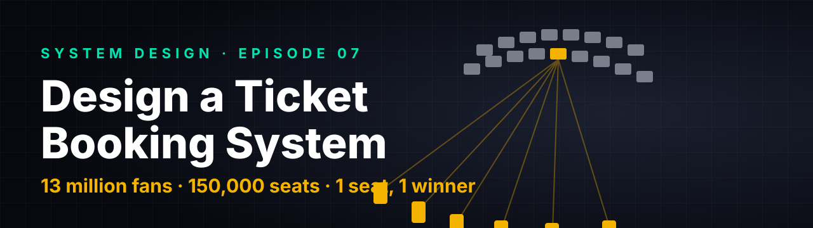

# Tech Intuition · System Design Notes

Interview-grade written walkthroughs that go with the **Tech Intuition** system design videos.

The video builds the **intuition**. These notes give you the **rigour**: requirements, numbers, APIs, schemas, diagrams, failure modes and the follow-up questions interviewers actually ask — written so you can rehearse a clear answer for a big-tech system design round.

## 🚀 New to system design? Start here

**[START-HERE.md](START-HERE.md)** explains how interviews are structured, how to study, and gives a 6-week plan.

| Read | For |
|---|---|
| [Start here](START-HERE.md) | the map, the method, the plan |
| [HLD framework](fundamentals/01-hld-framework.md) | a repeatable 7-step answer |
| [Numbers & estimation](fundamentals/02-numbers-and-estimation.md) | back-of-envelope maths |
| [Building blocks](fundamentals/03-building-blocks.md) | caching, DBs, sharding, queues, consistency, reliability… |
| [LLD guide (C#)](fundamentals/04-lld-guide.md) | OOP, SOLID, patterns, concurrency |
| [Problem bank](problem-bank.md) | what gets asked, in what order to prepare |
| [Glossary](glossary.md) | every term in one line |

## How to use these notes
1. Watch the video once, for the picture in your head.
2. Read the **60-second answer** at the top of the note. Say it out loud.
3. Work through the deep dives; try the **follow-up questions** with the answer folded.
4. Re-read the **Common mistakes** list the night before.

## Problems

| # | Problem | Note | Core ideas |
|---|---|---|---|
| 07 | **Design a ticket booking system** (BookMyShow / Ticketmaster style) | [HLD →](sd-07-ticket-booking/HLD.md) · [LLD (C#) →](sd-07-ticket-booking/LLD.md) | virtual waiting room · atomic seat holds · UNIQUE as final judge · idempotent payments · outbox · hot partitions |
| 08 | **Design a URL shortener** (TinyURL / bit.ly style) | [HLD →](sd-08-url-shortener/HLD.md) | read-heavy design · base-62 codes · id blocks · caching · 301 vs 302 · async analytics · abuse |

*Episodes 01–06 are being backfilled in the same format.*

## What every note contains
- ⚡ A **60-second answer**
- Requirements, **back-of-envelope numbers**, API, **data model (real schemas)**
- A **high-level design** diagram, then **deep dives**, each with a sequence/state diagram
- An **LLD companion** with a class diagram and runnable C# code
- A **consistency map**, **failure-modes cheat-sheet** and **observability**
- **Follow-up questions** with answers, **common mistakes**, and a **45-minute plan**

> [!NOTE]
> The designs are *how you would build it*. When a real company has not published its architecture, these notes say so and never claim internals.

## Contributing
Spotted a mistake or have a better answer to a follow-up? Open an issue or a PR.

Diagrams are Mermaid, rendered natively by GitHub.
