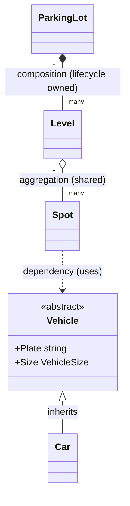

# LLD guide (C#): OOP, SOLID, patterns and how to approach any LLD question

LLD rounds ask you to design **classes and interfaces** for one component and usually **write the code**. Typical prompts reported for big-tech loops: parking lot, vending machine, elevator, movie ticket booking, splitwise, LRU cache, library management, chess.

## Contents
1. [The approach](#1-the-approach-for-any-lld-problem) · 2. [OOP in four lines](#2-oop-in-four-lines) · 3. [SOLID with C# examples](#3-solid-with-c-examples) · 4. [Design patterns: when and when not](#4-design-patterns-when-and-when-not) · 5. [Concurrency toolkit in C#](#5-concurrency-toolkit-in-c) · 6. [UML you need](#6-uml-you-actually-need) · 7. [Worked problem list](#7-the-classic-lld-problems-and-their-key-ideas) · 8. [Pitfalls](#8-pitfalls)

---

## 1. The approach for any LLD problem

1. **Clarify** actors, features, scale, what is out of scope.
2. **List nouns and verbs.** Nouns → classes; verbs → methods.
3. **Draw relationships:** has-a (composition), is-a (inheritance, use sparingly), uses (dependency).
4. **Find what varies**; that is where interfaces and patterns go.
5. **List invariants** (rules that must never break) and **concurrency/failure points**.
6. **Code the core path first**, depend on **interfaces**, then extend.
7. **Walk a test** and an **extension** ("now add X").

> [!TIP]
> Spend the first 10 minutes talking. Interviewers often care more about the model than the last 50 lines of code.

### How much to actually write

You get about 45 minutes. Plan for **~100–200 lines** of real code.

| Write | Describe or stub |
|---|---|
| Core entities and the one tricky method (the concurrency-safe or stateful one) | Secondary features (pricing variants, notifications, reporting) |
| Interfaces for external things (payment, clock) | Their implementations |
| One test that proves the hard part | Full test suites |

Rule: **code the hard part first**, describe the easy parts in a sentence, and say what you would add next. A small correct core beats a large unfinished one.

## 2. OOP in four lines

- **Encapsulation:** hide state behind methods that protect invariants.
- **Abstraction:** depend on *what* something does (interface), not *how*.
- **Inheritance:** "is-a"; prefer **composition** ("has-a") because it is easier to change.
- **Polymorphism:** different implementations behind one interface.

## 3. SOLID with C# examples

### S: Single Responsibility
A class has one reason to change.
```csharp
// ❌ Does pricing, payment and email: three reasons to change
class BookingManager { void Book() { /* price + charge + email */ } }

// ✅ Split
class PricingService { decimal Price(Show s, Seat seat) => /* ... */ 0m; }
class PaymentService { PaymentResult Charge(string key, decimal amount) => /* ... */ default!; }
class Notifier { void Send(Booking b) { /* ... */ } }
```

### O: Open/Closed
Open for extension, closed for modification: add behaviour by adding a class.
```csharp
interface IPricingStrategy { decimal PriceFor(Show show, Seat seat); }
class WeekendSurcharge(IPricingStrategy inner) : IPricingStrategy { /* wraps */ public decimal PriceFor(Show s, Seat st) => inner.PriceFor(s, st) * 1.2m; }
```
New rule = new class; existing code untouched.

### L: Liskov Substitution
A subtype must be usable wherever the base is, without surprises.
```csharp
// ❌ Violates LSP: a Penguin "is a" Bird, but Fly() throws
class Bird { public virtual void Fly() { } }
class Penguin : Bird { public override void Fly() => throw new NotSupportedException(); }
// ✅ Model capability: interface IFlyable
```

### I: Interface Segregation
Many small interfaces beat one fat one.
```csharp
// ❌ interface IMachine { void Print(); void Scan(); void Fax(); }
interface IPrinter { void Print(); }
interface IScanner { void Scan(); }
```

### D: Dependency Inversion
Depend on abstractions; inject them.
```csharp
class BookingService(IPaymentGateway payments, IClock clock) { /* testable: pass fakes */ }
```
**Why it matters in interviews:** it makes your code testable and lets you swap the real payment or clock for a fake, which is exactly how you demo expiry and failures.

## 4. Design patterns: when and when not

Name a pattern **only** when it solves a problem you actually have.

| Pattern | Use when | Example | Skip when |
|---|---|---|---|
| **Strategy** | Interchangeable algorithms | Pricing, payment method, parking fee, seat selection | Only one algorithm exists |
| **State** | Behaviour depends on state; many transitions | Seat (Available/Held/Booked), vending machine, order lifecycle, elevator | 2 states and no rules (use a bool/enum) |
| **Observer** | One event, many reactions | Notify on booking, waitlist, UI updates | One listener |
| **Decorator** | Stack optional behaviour on an object | Pricing surcharges/discounts, logging wrappers | Fixed behaviour |
| **Factory** | Construction is complex or varies by type | Create vehicle/payment by type | `new` is enough |
| **Builder** | Many optional constructor parameters | Building a complex request/report | Few parameters |
| **Singleton** | Exactly one instance is truly required | Config, a shared pool (prefer **DI** lifetime instead) | Almost always (hides global state, hurts tests) |
| **Command** | Encapsulate an action (undo, queue, log) | Elevator requests, editor undo | Direct call is fine |
| **Facade** | Simple front for a complex subsystem | `BookingService` | Nothing complex behind it |
| **Adapter** | Wrap an incompatible interface | Third-party payment SDK | You own both sides |
| **Chain of Responsibility** | Pass a request along handlers | Validation/approval pipelines, middleware | One handler |
| **Template Method** | Fixed skeleton, variable steps | Report generation | Composition is simpler |

> [!WARNING]
> **Pattern stuffing** (a Factory, Singleton and Visitor for three classes) is a red flag. Saying "I considered a Factory but `new` is enough here" scores well.

## 5. Concurrency toolkit in C#

| Need | Tool | Note |
|---|---|---|
| Mutual exclusion | `lock (obj) { }` / `Monitor` | Keep sections tiny; never `await` inside a `lock` |
| Async-friendly mutual exclusion | `SemaphoreSlim(1,1)` with `await WaitAsync()` | Use when the critical section awaits |
| Concurrent map | `ConcurrentDictionary<K,V>` | `GetOrAdd` factory may run more than once → wrap value in `Lazy<T>` for once-only work |
| Counters | `Interlocked.Increment` | Lock-free atomic |
| Read-mostly state | `ReaderWriterLockSlim` | More code; measure first |
| Immutable data | `record`, `IReadOnlyList<T>` | The easiest thread-safety is **no shared mutation** |
| Producer/consumer | `Channel<T>`, `BlockingCollection<T>` | Backpressure built in |
| Run in parallel | `Task.Run`, `Parallel.For` | For tests and fan-out |
| Rendezvous in tests | `Barrier`, `ManualResetEventSlim` | Make a race deterministic |

**Deadlock rules:** acquire locks in a **global order**; hold them briefly; never call unknown code while holding a lock.

**Check-then-act is the classic bug:**
```csharp
// ❌ Two threads both see "free"
if (seat.IsFree) seat.Take();
// ✅ One atomic step under a lock (or a single atomic operation)
lock (seat.Gate) { if (seat.IsFree) seat.Take(); }
```

## 6. UML you actually need



| Arrow | Meaning |
|---|---|
| `<|--` | inheritance (is-a) |
| `*--` | composition (owns, same lifetime) |
| `o--` | aggregation (has, independent lifetime) |
| `-->` | association (knows about) |
| `..>` | dependency (uses briefly) |
| `<|..` | implements an interface |

## 7. The classic LLD problems and their key ideas

| Problem | Core entities | Pattern / idea to show | Trap |
|---|---|---|---|
| **Movie ticket booking** | Show, ShowSeat, Hold, Booking | State, Strategy (price), Observer, **atomic multi-seat hold** | Race on seats, expiry, idempotent confirm |
| **Parking lot** | Lot, Level, Spot, Vehicle, Ticket | Strategy (fee, spot choice), Factory (vehicle) | Spot-size matching; concurrent entry |
| **Vending machine** | Machine, Product, Slot, Coin | **State** (Idle/HasMoney/Dispensing) | Illegal transitions; refund path |
| **Elevator** | Elevator, Floor, Request, Controller | State, Command, Strategy (scheduling) | Which elevator takes a request; direction |
| **LRU cache** | Cache, DoublyLinkedList, Dictionary | O(1) get/put with map + list | Thread safety; capacity eviction |
| **Splitwise** | User, Expense, Split, Balance | Strategy (split type) | Rounding; simplifying debts |
| **Library** | Book, Member, Loan, Reservation | Observer (due reminders) | Overdue/fine rules |
| **Rate limiter** | Limiter, Bucket, Clock | Strategy (algorithm) | Thread safety; clock injection |
| **Chess / Tic-tac-toe** | Board, Piece, Move, Game | Polymorphism per piece, Command (undo) | Move validation |
| **Notification service** | Channel, Template, Event | Strategy (channel), Observer, Chain (retry) | Dedupe; provider failure |

## 8. Pitfalls

- God class that does everything.
- Inheritance where composition fits (a `VipSeat : Seat` tree).
- Public mutable state; no invariants.
- Static/global state (impossible to test).
- Time and I/O hard-coded (inject `IClock`, gateways).
- Ignoring concurrency and failure entirely.
- Over-engineering before the core path works.
- Not saying "if this ran on multiple servers, the lock becomes a shared store."
