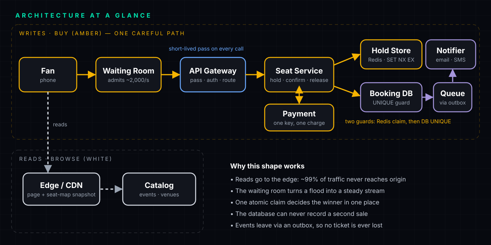
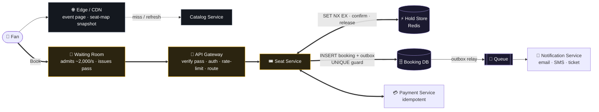
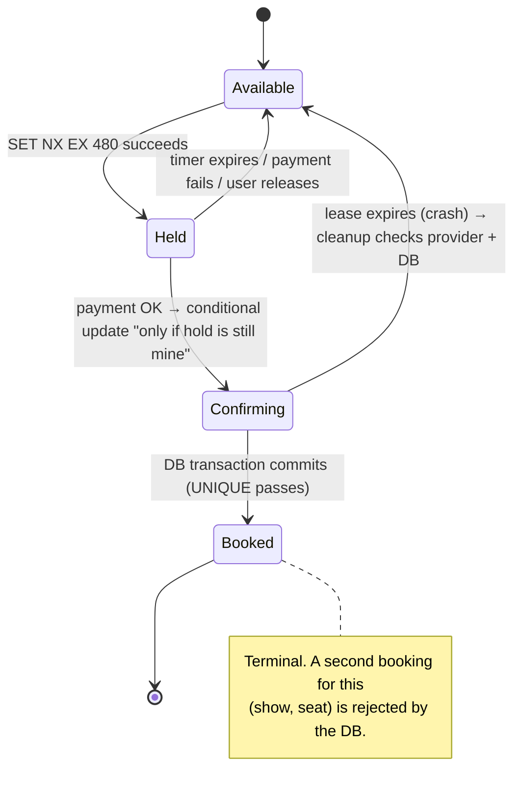
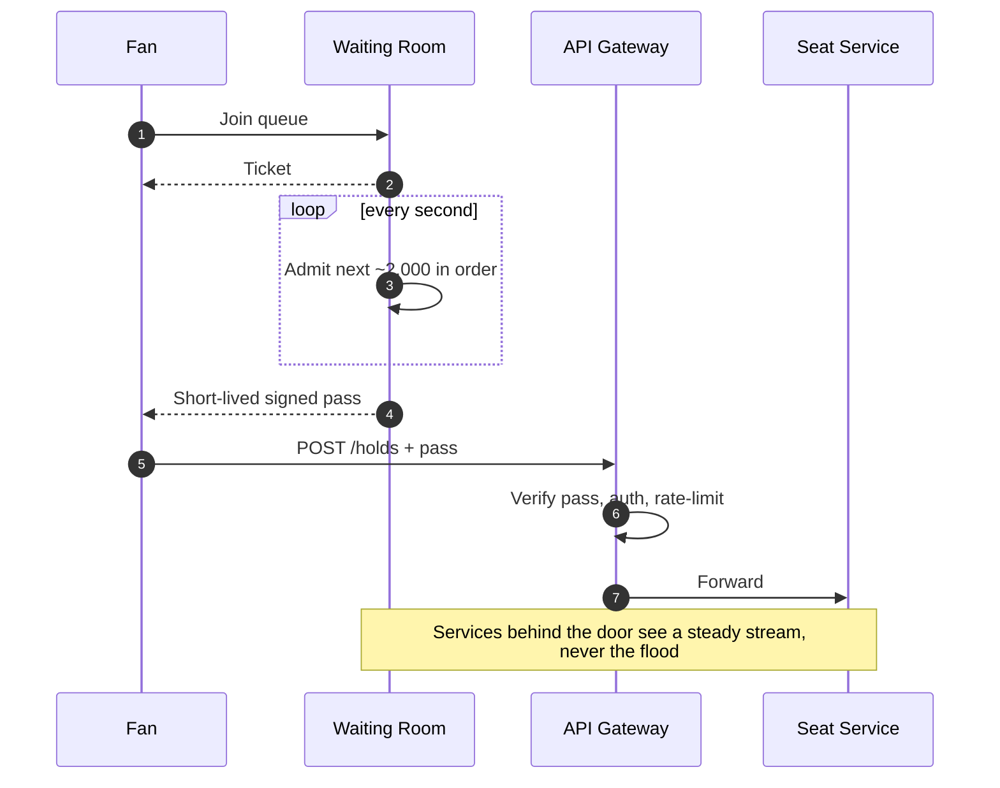
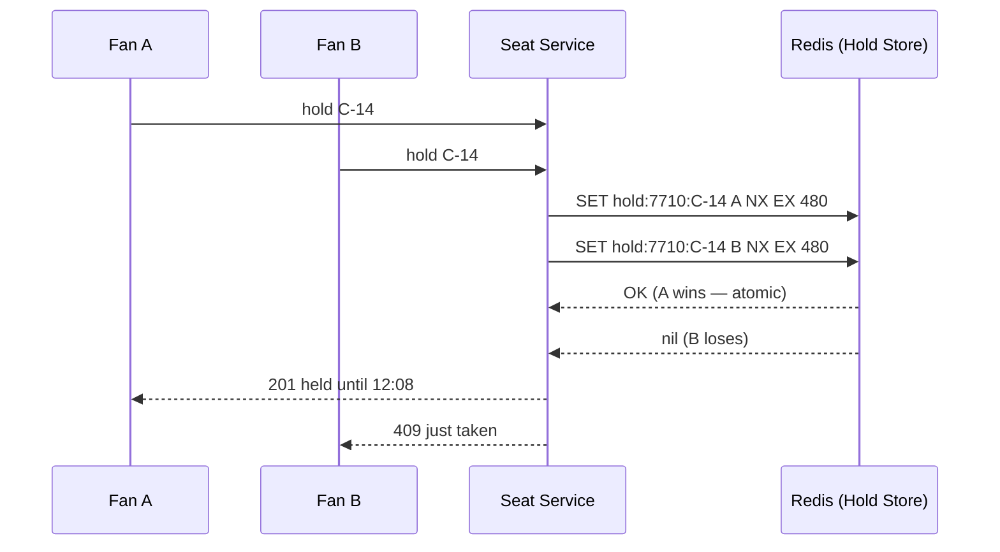
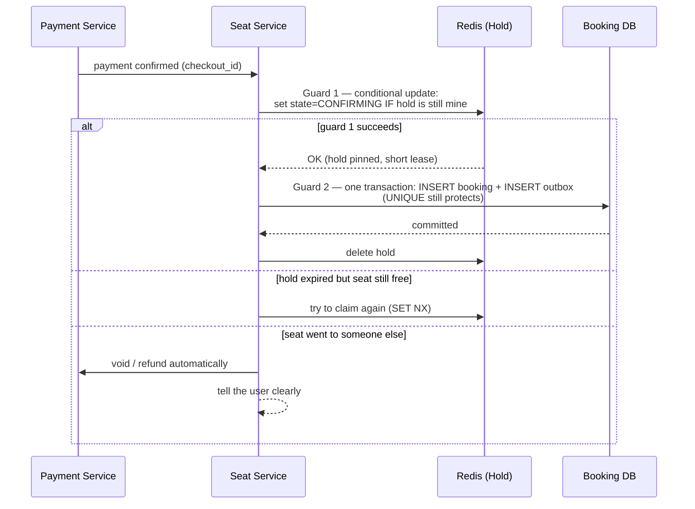
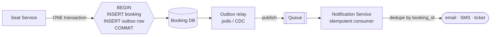
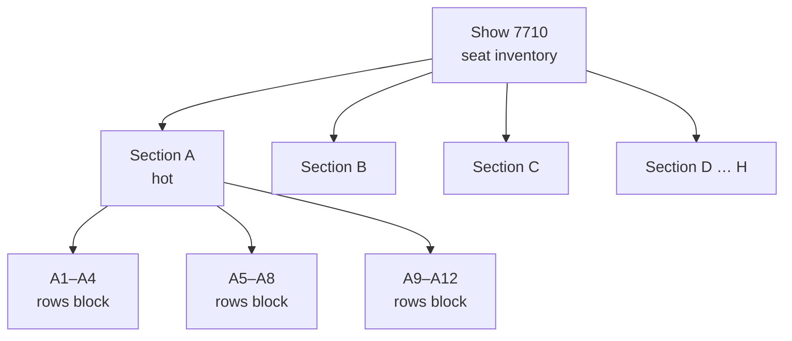

<p align="center"></p>

# Design a Ticket Booking System

**BookMyShow / Ticketmaster style · HLD walkthrough · Episode 07**

> 💻 **Preparing for an LLD round too?** See the [LLD companion with runnable C# code](LLD.md).

> 🎬 Watch the video first for the intuition, then use this page to rehearse the answer out loud.
> *(Video link: add on upload.)*

> [!IMPORTANT]
> BookMyShow has not published its architecture. Everything here is **how you would design it**, not how they did. Numbers about the Coldplay sale come from public reporting; every other number is an assumption you should *state out loud* in an interview.

---

## ⚡ The 60-second answer

If the interviewer gives you one minute, say this:

1. **Split reads from writes.** Browsing is read-heavy and identical for everyone → CDN. Buying is a narrow, careful write path.
2. **Protect the write path with a virtual waiting room** that admits users at the rate checkout can sell (say 2,000/s). The wait happens at the door, not inside the building.
3. **One seat, one winner, decided in one place:** a short-lived **hold** in Redis using atomic *set-if-absent* with a TTL (about 8 minutes).
4. **The database is the source of truth.** A `UNIQUE (show_id, seat_id)` constraint on confirmed bookings means even a bug above it cannot double-sell.
5. **Payments are idempotent** (one key per checkout) and the confirmation uses **two guards**: conditional update on the hold, then a DB transaction. A cleanup job reconciles with the payment provider.
6. **Events go through an outbox → queue**; consumers are idempotent. Email/SMS/ticket never slow the next buyer.
7. **Plan for a known start time:** pre-warm, pre-load the edge, shed non-essential features, partition hot sections, rehearse, and decide *what degrades first*.

---

## 📑 Contents

1. [Requirements](#1-requirements)
2. [Back-of-envelope numbers](#2-back-of-envelope-numbers)
3. [API](#3-api)
4. [Data model](#4-data-model)
5. [High-level design](#5-high-level-design)
6. [Deep dive A — Two systems in one app (read vs write)](#6-deep-dive-a--two-systems-in-one-app)
7. [Deep dive B — The waiting room](#7-deep-dive-b--the-waiting-room)
8. [Deep dive C — One seat, one winner](#8-deep-dive-c--one-seat-one-winner)
9. [Deep dive D — Payment, and the race against the clock](#9-deep-dive-d--payment-and-the-race-against-the-clock)
10. [Deep dive E — Events, outbox and duplicate delivery](#10-deep-dive-e--events-outbox-and-duplicate-delivery)
11. [Deep dive F — Surviving noon (scale, hot sections, degradation)](#11-deep-dive-f--surviving-noon)
    - [Alternatives you should be able to discuss](#11b-alternatives-you-should-be-able-to-discuss) · [Interview cheat card](#11c-interview-cheat-card)
12. [Consistency map](#12-consistency-map)
13. [Failure modes cheat-sheet](#13-failure-modes-cheat-sheet)
14. [Observability](#14-observability)
15. [Follow-up questions interviewers ask](#15-follow-up-questions-interviewers-ask)
16. [Common mistakes](#16-common-mistakes)
17. [Test yourself](#18-test-yourself)
18. [How to present this in 45 minutes](#19-how-to-present-this-in-45-minutes)

---

## 1. Requirements

**Functional**

| # | Requirement |
|---|---|
| F1 | Browse events, shows, venues, prices |
| F2 | View a seat map with availability |
| F3 | Select one or more seats and **hold** them for a short time |
| F4 | Pay, then receive a confirmed ticket |
| F5 | Release held seats if payment fails, the user leaves, or the timer runs out |
| F6 | Get notified (email / SMS / in-app ticket) |

**Non-functional — these are the four rules from the video**

| Rule | Meaning |
|---|---|
| 🛡 **Never sell a seat twice** | Correctness beats everything. Strong consistency on seat state. |
| 💳 **Never charge anyone twice** | Idempotent payments end to end. |
| ⚡ **Browsing stays fast** even when buying is slow | Reads are served from the edge, with slightly stale data allowed. |
| ⚖ **Fair to every fan** | No head start for bots or for the fastest connection. |

**Out of scope (say so explicitly):** search, recommendations, dynamic pricing, payment-gateway internals, resale. *A strong candidate names what they are skipping and why.*

> [!TIP]
> In the first two minutes, ask: *"Is this a general system or the flash-sale case?"* The interesting problem is the flash sale: huge synchronized demand for a tiny, fixed inventory.

---

## 2. Back-of-envelope numbers

State assumptions, then show the **shape** of the problem.

| Quantity | Value | Source / reasoning |
|---|---|---|
| Fans at noon | ~13,000,000 | Reported for the Coldplay Mumbai sale (Sep 2024) |
| Seats on sale | ~150,000 | Reported |
| Contention | **~87 fans per seat** | 13,000,000 ÷ 150,000 |
| Safe checkout rate | **2,000/s** | *Assumption* — the number the whole design is tuned around |
| Time to sell out at that rate | **~75 s** | 150,000 ÷ 2,000 |
| Browse traffic | millions of requests/s | Assumption: ~13M fans refreshing every few seconds |
| Share absorbed by the CDN | 99%+ | Static pages + seat-map snapshots |
| Live holds (max) | ~1M | 2,000/s × 480 s (8-minute TTL) |
| Hold storage | ~100 MB | ~1M keys × ~100 B → fits one Redis primary |
| Booking rows | ~150,000 | ~30 MB total |

**The insight to say out loud:**

> *The data is tiny. 150,000 rows is nothing. This is not a storage problem. It is a **contention and spike** problem: the hard part is that millions want the same few rows in the same few seconds, and the sale is over in about 75 seconds.*

---

## 3. API

REST sketch; all write calls carry an **idempotency key**.

```http
GET  /events/{eventId}/shows/{showId}                 # cached at the edge
GET  /shows/{showId}/seatmap                          # snapshot, ≤ a few seconds old

POST /queue/join            { showId }                # → { ticket, position, eta }
GET  /queue/status/{ticket}                           # → { state: waiting | admitted, position?, pass? }

POST /holds                 { showId, seatIds[≤6] }   # needs a valid pass
                            Idempotency-Key: <uuid>   # → 201 { holdId, expiresAt } | 409 { unavailable[] }
DELETE /holds/{holdId}                                # explicit release

POST /checkouts             { holdId }                # → { checkoutId, paymentUrl }
POST /payments/callback     (from provider)           # idempotent on paymentId / checkoutId
GET  /bookings/{bookingId}                            # the ticket
```

Notes worth saying:
- `POST /holds` is **all-or-nothing** for the seat list, with a cap (say 6).
- The **pass** from the waiting room is a short-lived signed token; the API gateway verifies it so no service repeats that work.

---

## 4. Data model

The **database holds the truth**. The **hold is temporary, so it lives in memory with a timer**, never in the database.

```sql
-- One row per seat per show (the inventory). Availability is DERIVED: a seat is free if it has no confirmed booking and no live hold.
CREATE TABLE seats (
  show_id    BIGINT       NOT NULL,
  seat_id    VARCHAR(8)   NOT NULL,        -- e.g. 'C-14'
  section    CHAR(1)      NOT NULL,
  price_tier SMALLINT     NOT NULL,
  PRIMARY KEY (show_id, seat_id)
);

-- The authoritative record of a SOLD seat.
CREATE TABLE bookings (
  booking_id  UUID         PRIMARY KEY,
  show_id     BIGINT       NOT NULL,
  seat_id     VARCHAR(8)   NOT NULL,
  user_id     BIGINT       NOT NULL,
  payment_id  VARCHAR(64)  NOT NULL,
  status      VARCHAR(12)  NOT NULL DEFAULT 'CONFIRMED',
  created_at  TIMESTAMP    NOT NULL DEFAULT now(),
  CONSTRAINT one_sale_per_seat UNIQUE (show_id, seat_id)   -- ⭐ the final judge
);

-- The outbox: written in the SAME transaction as the booking.
CREATE TABLE outbox (
  event_id    UUID         PRIMARY KEY,
  topic       VARCHAR(32)  NOT NULL,       -- 'booking.confirmed'
  payload     JSONB        NOT NULL,
  created_at  TIMESTAMP    NOT NULL DEFAULT now(),
  published   BOOLEAN      NOT NULL DEFAULT FALSE
);

-- Payment records, keyed for idempotency.
CREATE TABLE payments (
  checkout_id  UUID        PRIMARY KEY,    -- the idempotency key, created when checkout starts
  hold_id      UUID        NOT NULL,
  provider_ref VARCHAR(64),
  status       VARCHAR(12) NOT NULL,       -- CREATED | AUTHORIZED | CAPTURED | VOIDED | REFUNDED
  amount_paise BIGINT      NOT NULL,
  updated_at   TIMESTAMP   NOT NULL DEFAULT now()
);
```

**The hold (Redis)**

```text
KEY    hold:{showId}:{seatId}            e.g.  hold:7710:C-14
VALUE  { holdId, userId, state: "HELD" | "CONFIRMING" }
TTL    480 s (8 minutes)

SET hold:7710:C-14 <value> NX EX 480      # NX = "only if it doesn't exist" → atomic claim
```

> [!NOTE]
> **Partitioning key:** `show_id` first, then section, then row block. This is what lets a hot section be split further (see [§11](#11-deep-dive-f--surviving-noon)).

---

## 5. High-level design

<p align="center"></p>

The same system as an interactive-style diagram you can zoom (Mermaid):



**Read it left to right:** the fan's request either goes to the **edge** (reading) or through the **door** (buying). Everything on the buying path is narrow, ordered and idempotent.

| Part | Job | Why it exists |
|---|---|---|
| **Edge / CDN** | Serves event page, poster, venue, prices, and a seat-map *snapshot* | Absorbs ~99% of traffic; reads are identical for everyone |
| **Catalog Service** | Source of the static pages the CDN caches | Keeps read data out of the buying path |
| **Waiting Room** | Admits fans at a fixed rate, issues a short-lived pass, shuffles fairly, checks bots | Turns a flood into a steady stream |
| **API Gateway** | Verifies the pass, authenticates, rate-limits, routes | One front door so no service repeats identity/limit work |
| **Seat Service** | Holds, confirms and releases seats (this is the "booking service") | Owns the seat lifecycle |
| **Hold Store (Redis)** | Atomic temporary claims with TTL | Fast, atomic, self-expiring |
| **Booking DB** | Durable truth with `UNIQUE (show_id, seat_id)` | Final safeguard against double-sell |
| **Payment Service** | Charges idempotently, handles provider callbacks | One key, one charge |
| **Outbox + Queue** | Reliable event publication | Notifications never slow the next buyer |
| **Notification Service** | Email/SMS/in-app ticket | Runs after, from the queue |

### The seat's life — a state machine



---

## 6. Deep dive A — Two systems in one app

Reads and writes have opposite shapes.

| | **Browsing (reads)** | **Buying (writes)** |
|---|---|---|
| Same answer for everyone? | Yes (poster, venue, prices) | No — every purchase changes something |
| Tolerates staleness? | Yes — a 2-second-old seat map is fine | No — must be exact |
| Where it runs | **Edge / CDN** | Narrow, careful path |
| Scales by | Caching | Admission control + partitioning |

- Build each page **once**, let the CDN serve it near each fan. Only a **miss** or a request that **must be fresh** travels back to origin.
- The **seat map** is a **snapshot**, refreshed every few seconds at the edge. The *real* check happens at hold time, so a stale map just means the user sometimes taps a seat that's gone and gets a friendly "just taken".

> [!TIP]
> **Interview line:** *"I'd route anything cacheable to the edge and keep the origin for the narrow write path. The seat map can be 2 seconds stale because the authoritative check is the hold."*

---

## 7. Deep dive B — The waiting room

**Problem.** The Seat Service can safely handle ~2,000 checkouts/s. At noon, a million people tap Book in a few seconds. Letting them all in does not slow the system down. It **sells nothing to anyone**.

**Idea.** Don't make more capacity. **Decide where the wait happens** — at the door, not inside the building.



**Design details**
- **Admit rate** is the one dial the whole system is tuned around. It can be turned **down** live (that's the "slow the door" switch).
- **Position & ETA** shown to everyone, so waiting feels fair rather than broken.
- **Pass** = signed, short-lived token (e.g. 5–10 minutes). Verified at the gateway; no DB lookup.

**Fairness: first-come vs shuffled**

| Approach | Winner is… | Problem |
|---|---|---|
| First-come, first-served | Fastest connection, best bots | Unfair; bots win |
| **Randomized start (lottery)** | Random among everyone who arrived *before* the start time | Your place doesn't depend on milliseconds ✅ |

Collect everyone who arrives before the start time, **shuffle** into a random order the moment the sale opens.

**Bots.** The waiting room is the one place every request must pass, so that's where you check them: per-account/per-device **rate limits**, challenges (CAPTCHA/proof-of-work) for suspicious traffic, device/behaviour signals. *(Link: our [rate limiter episode](../README.md#series).)*

> [!WARNING]
> Don't implement the queue as a single in-memory list on one server — that becomes your new single point of failure. Use a sharded/replicated store (e.g. sorted sets keyed by position) and make the queue state recoverable.

---

## 8. Deep dive C — One seat, one winner

**The bug everyone writes first**

```text
1. read:  is C-14 free?      → yes
2. write: mark C-14 taken
```

Two requests both read "free" before either writes → **sold twice**. The gap between check and write is the whole problem.

**The fix:** make *check-and-take* **one atomic step**.

```text
SET hold:7710:C-14 <holdValue> NX EX 480
```

- `NX` = set **only if absent**. Redis runs it as one atomic operation, so **exactly one** request wins.
- The loser gets an instant answer: *"Sorry, that seat was just taken. Pick another."*
- `EX 480` = the hold **disappears by itself** after 8 minutes. A hold is **a reservation with a timer, not a sale**.



**The hold is only a claim — the DB is the final judge.**

A hold can expire early, Redis can fail over, or a bug above can misbehave. So confirmed sales live in the DB with:

```sql
CONSTRAINT one_sale_per_seat UNIQUE (show_id, seat_id)
```

Even if two requests both believe they own the seat, the **second insert fails**. Two layers: **fast path (Redis) + safety net (DB).**

### Pessimistic vs optimistic — and where each appears

| | **Pessimistic** | **Optimistic** |
|---|---|---|
| Idea | Lock first; others wait or are turned away | Everyone tries; check at write time who got there first |
| Cost | Waiting | Retries |
| Good when | Conflicts are likely (a hot seat) | Conflicts are rare |
| **In this design** | **The hold** — a short lock taken at the tap, loser knows in milliseconds, before any card details | **The DB constraint** — checked at write time |

> [!TIP]
> **Interview line:** *"The hold works like a short pessimistic lock so the loser finds out in milliseconds. The UNIQUE constraint is the optimistic check behind it."*

### Multiple seats: all-or-nothing

Most fans want several seats together.
- A hold request carries **all** seat IDs and is **all-or-nothing**: either every seat is claimed or none.
- Implement with a **Lua script** (atomic in Redis) that checks all keys are absent, then sets them all. Or acquire in a **canonical order** (sorted by seat id) and roll back on failure, to avoid deadlock between overlapping requests.
- **Cap** seats per fan (e.g. 6) so nobody hoards the stadium.

```lua
-- KEYS = hold keys (sorted), ARGV[1] = value, ARGV[2] = ttl
for i = 1, #KEYS do
  if redis.call('EXISTS', KEYS[i]) == 1 then return 0 end   -- any taken → fail whole request
end
for i = 1, #KEYS do
  redis.call('SET', KEYS[i], ARGV[1], 'EX', ARGV[2])
end
return 1
```

### What if the Hold Store dies?

- Holds in it are lost, **but nothing is double-sold**, because the DB still refuses a second booking.
- Run Redis with a **replica that takes over**. Replication is asynchronous, so a failover can lose a few just-acknowledged holds, and two fans may briefly believe they hold the same seat. The DB `UNIQUE` guard turns that into a clean "just taken" at confirm time, not a double sale. Worst case: a few fans are asked to pick seats again.
- **Redis Cluster note:** a multi-key Lua script needs all keys in one hash slot. Use a hash tag, e.g. `hold:{7710:C}:C-14`, so every seat in a section lives together.

> [!NOTE]
> **Redis is not the bottleneck.** ~2,000 holds/s is a rounding error for one primary (tens of thousands of ops/s). You shard holds for *blast radius and hot sections*, not for raw throughput.

> [!NOTE]
> **Why not just use a DB lock (`SELECT … FOR UPDATE`)?** It works at small scale, but at flash-sale volume lock contention on a few hot rows ties up connections and shreds throughput. A fast in-memory atomic claim in front keeps most contention off the database.

---

## 9. Deep dive D — Payment, and the race against the clock

### D1 — Double tap: idempotency

You tap **Pay**, the screen spins, the network drops. Did it go through? You tap again.

If the system treats tap #2 as a new payment, you're charged twice. So:

1. When checkout starts, create a **unique checkout key** (`checkout_id`).
2. The Payment Service **remembers every key it has processed**.
3. A retry with the same key returns **the same answer** — not a second charge.

```text
POST /checkouts  Idempotency-Key: 9f2c…   → creates payment (CREATED)
POST /checkouts  Idempotency-Key: 9f2c…   → returns the same payment, no new charge
```

### D2 — The provider calls back… twice (or late)

The payment provider confirms by **calling your server**, and callbacks can arrive **twice or out of order**. Make the handler **safe to repeat**:

```text
on callback(paymentId):
    payment = SELECT … WHERE checkout_id = …  FOR UPDATE
    if payment.status already CAPTURED: return 200   # already applied → do nothing
    apply once; return 200
```

Always answer 200 for a replay so the provider stops retrying.

### D3 — Payment succeeds at 7:59 but the confirmation lands at 8:01

The hold already expired and the seat may have gone to someone else. A good design **decides this in advance** and **doesn't pretend two separate stores can change in one step** (Redis and Postgres have no shared transaction). Each store guards its own part — **two guards in a row**:



- **Guard 1 (atomic inside Redis):** "mark this hold as CONFIRMING **only if it's still mine**." If it succeeds, the hold is *pinned*.

```lua
-- KEYS[1] = hold key, ARGV[1] = my holdId, ARGV[2] = lease seconds
local v = redis.call('GET', KEYS[1])
if v == ARGV[1] then
  redis.call('SET', KEYS[1], ARGV[1] .. ':CONFIRMING', 'EX', ARGV[2])   -- short lease: a crash can't lock the seat forever
  return 1
end
return 0
```
- **Guard 2 (DB transaction):** insert the booking; the **UNIQUE constraint** still refuses any second booking.
- **Hold expired but seat still free →** the system may re-claim it.
- **Seat taken by someone else →** no booking is written; **void/refund automatically** and tell the user.

### D4 — "Payment succeeded but the booking write failed" (a crash between steps)

This is the classic question. Between "charged" and "booked" a crash can strand money.

- Guard 1 puts the hold in **CONFIRMING with a short lease** (it expires on its own, so a crash doesn't lock the seat forever).
- A **cleanup/reconciliation job** scans stuck `CONFIRMING` holds and unmatched payments. **Before** it releases a confirming hold or refunds a payment it checks **two facts**:
  1. **What does the payment provider say happened?** (captured / failed / pending)
  2. **Was the booking durably written?** (row in `bookings`)

| Provider says | Booking exists? | Action |
|---|---|---|
| Captured | ✅ | Nothing — already consistent (re-send ticket if needed) |
| Captured | ❌ | Try to complete the booking; if the seat is gone → **refund** |
| Failed / not captured | ❌ | Release the hold |
| Pending | ❌ | Wait; re-check later |

**Result: no one is left holding a ticket to a seat that belongs to someone else, and no one pays for nothing.**

### D5 — Payment fails or the fan walks away

The seat shouldn't wait out the timer. The system **releases the hold right away** with the same conditional check — *only if it's still mine* — implemented as a compare-and-delete:

```lua
if redis.call('GET', KEYS[1]) == ARGV[1] then return redis.call('DEL', KEYS[1]) else return 0 end
```

If nothing happens at all, **the TTL does it for us**. Either way the seat goes back on the map.

> [!WARNING]
> Never release with a bare `DEL`. If your hold already expired and someone *else* now owns the key, a bare `DEL` would delete **their** hold. Always compare the holder first.

---

## 10. Deep dive E — Events, outbox and duplicate delivery

After the booking is written, an event goes to a queue. Email, SMS and the in-app ticket all happen **after, from that queue**, so none of it slows the next buyer.

**The trap (dual write).** If you save the booking and then publish to the queue as two steps, a crash between them means **a booking with no ticket ever sent**. Two stores, no shared transaction.

**The fix — the transactional outbox**



1. The booking **and its event** are saved **together, in one DB transaction** (the `outbox` table).
2. A small **relay** publishes unpublished outbox rows to the queue (polling or CDC), then marks them published.
3. A queue gives **at-least-once** delivery, so the **consumer must be idempotent**: it ignores an event it has already handled, using the **`booking_id`** (store processed IDs, or use a unique constraint on `(booking_id, channel)`).

> [!TIP]
> **Interview line:** *"Exactly-once is built from at-least-once delivery plus idempotent consumers."* Our [notification system episode](../README.md#series) goes deeper.

---

## 11. Deep dive F — Surviving noon

A sale has one enormous advantage over a real outage: **you know exactly when it starts.**

### Before noon
- **Add servers an hour early** — new machines take minutes to warm up; the spike takes seconds.
- **Pre-load the edge** — push the seat map and event page to every edge location *before* anyone asks.
- **Switch off non-essential features** (recommendations, reviews, "people also booked") — every request you don't serve is capacity for one you must.
- **Rehearse with a synthetic crowd.** Never trust the design untested.

### Hot sections
Everyone wants the floor near the stage. If all seats for one show live in **one partition**, that partition melts while others idle.



1. **Split by section** across machines → a quiet section isn't dragged down by a busy one.
2. Section A can still be too hot for one machine → **split again into blocks of rows**, each on its own partition.
3. A seat is still one seat (one owner partition) — and the **waiting room cuts how many requests, and how fast, reach the Seat Service**.

Each partition has a **primary** (takes writes) and **replicas** that can take over.

### If it's still too hot: choose what fails
Graceful degradation, decided in advance:

| Lever | Effect |
|---|---|
| Waiting room **slows its door** | A few people wait longer |
| Browsing serves a **slightly older seat map** | Fine — the hold is the real check |
| Non-essential features stay **off** | Capacity preserved |

> **Slow and honest beats fast and broken — every single time.**

---

## 11b. Alternatives you should be able to discuss

| Option | How it works | Why not (here) | When it's fine |
|---|---|---|---|
| **DB row lock** (`SELECT … FOR UPDATE`) | Lock the seat row, then update | Connections pile up on hot rows; throughput collapses under a flash sale | Low-volume venues |
| **Optimistic version column** | `UPDATE … WHERE version = ?` | Great as the safety net, but every loser still costs a DB round trip | Rare conflicts |
| **Per-seat serialization via a queue** (partition key = seat) | One consumer decides each seat in order | Adds latency, complexity, and ordering/partition-hotness concerns | Very small inventories |
| **Redis `SET NX EX` + DB `UNIQUE`** ⭐ | Fast atomic claim, durable judge behind it | Needs the confirm/cleanup logic of §9 | Flash sales (this design) |
| **Distributed lock service** (ZooKeeper/etcd) | Lease-based lock per seat | Heavier and slower per claim; not needed when one primary decides | Cross-resource coordination |

> [!TIP]
> Interviewers love the *"why not X"* question. Have a one-line reason for each row above.

---

## 11c. Interview cheat card

```text
READ/WRITE SPLIT   edge for reads, narrow path for writes
WAITING ROOM       admit ~2,000/s · shuffled start · signed pass · bot checks
ONE WINNER         SET NX EX (atomic) → hold, 8 min TTL
FINAL JUDGE        UNIQUE (show_id, seat_id) in the DB
LOCKING            hold = pessimistic · DB constraint = optimistic
PAYMENT            idempotency key · idempotent callbacks
RACE AT 8:00       guard 1 (Redis CAS) → guard 2 (DB txn) → else refund
CRASH RECOVERY     lease + reconciler checks provider AND booking
EVENTS             outbox in the same txn · idempotent consumer by booking_id
SCALE              pre-warm · preload edge · shed features · split hot sections
CONSISTENCY        strong where a seat is sold · eventual elsewhere
```

---

## 12. Consistency map

> *Strong consistency where a seat is sold. Eventual consistency everywhere else. That one split explains most of the design.*

| Data | Consistency | Why |
|---|---|---|
| Hold (Redis, per seat) | **Strong** (atomic `SET NX`) | Exactly one winner |
| `bookings` (UNIQUE) | **Strong** (primary) | Source of truth |
| Payment state | **Strong** + idempotent | Money |
| Seat-map snapshot at the edge | **Eventual** (seconds) | Browsing only |
| Event page / catalog | **Eventual** | Static |
| Notifications | **Eventual**, at-least-once + dedupe | Never blocks a sale |
| Queue position display | **Eventual** | Informational |

---

## 13. Failure modes cheat-sheet

| What breaks | What happens | Why it's safe |
|---|---|---|
| Hold Store (Redis) dies | Holds lost; replica takes over; some users re-pick | DB `UNIQUE` still blocks double-sale |
| Seat Service crashes mid-confirm | Hold in `CONFIRMING` with lease; cleanup reconciles | Lease expires; provider + DB are checked before release/refund |
| Payment callback arrives twice | Second is a no-op | Handler idempotent on `checkout_id` |
| User double-taps Pay | Same key → same answer | One charge |
| Payment OK, hold expired, seat sold elsewhere | No booking; auto void/refund | Guard 1 fails; DB would also refuse |
| Booking saved, event not sent | Impossible | Outbox row is in the same transaction |
| Event delivered twice | Ignored the second time | Idempotent consumer by `booking_id` |
| Waiting room overloaded | Slow the door; shed features | Wait happens at the door |
| Hot section | Split into row-block partitions | Spreads writes |
| CDN stale seat map | User taps a taken seat → friendly "just taken" | Hold is the authority |
| Bot flood | Rate limits + challenges at the waiting room | Single choke point |

---

## 14. Observability

You can't run a flash sale blind. Watch live (and rehearse watching them):

- **Admit rate** vs target (2,000/s) and **queue depth / wait time**
- **Hold success vs "just taken"** ratio, hold-store latency (p50/p99)
- **Booking errors** (UNIQUE violations should be ~0 in steady state — a spike means a bug upstream)
- **CONFIRMING holds stuck** > lease, **unmatched payments** (charged but not booked)
- **Outbox lag** (oldest unpublished event age), **queue lag**, notification failures
- **Edge cache hit ratio**, origin QPS
- Alerts → a runbook, and the **"slow the door" switch** one click away

---

## 15. Follow-up questions interviewers ask

<details><summary><b>Why Redis for holds? Why not just the DB?</b></summary>

Holds are short-lived, high-churn, and need an atomic claim with automatic expiry — exactly Redis's `SET NX EX`. Putting that churn on the DB adds lock contention and write load for data you throw away. But **Redis is not the source of truth**; the DB `UNIQUE` constraint is. If Redis is lost, nothing is double-sold.
</details>

<details><summary><b>What if Redis and the DB disagree?</b></summary>

The DB wins. A hold says "this user intends to buy"; only a committed `bookings` row means "sold". On conflict the booking insert fails and the user is refunded/told.
</details>

<details><summary><b>Can you use a distributed lock (Redlock) instead?</b></summary>

You don't need a general lock — you need a single atomic claim per seat, which `SET NX EX` provides with a single primary. Multi-node Redlock adds complexity and has well-known correctness debates around clock/pause assumptions; the DB constraint gives the safety net anyway.
</details>

<details><summary><b>How do you handle the thundering herd when the sale opens?</b></summary>

Three layers: CDN absorbs reads, the **waiting room** absorbs the write spike and admits at a fixed rate, and the **gateway** rate-limits per account/device. Pre-warm capacity and pre-load the edge before the start time.
</details>

<details><summary><b>How do you make the queue fair and bot-resistant?</b></summary>

Randomized start for everyone who arrived before the start time, per-account/device rate limits, challenges for suspicious traffic, and a signed pass so admission can't be forged or replayed.
</details>

<details><summary><b>Exactly-once payments?</b></summary>

You can't get exactly-once delivery from a network; you get **at-least-once + idempotency**. Idempotency key per checkout, an idempotent callback handler, and an idempotent consumer for events.
</details>

<details><summary><b>How do you shard the database?</b></summary>

By `show_id`, then section, then row block. A seat's authoritative rows live in one partition so the UNIQUE constraint stays local (no cross-shard transaction needed). Hot sections are split further.
</details>

<details><summary><b>Best-available seat selection ("give me any 2 together")?</b></summary>

Do selection in the Seat Service from the snapshot, then attempt the all-or-nothing hold; on failure, retry with the next candidate set. Keep contiguous-seat search per section to avoid cross-partition scans.
</details>

<details><summary><b>How do you handle cancellations / refunds?</b></summary>

Mark the booking `CANCELLED` and free the seat (a new availability row/state change in the DB, then reflect to the seat map). The `UNIQUE` constraint should be on *active* bookings (partial unique index) so a cancelled seat can be sold again.
</details>

<details><summary><b>Multi-region?</b></summary>

Seat inventory for a show has a single home region (single writer per partition) to keep the constraint strong. Read paths (CDN, catalog) are global. Cross-region failover is a promotion of the replica, accepting a small window of re-picked holds.
</details>

<details><summary><b>What would you monitor to know the design is failing?</b></summary>

See [§14](#14-observability): admit rate, hold failures, booking UNIQUE violations, stuck CONFIRMING holds, unmatched payments, outbox lag.
</details>

<details><summary><b>How would you test this?</b></summary>

Load test with a synthetic crowd at 2× expected, chaos-test Redis failover and Seat Service crashes mid-confirm, replay duplicate callbacks and duplicate events, and assert the invariants: *no seat has two confirmed bookings; no checkout has two charges.*
</details>

---

## 16. Common mistakes

- ❌ **"Just use a DB transaction"** and stopping there — ignores the spike and lock contention.
- ❌ **Check-then-write** instead of an atomic claim (the race in §8).
- ❌ **Releasing with a bare `DEL`** and freeing someone else's hold.
- ❌ **Pretending Redis + Postgres commit together.** Use two guards + reconciliation.
- ❌ **Publishing the event after the commit as a separate step** (dual write) — use the outbox.
- ❌ **No idempotency on payment callbacks.**
- ❌ **Treating the CDN seat map as authoritative.**
- ❌ **One partition per show** with no plan for hot sections.
- ❌ **Letting the flood reach the services** instead of queueing at the door.
- ❌ **Claiming "how BookMyShow does it".** Say "how I would design it."

---

## 18. Test yourself

Cover the page, answer out loud, then open the fold.

<details><summary><b>Q1.</b> Why is this a <i>contention</i> problem and not a storage problem?</summary>

150,000 seats is tiny data. The difficulty is millions of people wanting the same few rows in the same seconds, and a sale that is over in about 75 seconds.
</details>

<details><summary><b>Q2.</b> What single step makes "check if free, then take it" safe?</summary>

Make check-and-take **one atomic operation**: Redis `SET key value NX EX 480`. Exactly one caller creates the key; the other gets nothing back.
</details>

<details><summary><b>Q3.</b> If Redis lost every hold, could a seat be double-sold? Why not?</summary>

No. The database has `UNIQUE (show_id, seat_id)` on confirmed bookings, so a second booking for the same seat fails no matter what Redis believed.
</details>

<details><summary><b>Q4.</b> Payment succeeds at 7:59 but the confirmation arrives at 8:01. Walk through what happens.</summary>

Guard 1 (Redis, atomic): "set CONFIRMING only if the hold is still mine". If the hold expired and someone else owns the seat, it fails, no booking is written, and the payment is voided/refunded. If the seat is still free the system may re-claim it. If it succeeds, Guard 2 (a DB transaction) writes the booking and the outbox row.
</details>

<details><summary><b>Q5.</b> Why an outbox instead of "save booking, then publish event"?</summary>

A crash between the two steps would leave a booking with no ticket ever sent (a dual write). The outbox saves the event in the **same transaction** as the booking, and a relay publishes it afterwards.
</details>

<details><summary><b>Q6.</b> The payment provider calls your callback twice. What keeps this safe?</summary>

An idempotent handler keyed on the checkout/payment id: if already applied, return 200 and do nothing.
</details>

<details><summary><b>Q7.</b> What does the waiting room change about the load on the Seat Service?</summary>

It turns a flood into a steady stream (about 2,000/s). The wait happens at the door, not inside the building.
</details>

<details><summary><b>Q8.</b> Where do you use strong consistency and where eventual?</summary>

Strong where a seat is sold (hold, bookings, payment). Eventual for the edge seat-map snapshot, catalog pages, notifications and queue position.
</details>

---

## 19. How to present this in 45 minutes

| Minutes | Do this |
|---|---|
| 0–5 | Clarify, state requirements and the four rules, name what's out of scope |
| 5–8 | Numbers: 87 fans/seat, ~75 s to sell out, tiny data → contention problem |
| 8–15 | Draw the HLD (§5): edge, waiting room, gateway, seat service, hold store, DB, payment, outbox/queue |
| 15–28 | Deep dive the **hard part**: atomic hold, UNIQUE as final judge, optimistic vs pessimistic |
| 28–36 | Payment: idempotency, callbacks, two guards, crash recovery, release |
| 36–42 | Scale: pre-warm, hot-section partitioning, degradation, observability |
| 42–45 | Recap with the consistency map; invite follow-ups |

> [!TIP]
> Practise saying it out loud against the **60-second answer** at the top. If you can do that cleanly, the rest is just depth.

---

<p align="center">
  <a href="../README.md">⬅ All problems</a> · Built alongside the <b>Tech Intuition</b> video series
</p>
