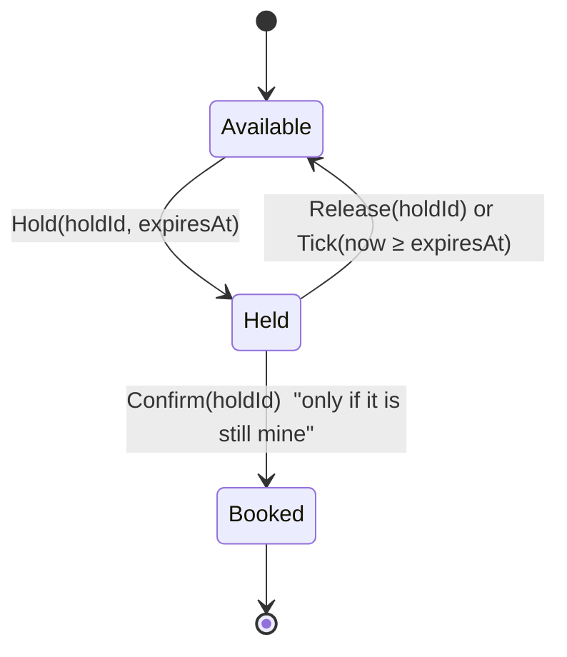

# LLD — Design a Movie Ticket Booking System (C#)

**Low-level design · BookMyShow style · companion to [the HLD note](README.md)**

> [!IMPORTANT]
> **HLD vs LLD in one line.** HLD asks *"what are the boxes and how do they scale?"* LLD asks *"what are the classes inside one box, and how do they stay correct and easy to change?"* The same product (BookMyShow) shows up in both rounds, so you must be able to switch between them.

---

## ⚡ The 60-second answer

1. **Clarify scope**, then list the **nouns** (Show, Seat, Hold, Booking, Payment) and the **verbs** (hold, confirm, release).
2. **A seat's life is a State machine:** `Available → Held → Booked`. Each state owns which transitions are legal.
3. **One lock per seat**, taken in **sorted order**, gives all-or-nothing multi-seat holds with **no deadlock**.
4. **Holds expire lazily:** a `Held` state checks the clock when asked. No background timer needed.
5. **Strategy + Decorator** for pricing, **Observer** for notifications, **idempotency key** for confirm.
6. **Confirm = guard 1 (my hold still valid) → charge → guard 2 (seats confirm, then a UNIQUE check) → else refund.**
7. In the room, code only the **spine** (§0, about 100 lines); describe the rest.
8. Code against **interfaces** (`IClock`, `IPaymentGateway`, `IBookingRepository`) so everything is testable.

---

## Contents
0. [The interview-sized version (start here)](#0-the-interview-sized-version-what-you-would-actually-write-in-20-minutes)
1. [What interviewers look for](#1-what-interviewers-look-for)
2. [A framework you can reuse for any LLD problem](#2-a-framework-you-can-reuse)
3. [Requirements and scope](#3-requirements-and-scope)
4. [Nouns → classes](#4-nouns--classes)
5. [Class diagram](#5-class-diagram)
6. [Design decisions (and what we deliberately did NOT use)](#6-design-decisions)
7. [The full reference solution](#7-the-full-reference-solution-do-not-write-this-live)
8. [Concurrency: in-process vs distributed](#8-concurrency-in-process-vs-distributed)
9. [Run it](#9-run-it)
10. [Extension questions and how to answer them](#10-extension-questions)
11. [Common mistakes](#11-common-mistakes)
12. [Pacing a 45-minute LLD round](#12-pacing-a-45-minute-lld-round)

---

## 0. The interview-sized version (what you would actually write in ~20 minutes)

> [!IMPORTANT]
> **Do not write the full project in §7 in an interview.** It is a reference. In the room, code the spine below, say "pricing is a Strategy, notifications are an Observer" in a sentence each, and move on. About 100 lines, one file.

What this version keeps: **one lock per seat, sorted order, all-or-nothing hold, lazy expiry, idempotent confirm.** What it skips (and you *say* you skip): pricing rules, notifications, State classes, a real repository.

```csharp
public enum SeatStatus { Available, Held, Booked }

public sealed class Seat
{
    public string Id { get; }
    public SeatStatus Status;           // guarded by `this` lock
    public string? HoldId;              // who holds it
    public DateTime HoldExpiresAt;      // lazy expiry: checked when asked, no timer thread
    public Seat(string id) => Id = id;
}

public sealed record Hold(string HoldId, string UserId, List<string> SeatIds, DateTime ExpiresAt);

public interface IPaymentGateway
{
    bool Charge(string idempotencyKey, decimal amount);   // must be idempotent
    void Refund(string idempotencyKey);
}

public sealed class BookingService
{
    private readonly Dictionary<string, Seat> _seats;                 // seatId -> Seat (read-only after setup)
    private readonly Dictionary<string, Hold> _holds = new();         // guarded by _holds
    private readonly Dictionary<string, string> _confirmed = new();   // idempotencyKey -> bookingId; guarded by _holds
    private readonly IPaymentGateway _pay;
    private readonly Func<DateTime> _now;                             // inject time so expiry is testable
    private readonly TimeSpan _ttl = TimeSpan.FromMinutes(8);

    public BookingService(IEnumerable<Seat> seats, IPaymentGateway pay, Func<DateTime>? now = null)
    {
        _seats = seats.ToDictionary(s => s.Id);
        _pay = pay;
        _now = now ?? (() => DateTime.UtcNow);
    }

    // 1) HOLD: all-or-nothing. Lock seats in SORTED order so two overlapping requests cannot deadlock.
    public Hold? TryHold(string userId, IEnumerable<string> seatIds)
    {
        var ids = seatIds.Distinct().OrderBy(x => x, StringComparer.Ordinal).ToList();
        var seats = ids.Select(id => _seats[id]).ToList();
        var now = _now();
        var holdId = Guid.NewGuid().ToString("N");

        return LockAll(seats, 0, () =>
        {
            foreach (var s in seats)                                   // check phase
            {
                if (s.Status == SeatStatus.Held && now >= s.HoldExpiresAt) s.Status = SeatStatus.Available; // lazy expiry
                if (s.Status != SeatStatus.Available) return null;     // one bad seat vetoes the whole request
            }
            foreach (var s in seats)                                   // apply phase
            {
                s.Status = SeatStatus.Held; s.HoldId = holdId; s.HoldExpiresAt = now + _ttl;
            }
            var hold = new Hold(holdId, userId, ids, now + _ttl);
            lock (_holds) _holds[holdId] = hold;
            return hold;
        });
    }

    // 2) CONFIRM: idempotent by key; re-check the hold is still mine AFTER charging; refund if not.
    public string? Confirm(string holdId, string idempotencyKey, decimal amount)
    {
        lock (_holds) { if (_confirmed.TryGetValue(idempotencyKey, out var done)) return done; }   // double tap -> same answer
        if (!_pay.Charge(idempotencyKey, amount)) { Release(holdId); return null; }                // declined -> free the seats

        Hold hold; lock (_holds) hold = _holds[holdId];                                          // Dictionary isn't thread-safe: read under its lock
        var seats = hold.SeatIds.Select(id => _seats[id]).ToList();
        var now = _now();
        var ok = LockAll(seats, 0, () =>
        {
            if (!seats.All(s => s.Status == SeatStatus.Held && s.HoldId == holdId && now < s.HoldExpiresAt)) return false;
            foreach (var s in seats) s.Status = SeatStatus.Booked;
            return true;
        });
        if (!ok) { _pay.Refund(idempotencyKey); return null; }                                    // hold expired while paying

        var bookingId = Guid.NewGuid().ToString("N");
        lock (_holds) { _confirmed[idempotencyKey] = bookingId; _holds.Remove(holdId); }
        return bookingId;
    }

    public void Release(string holdId)
    {
        Hold? hold; lock (_holds) { _holds.TryGetValue(holdId, out hold); _holds.Remove(holdId); }
        if (hold is null) return;
        var seats = hold.SeatIds.Select(id => _seats[id]).ToList();
        LockAll(seats, 0, () =>
        {
            foreach (var s in seats) if (s.HoldId == holdId && s.Status == SeatStatus.Held) { s.Status = SeatStatus.Available; s.HoldId = null; }
            return true;
        });
    }

    private static T LockAll<T>(List<Seat> seats, int i, Func<T> body) =>
        i == seats.Count ? body() : LockOne(seats, i, body);
    private static T LockOne<T>(List<Seat> seats, int i, Func<T> body) { lock (seats[i]) return LockAll(seats, i + 1, body); }
}
```

**Then say, out loud (this is the part that scores):**
- *"Check-then-act is the race, so each seat has its own lock and the check and the write happen under it."*
- *"Multi-seat requests lock in sorted order, so overlapping requests can't deadlock, and nothing is applied unless every seat is free: all-or-nothing."*
- *"Expiry is lazy. A held seat whose time has passed counts as free when someone asks."*
- *"Confirm re-checks the hold after the charge. If it expired while paying, I refund."*
- *"This lock only protects one process. Across servers the claim becomes a Redis `SET NX EX`, with a DB unique constraint as the backstop."*

**One test you would write (a race):**
```csharp
var svc = new BookingService(new[] { new Seat("A1") }, gateway);
var results = await Task.WhenAll(
    Task.Run(() => svc.TryHold("u1", new[] { "A1" })),
    Task.Run(() => svc.TryHold("u2", new[] { "A1" })));
Debug.Assert(results.Count(r => r is not null) == 1);   // exactly one winner
```

> [!NOTE]
> This mini version was written but not compiled where these notes were authored. If you use it for practice, type it out and fix any typos; that is also good rehearsal.

**If you have time left, extend in this order:** pricing as a Strategy → State pattern for the seat → notifications as an Observer → a repository interface. Each is a 2-minute verbal sketch, not extra code.

---

## 1. What interviewers look for

Candidate reports for Microsoft-style loops describe LLD as a separate round, often in a shared editor, where you design **classes, interfaces and methods**, then write working code. Typical scoring areas:

| Area | What a strong answer shows |
|---|---|
| **Requirements** | You ask before you draw (one cinema or many? seat types? cancellation?) |
| **Object model** | Small classes with one reason to change; clear ownership |
| **SOLID** | Open/closed pricing, interfaces for dependencies, no god class |
| **Patterns (with restraint)** | State, Strategy, Observer, Decorator, Factory *where they earn their place* |
| **Concurrency** | Two users, one seat, handled on purpose |
| **Extensibility** | A new requirement changes little existing code |
| **Working code** | It compiles, it runs, you can walk a test through it |
| **Edge cases** | Expiry, cancel, payment failure, duplicate requests |

> [!NOTE]
> Reports vary by team, level and interviewer. Use this as a pattern to prepare for, not a guarantee.

---

## 2. A framework you can reuse

Use the same six steps for parking lot, elevator, splitwise, LRU cache, etc.

| Step | Do this | Here |
|---|---|---|
| 1. **Clarify** | Scope, scale, actors, what is out | One show, many seats, hold then pay |
| 2. **Nouns & verbs** | Candidate classes and operations | Show, Seat, Hold, Booking · hold, confirm, release |
| 3. **Relationships** | Has-a, is-a, who owns whom | Show owns ShowSeats; Booking references seat ids |
| 4. **Behaviour that varies** | That is where patterns go | Seat lifecycle (State), price (Strategy), notify (Observer) |
| 5. **Concurrency & failure** | What can race or fail? | Two holds on one seat; payment fails; hold expires |
| 6. **Code the core, then extend** | Write the spine; discuss extensions | `BookingService`, `Show`, `ShowSeat` |

> [!TIP]
> Say the step out loud as you go. Interviewers score *how you think*, not only the final code.

---

## 3. Requirements and scope

**In scope**
- A **show** has a fixed set of **seats**, each with a type (regular / premium / recliner).
- A user **holds** 1–6 seats for a limited time (8 minutes).
- The user **confirms** by paying; a **booking** is created and listeners are notified.
- Holds can be **released** by the user, or **expire** on their own.
- **Pricing** depends on seat type and can have extra rules (weekend surcharge).

**Out of scope (say so):** search, multiple cities/theatres, seat-map rendering, real payment providers, persistence, cancellation/refund policy. *(Extensions in §10.)*

**Invariants to protect** (state them; they guide every decision):
1. A seat is **never** held by two users at once.
2. A seat is **never** booked twice.
3. A payment key is **never** charged twice.
4. A multi-seat hold is **all-or-nothing**.

---

## 4. Nouns → classes

| Noun / verb | Becomes | Responsibility |
|---|---|---|
| Seat | `Seat` (record) | Identity + type. Immutable. |
| A seat *in a show* | `ShowSeat` | Owns its state and its own lock |
| Seat lifecycle | `ISeatState` + `AvailableState` / `HeldState` / `BookedState` | Which transitions are legal |
| Show | `Show` | Owns its seats; does all-or-nothing transitions |
| Hold | `Hold` (record) | Who holds what until when |
| Booking | `Booking` (record) | The durable sale |
| Price rule | `IPricingStrategy` | Price for a seat in a show |
| Payment | `IPaymentGateway` | Charge (idempotent) / refund |
| "Sold" truth | `IBookingRepository` | Mirrors the DB `UNIQUE (show, seat)` |
| Notify | `IBookingListener` | Observer for confirmed bookings |
| Time | `IClock` | Testable expiry |
| Orchestrator | `BookingService` | The facade: hold, confirm, release |

---

## 5. Class diagram


### The seat state machine



---

## 6. Design decisions

| Decision | Why | Alternative you should be able to discuss |
|---|---|---|
| **State pattern** for the seat | Transitions are rules, not `if` chains; adding `Blocked` or `Cancelled` adds a class | An `enum` + `switch` is fine for 3 states in a quick answer; say which you chose and why |
| **Per-seat lock, sorted order** | Seats do not contend; fixed order prevents deadlock between overlapping requests | One global lock = correct but serialises every booking (poor under load) |
| **Two-phase transition** (plan, then apply) | All-or-nothing without rollback logic | Apply one-by-one with undo on failure (more code, more bugs) |
| **Lazy expiry** (`Tick`) | No timer threads, trivially testable with a fake clock | A scheduler/`Timer` that releases holds (more moving parts; races with confirm) |
| **Strategy + Decorator** for price | New pricing rule = new class, old code untouched (open/closed) | `if (weekend) …` inside the service (grows forever) |
| **Observer** for notifications | Booking code does not know about email/SMS | Call the notifier directly (couples sale to a flaky dependency) |
| **Idempotency key + `Lazy`** | Double tap runs confirm once, even across threads | Check-then-act on a dictionary (race: both pass the check) |
| **Repository mirrors UNIQUE** | The last-line guard exists in code too | Trust the hold alone (one bug = a double sale) |
| **Interfaces for clock, payment, repo** | Tests are fast and deterministic | Concrete classes (hard to test expiry or failures) |

**What we deliberately did not use:** Singleton (global state hurts tests), inheritance trees for seat types (a `SeatType` enum is enough until behaviour differs), a Factory (nothing is complex to construct yet). *Naming a pattern you chose not to use is a strong signal.*

---

## 7. The full reference solution (do not write this live)

> [!WARNING]
> This is the **complete** design: State classes, pricing strategies, observer, repository, and demo. It exists so you can see every extension in one place. In an interview you write §0, not this.

> [!NOTE]
> Full project: [`lld-csharp/`](lld-csharp/) (.NET 8). Files below are shown in dependency order. Written for .NET 8 with nullable reference types on. I could not compile it where it was written, so run `dotnet run` once (§9).

### 7.1 Common types: `Result`, `IClock`
```csharp
namespace TicketBooking;

/// <summary>Tiny Result type: callers must look at Ok before touching Value.</summary>
public sealed record Result<T>(bool Ok, T? Value, string? Error)
{
    public static Result<T> Success(T value) => new(true, value, null);
    public static Result<T> Fail(string error) => new(false, default, error);
}

/// <summary>Time is a dependency, so hold expiry is testable without Thread.Sleep.</summary>
public interface IClock { DateTime UtcNow { get; } }

public sealed class SystemClock : IClock
{
    public DateTime UtcNow => DateTime.UtcNow;
}

public sealed class FakeClock(DateTime start) : IClock
{
    private DateTime _now = start;
    public DateTime UtcNow => _now;
    public void Advance(TimeSpan by) => _now += by;
}
```

### 7.2 The seat: State pattern and the per-seat lock
```csharp
namespace TicketBooking;

public enum SeatType { Regular, Premium, Recliner }
public enum SeatStatus { Available, Held, Booked }

public sealed record Seat(string Id, SeatType Type);

// ── State pattern: a seat's life is Available → Held → Booked (or back to Available) ──────────
// Each state decides which transitions are legal. A transition returns the NEXT state, or null if illegal.
public interface ISeatState
{
    SeatStatus Status { get; }
    ISeatState? Hold(string holdId, DateTime expiresAt);
    ISeatState? Confirm(string holdId);
    ISeatState? Release(string holdId);
    /// <summary>Lazy expiry: a Held state whose timer has run out behaves as Available. No background thread needed.</summary>
    ISeatState Tick(DateTime now) => this;
}

internal sealed class AvailableState : ISeatState
{
    public static readonly AvailableState Instance = new();
    public SeatStatus Status => SeatStatus.Available;
    public ISeatState? Hold(string holdId, DateTime expiresAt) => new HeldState(holdId, expiresAt);
    public ISeatState? Confirm(string holdId) => null;   // cannot confirm what nobody holds
    public ISeatState? Release(string holdId) => null;
}

internal sealed class HeldState : ISeatState
{
    private readonly string _holdId;
    private readonly DateTime _expiresAt;
    public HeldState(string holdId, DateTime expiresAt) { _holdId = holdId; _expiresAt = expiresAt; }
    public SeatStatus Status => SeatStatus.Held;
    public ISeatState? Hold(string holdId, DateTime expiresAt) => null;                        // already held
    public ISeatState? Confirm(string holdId) => holdId == _holdId ? BookedState.Instance : null;   // "only if it's still mine"
    public ISeatState? Release(string holdId) => holdId == _holdId ? AvailableState.Instance : null;
    public ISeatState Tick(DateTime now) => now >= _expiresAt ? AvailableState.Instance : this;
}

internal sealed class BookedState : ISeatState
{
    public static readonly BookedState Instance = new();
    public SeatStatus Status => SeatStatus.Booked;
    public ISeatState? Hold(string holdId, DateTime expiresAt) => null;
    public ISeatState? Confirm(string holdId) => null;
    public ISeatState? Release(string holdId) => null;   // a booked seat is terminal (cancellation is an extension)
}

/// <summary>One seat in one show. It owns its own lock, so seats never contend with each other.</summary>
public sealed class ShowSeat
{
    private readonly object _gate = new();
    private ISeatState _state = AvailableState.Instance;

    public ShowSeat(Seat seat) => Seat = seat;
    public Seat Seat { get; }
    internal object Gate => _gate;

    public SeatStatus StatusAt(DateTime now)
    {
        lock (_gate) { _state = _state.Tick(now); return _state.Status; }
    }

    // The *Unsafe members must be called while holding Gate (Show takes the locks in a fixed order).
    internal ISeatState? PlanUnsafe(Func<ISeatState, ISeatState?> transition, DateTime now)
    {
        _state = _state.Tick(now);
        return transition(_state);
    }
    internal void SetUnsafe(ISeatState next) => _state = next;
}
```

### 7.3 The show: all-or-nothing transitions
```csharp
namespace TicketBooking;

public sealed class Show
{
    private readonly Dictionary<string, ShowSeat> _seats;   // read-only after construction → safe to read from many threads

    public Show(string id, string movie, DateTime startsAtUtc, IEnumerable<Seat> seats)
    {
        Id = id; Movie = movie; StartsAtUtc = startsAtUtc;
        _seats = seats.ToDictionary(s => s.Id, s => new ShowSeat(s), StringComparer.Ordinal);
    }

    public string Id { get; }
    public string Movie { get; }
    public DateTime StartsAtUtc { get; }

    public Seat GetSeat(string seatId) => Find(seatId).Seat;
    public SeatStatus StatusOf(string seatId, DateTime now) => Find(seatId).StatusAt(now);

    private ShowSeat Find(string seatId) =>
        _seats.TryGetValue(seatId, out var s) ? s : throw new KeyNotFoundException($"Unknown seat {seatId} for show {Id}");

    /// <summary>All-or-nothing hold. Locks are taken in sorted seat-id order, so two overlapping requests can never deadlock.</summary>
    public bool TryHoldAll(IEnumerable<string> seatIds, string holdId, DateTime now, TimeSpan ttl) =>
        Transition(seatIds, now, s => s.Hold(holdId, now + ttl), allOrNothing: true);

    public bool TryConfirmAll(IEnumerable<string> seatIds, string holdId, DateTime now) =>
        Transition(seatIds, now, s => s.Confirm(holdId), allOrNothing: true);

    /// <summary>Best effort and idempotent: seats that already expired or were never ours are simply skipped.</summary>
    public void ReleaseAll(IEnumerable<string> seatIds, string holdId, DateTime now) =>
        Transition(seatIds, now, s => s.Release(holdId), allOrNothing: false);

    private bool Transition(IEnumerable<string> seatIds, DateTime now, Func<ISeatState, ISeatState?> step, bool allOrNothing)
    {
        var ordered = seatIds.Distinct().OrderBy(id => id, StringComparer.Ordinal).Select(Find).ToList();
        return WithAllLocked(ordered, 0, () =>
        {
            var plans = ordered.Select(s => s.PlanUnsafe(step, now)).ToList();       // phase 1: decide
            if (allOrNothing && plans.Any(p => p is null)) return false;             // one bad seat vetoes everything
            for (var i = 0; i < ordered.Count; i++)                                  // phase 2: apply
                if (plans[i] is { } next) ordered[i].SetUnsafe(next);
            return true;
        });
    }

    private static bool WithAllLocked(IReadOnlyList<ShowSeat> seats, int i, Func<bool> action)
    {
        if (i == seats.Count) return action();
        lock (seats[i].Gate) return WithAllLocked(seats, i + 1, action);
    }
}
```

**Why `Transition` has two phases.** Phase 1 asks every seat "would this transition be legal?" while all locks are held. Only if all say yes does phase 2 apply the change. No partial state is ever visible, and there is nothing to roll back.

### 7.4 Pricing: Strategy and Decorator
```csharp
namespace TicketBooking;

// ── Strategy: how a seat is priced is a policy you can swap without touching booking code ─────
public interface IPricingStrategy { decimal PriceFor(Show show, Seat seat); }

public sealed class SeatTypePricing(IReadOnlyDictionary<SeatType, decimal> prices) : IPricingStrategy
{
    public decimal PriceFor(Show show, Seat seat) => prices[seat.Type];
}

// ── Decorator: layer a rule on top of another strategy (open/closed: add rules, don't edit old ones) ──
public sealed class WeekendSurchargePricing(IPricingStrategy inner, decimal surchargePercent) : IPricingStrategy
{
    public decimal PriceFor(Show show, Seat seat)
    {
        var basePrice = inner.PriceFor(show, seat);
        var weekend = show.StartsAtUtc.DayOfWeek is DayOfWeek.Saturday or DayOfWeek.Sunday;
        return weekend ? basePrice * (1 + surchargePercent / 100m) : basePrice;
    }
}
```

### 7.5 Payments (idempotent)
```csharp
namespace TicketBooking;

public sealed record PaymentResult(bool Success, string PaymentId, string? Error);

public interface IPaymentGateway
{
    /// <summary>MUST be idempotent: the same key returns the same result and never charges twice.</summary>
    PaymentResult Charge(string idempotencyKey, decimal amount);
    void Refund(string paymentId);
}

/// <summary>In-memory stand-in for a real provider. FailNextCharge lets tests simulate a declined card.</summary>
public sealed class FakePaymentGateway : IPaymentGateway
{
    private readonly object _gate = new();
    private readonly Dictionary<string, PaymentResult> _byKey = new();
    private readonly HashSet<string> _refunded = new();

    public int ChargeCount { get; private set; }
    public int RefundCount => _refunded.Count;
    public bool FailNextCharge { get; set; }

    public PaymentResult Charge(string idempotencyKey, decimal amount)
    {
        lock (_gate)
        {
            if (_byKey.TryGetValue(idempotencyKey, out var existing)) return existing;   // replay → same answer
            PaymentResult result;
            if (FailNextCharge) { FailNextCharge = false; result = new(false, "", "card declined"); }
            else { ChargeCount++; result = new(true, $"pay-{ChargeCount}", null); }
            _byKey[idempotencyKey] = result;
            return result;
        }
    }

    public void Refund(string paymentId) { lock (_gate) _refunded.Add(paymentId); }   // HashSet → refund is idempotent too
}
```

### 7.6 Holds, bookings, repository, observer
```csharp
namespace TicketBooking;

public sealed record Hold(string HoldId, string UserId, string ShowId, IReadOnlyList<string> SeatIds, DateTime ExpiresAt);

public sealed record Booking(
    string BookingId, string ShowId, IReadOnlyList<string> SeatIds, string UserId,
    string PaymentId, decimal Amount, DateTime CreatedAt);

public interface IBookingRepository
{
    /// <summary>Mirrors the database UNIQUE (show_id, seat_id): returns false if ANY seat is already sold.</summary>
    bool TryAdd(Booking booking);
}

public sealed class InMemoryBookingRepository : IBookingRepository
{
    private readonly object _gate = new();
    private readonly HashSet<(string Show, string Seat)> _sold = new();
    private readonly List<Booking> _all = new();

    public IReadOnlyList<Booking> All { get { lock (_gate) return _all.ToList(); } }

    public bool TryAdd(Booking booking)
    {
        lock (_gate)
        {
            if (booking.SeatIds.Any(s => _sold.Contains((booking.ShowId, s)))) return false;
            foreach (var s in booking.SeatIds) _sold.Add((booking.ShowId, s));
            _all.Add(booking);
            return true;
        }
    }
}

// ── Observer: anything that cares about a confirmed booking subscribes; the booking code never knows who ──
public interface IBookingListener { void OnConfirmed(Booking booking); }

public sealed class RecordingListener : IBookingListener
{
    private readonly List<string> _events = new();
    public IReadOnlyList<string> Events { get { lock (_events) return _events.ToList(); } }
    public void OnConfirmed(Booking b) { lock (_events) _events.Add($"ticket for {b.UserId}: {string.Join(",", b.SeatIds)}"); }
}
```

### 7.7 The orchestrator
```csharp
using System.Collections.Concurrent;

namespace TicketBooking;

/// <summary>The facade the rest of the app talks to. It coordinates; it does not own seat rules (Show/ShowSeat do).</summary>
public sealed class BookingService
{
    public const int MaxSeatsPerHold = 6;

    private readonly IClock _clock;
    private readonly IPaymentGateway _payments;
    private readonly IBookingRepository _bookings;
    private readonly IPricingStrategy _pricing;
    private readonly IReadOnlyList<IBookingListener> _listeners;
    private readonly TimeSpan _holdTtl;

    private readonly ConcurrentDictionary<string, Show> _shows = new();
    private readonly ConcurrentDictionary<string, Hold> _holds = new();
    // One entry per idempotency key. Lazy guarantees the confirm logic runs ONCE even if the same key arrives on two threads.
    private readonly ConcurrentDictionary<string, Lazy<Result<Booking>>> _confirmations = new();

    public BookingService(IClock clock, IPaymentGateway payments, IBookingRepository bookings,
        IPricingStrategy pricing, IEnumerable<IBookingListener> listeners, TimeSpan holdTtl)
    {
        _clock = clock; _payments = payments; _bookings = bookings; _pricing = pricing;
        _listeners = listeners.ToList(); _holdTtl = holdTtl;
    }

    public void AddShow(Show show) => _shows[show.Id] = show;

    // ── 1. HOLD: one atomic claim per seat set (the in-process twin of Redis SET NX EX) ────────────────
    public Result<Hold> CreateHold(string userId, string showId, IReadOnlyCollection<string> seatIds)
    {
        if (!_shows.TryGetValue(showId, out var show)) return Result<Hold>.Fail("unknown show");
        if (seatIds.Count == 0 || seatIds.Count > MaxSeatsPerHold) return Result<Hold>.Fail($"choose 1 to {MaxSeatsPerHold} seats");

        var now = _clock.UtcNow;
        var holdId = Guid.NewGuid().ToString("N");
        try
        {
            if (!show.TryHoldAll(seatIds, holdId, now, _holdTtl)) return Result<Hold>.Fail("one or more seats were just taken");
        }
        catch (KeyNotFoundException e) { return Result<Hold>.Fail(e.Message); }

        var hold = new Hold(holdId, userId, showId, seatIds.Distinct().OrderBy(s => s, StringComparer.Ordinal).ToList(), now + _holdTtl);
        _holds[holdId] = hold;
        return Result<Hold>.Success(hold);
    }

    // ── 2. CONFIRM: idempotent per key; guard 1 (still my hold) → charge → guard 2 (seats confirm + UNIQUE) ──
    public Result<Booking> Confirm(string holdId, string idempotencyKey) =>
        _confirmations.GetOrAdd(idempotencyKey, _ => new Lazy<Result<Booking>>(() => ConfirmCore(holdId, idempotencyKey))).Value;

    private Result<Booking> ConfirmCore(string holdId, string idempotencyKey)
    {
        if (!_holds.TryGetValue(holdId, out var hold)) return Result<Booking>.Fail("hold not found");
        var show = _shows[hold.ShowId];
        var now = _clock.UtcNow;
        if (now >= hold.ExpiresAt) return Result<Booking>.Fail("hold expired");     // cheap early check before touching money

        var amount = hold.SeatIds.Sum(id => _pricing.PriceFor(show, show.GetSeat(id)));
        var pay = _payments.Charge(idempotencyKey, amount);
        if (!pay.Success)
        {
            show.ReleaseAll(hold.SeatIds, holdId, _clock.UtcNow);                    // payment failed → free the seats right away
            _holds.TryRemove(holdId, out _);
            return Result<Booking>.Fail(pay.Error ?? "payment failed");
        }

        // The race from the video: the money moved, but did the hold survive? Ask the seats, "only if it's still mine".
        if (!show.TryConfirmAll(hold.SeatIds, holdId, _clock.UtcNow))
        {
            _payments.Refund(pay.PaymentId);                                         // seat gone → automatic refund
            return Result<Booking>.Fail("hold expired while paying; payment refunded");
        }

        var booking = new Booking(Guid.NewGuid().ToString("N"), hold.ShowId, hold.SeatIds, hold.UserId, pay.PaymentId, amount, _clock.UtcNow);
        if (!_bookings.TryAdd(booking))                                              // the UNIQUE safety net; should be unreachable
        {
            _payments.Refund(pay.PaymentId);
            return Result<Booking>.Fail("seat already sold; payment refunded");
        }

        _holds.TryRemove(holdId, out _);
        foreach (var l in _listeners)
        {
            try { l.OnConfirmed(booking); }
            catch { /* a failing notifier must never undo a sale (production: outbox + retry) */ }
        }
        return Result<Booking>.Success(booking);
    }

    // ── 3. RELEASE: the user walks away ──────────────────────────────────────────────────────────────
    public bool Release(string holdId, string userId)
    {
        if (!_holds.TryGetValue(holdId, out var hold) || hold.UserId != userId) return false;
        _shows[hold.ShowId].ReleaseAll(hold.SeatIds, holdId, _clock.UtcNow);
        return _holds.TryRemove(holdId, out _);
    }
}
```

**Read `ConfirmCore` as the same two guards from the HLD note:**
1. *Guard 1:* is the hold still mine and unexpired? (checked again after the charge by `TryConfirmAll`)
2. *Charge:* idempotent by key.
3. *Guard 2:* `TryConfirmAll` then `TryAdd` (the UNIQUE mirror).
4. Any failure after the money moved **refunds automatically**.

### 7.8 A self-checking demo
```csharp
using TicketBooking;

// A self-checking demo: each scenario prints PASS/FAIL. Run with:  dotnet run
var failures = 0;
void Check(bool ok, string what) { Console.WriteLine($"{(ok ? "PASS" : "FAIL")}  {what}"); if (!ok) failures++; }

static Show MakeShow(string id, DateTime startsAt) => new(id, "Coldplay Live", startsAt,
    new[] { "A", "B" }.SelectMany(row => Enumerable.Range(1, 6).Select(n =>
        new Seat($"{row}{n}", row == "A" ? SeatType.Premium : SeatType.Regular))));

static (BookingService Svc, FakeClock Clock, FakePaymentGateway Pay, InMemoryBookingRepository Repo, RecordingListener Mail) Build(DateTime startsAt)
{
    var clock = new FakeClock(new DateTime(2026, 10, 1, 11, 59, 0, DateTimeKind.Utc));
    var pay = new FakePaymentGateway();
    var repo = new InMemoryBookingRepository();
    var mail = new RecordingListener();
    var pricing = new WeekendSurchargePricing(
        new SeatTypePricing(new Dictionary<SeatType, decimal> { [SeatType.Regular] = 2500m, [SeatType.Premium] = 6000m, [SeatType.Recliner] = 9000m }), 20m);
    var svc = new BookingService(clock, pay, repo, pricing, new IBookingListener[] { mail }, TimeSpan.FromMinutes(8));
    svc.AddShow(MakeShow("show-1", startsAt));
    return (svc, clock, pay, repo, mail);
}

var weekday = new DateTime(2026, 10, 7, 14, 0, 0, DateTimeKind.Utc);   // Wednesday
var weekend = new DateTime(2026, 10, 10, 14, 0, 0, DateTimeKind.Utc);  // Saturday

// 1. Two fans race for the same seat → exactly one winner.
{
    var (svc, _, _, _, _) = Build(weekday);
    using var barrier = new Barrier(2);
    var results = new[] { "fan-1", "fan-2" }
        .Select(u => Task.Run(() => { barrier.SignalAndWait(); return svc.CreateHold(u, "show-1", new[] { "A1" }); }))
        .Select(t => t.Result).ToList();
    Check(results.Count(r => r.Ok) == 1, "race for A1: exactly one hold wins");
}

// 2. Hundreds of racers, many seats: no seat is ever held twice.
{
    var (svc, _, _, _, _) = Build(weekday);
    var wins = new System.Collections.Concurrent.ConcurrentBag<string>();
    Parallel.For(0, 400, i =>
    {
        var seat = $"B{1 + i % 6}";
        var r = svc.CreateHold($"fan-{i}", "show-1", new[] { seat });
        if (r.Ok) wins.Add(seat);
    });
    Check(wins.Count == 6 && wins.Distinct().Count() == 6, "400 racers over 6 seats: exactly 6 winners, one per seat");
}

// 3. Multi-seat is all-or-nothing: an overlapping request leaves NO half-held seats behind.
{
    var (svc, _, _, _, _) = Build(weekday);
    var a = svc.CreateHold("fan-a", "show-1", new[] { "B1", "B2", "B3" });
    var b = svc.CreateHold("fan-b", "show-1", new[] { "B3", "B4" });
    var c = svc.CreateHold("fan-c", "show-1", new[] { "B4" });
    Check(a.Ok && !b.Ok && c.Ok, "overlap on B3: second request fails as a set, B4 stays free");
}

// 4. Idempotent confirm: a double tap charges once and returns the same booking.
{
    var (svc, _, pay, repo, mail) = Build(weekday);
    var hold = svc.CreateHold("fan-a", "show-1", new[] { "A1", "A2" }).Value!;
    var first = svc.Confirm(hold.HoldId, "checkout-123");
    var second = svc.Confirm(hold.HoldId, "checkout-123");
    Check(first.Ok && second.Ok && first.Value!.BookingId == second.Value!.BookingId, "double tap returns the same booking");
    Check(pay.ChargeCount == 1 && repo.All.Count == 1 && mail.Events.Count == 1, "…with one charge, one booking, one notification");
    Check(first.Value!.Amount == 12000m, "2 premium seats on a weekday = 12,000");
}

// 5. Expiry is lazy: after 8 minutes the seat is free again, and a late confirm is refused.
{
    var (svc, clock, pay, _, _) = Build(weekday);
    var hold = svc.CreateHold("fan-a", "show-1", new[] { "B5" }).Value!;
    clock.Advance(TimeSpan.FromMinutes(8) + TimeSpan.FromSeconds(1));
    var other = svc.CreateHold("fan-b", "show-1", new[] { "B5" });
    var late = svc.Confirm(hold.HoldId, "checkout-late");
    Check(other.Ok, "after the timer, someone else can take the seat");
    Check(!late.Ok && pay.ChargeCount == 0, "late confirm is refused before any money moves");
}

// 6. Payment declined → the hold is released at once.
{
    var (svc, _, pay, _, _) = Build(weekday);
    var hold = svc.CreateHold("fan-a", "show-1", new[] { "B6" }).Value!;
    pay.FailNextCharge = true;
    var res = svc.Confirm(hold.HoldId, "checkout-bad");
    var retry = svc.CreateHold("fan-b", "show-1", new[] { "B6" });
    Check(!res.Ok && retry.Ok, "declined card frees the seat immediately");
}

// 7. Pricing decorator: weekend surcharge stacks on the base strategy without editing it.
{
    var (svc, _, _, _, _) = Build(weekend);
    var hold = svc.CreateHold("fan-a", "show-1", new[] { "B1" }).Value!;
    var res = svc.Confirm(hold.HoldId, "checkout-wknd");
    Check(res.Ok && res.Value!.Amount == 3000m, "regular seat on a Saturday = 2,500 + 20% = 3,000");
}

Console.WriteLine(failures == 0 ? "\nAll scenarios passed." : $"\n{failures} scenario(s) FAILED.");
return failures;
```

---

## 8. Concurrency: in-process vs distributed

This is the bridge between your two rounds.

| Concern | **LLD (one process)** | **HLD (many servers)** |
|---|---|---|
| Atomic claim of a seat | Per-seat `lock` (or `ConcurrentDictionary`/`Interlocked`) | Redis `SET NX EX` |
| Multi-seat all-or-nothing | Sorted lock order, two-phase transition | Lua script / ordered acquisition |
| Hold expiry | `Tick(now)` against a clock | Redis TTL |
| Final truth | `IBookingRepository` uniqueness check | DB `UNIQUE (show_id, seat_id)` |
| Idempotent confirm | `ConcurrentDictionary<key, Lazy<…>>` | Idempotency key table / unique constraint |
| Notify after sale | Observer | Outbox → queue → idempotent consumer |

> [!WARNING]
> **The in-memory locks only protect one process.** If the interviewer says "now run two instances", the honest answer is: *the claim must move to a shared store (Redis/DB), exactly as in the HLD.* That sentence is often the follow-up they want.

**Why not lock the whole `Show`?** Correct but slow: every booking waits behind every other. Per-seat locks mean two fans booking different seats never wait for each other.

**Why sort the seat ids?** If request 1 locks `B3` then `B4` while request 2 locks `B4` then `B3`, they deadlock. A global order removes the cycle.

**Why not `async`/`await`?** Nothing here awaits I/O; the gateway is in-memory. In production the gateway call is async I/O, and you must **not** hold a `lock` across an `await`. You would call the gateway *outside* the seat locks (as `ConfirmCore` already does) and use `SemaphoreSlim` only if you truly need an async critical section.

---

## 9. Run it

```bash
cd sd-07-ticket-booking/lld-csharp
dotnet run
```

Expected output (each line is a self-check):

```text
PASS  race for A1: exactly one hold wins
PASS  400 racers over 6 seats: exactly 6 winners, one per seat
PASS  overlap on B3: second request fails as a set, B4 stays free
PASS  double tap returns the same booking
PASS  …with one charge, one booking, one notification
PASS  2 premium seats on a weekday = 12,000
PASS  after the timer, someone else can take the seat
PASS  late confirm is refused before any money moves
PASS  declined card frees the seat immediately
PASS  regular seat on a Saturday = 2,500 + 20% = 3,000

All scenarios passed.
```

> [!NOTE]
> I could not run a .NET compiler in the environment where these notes were written, so please run `dotnet run` once and tell me if anything needs fixing. That is exactly the kind of check you should also do before presenting code in an interview.

---

## 10. Extension questions

Practise answering each in under a minute, naming *which class changes*.

<details><summary><b>Cancel a booking and refund</b></summary>

Add `Cancel(bookingId)` to `BookingService`. Add a `CancelledState`? No: a booked seat becomes `Available` again, so add a `Booked → Available` transition guarded by policy (e.g. before show start). Refund via `IPaymentGateway.Refund`. The repository needs `Remove`, and in a database the unique index should be **partial** (`WHERE status = 'CONFIRMED'`) so a cancelled seat can be sold again.
</details>

<details><summary><b>Add coupons / discounts</b></summary>

Another `IPricingStrategy` decorator (`CouponPricing(inner, coupon)`). Booking code is untouched. Mention ordering: surcharge before discount or after?
</details>

<details><summary><b>Waitlist when a show is sold out</b></summary>

Observer again: `ReleaseAll` and expiry publish a "seat freed" event; a `WaitlistService` listens and offers the seat to the first waiter by creating a short hold for them.
</details>

<details><summary><b>Best-available "any 2 seats together"</b></summary>

A `ISeatSelectionStrategy` that proposes candidate seat sets from the seat map (adjacent in a row). `CreateHold` tries candidates in order; the all-or-nothing hold makes each attempt safe.
</details>

<details><summary><b>Multiple theatres, screens and cities</b></summary>

Add `City → Theatre → Screen → Show`. `Screen` owns the seat layout; `Show` instantiates `ShowSeat`s from it. `BookingService` is unchanged because it only needs a `Show`.
</details>

<details><summary><b>Notifications must retry</b></summary>

Move from a synchronous observer to the outbox pattern: persist an event with the booking, a relay publishes with retries, the consumer dedupes by booking id (see the HLD note §10).
</details>

<details><summary><b>Persist to a database</b></summary>

Implement `IBookingRepository` with SQL. `TryAdd` becomes an `INSERT` that relies on the `UNIQUE` constraint; catch the violation and return `false`. Holds move to Redis (TTL) in a distributed setup.
</details>

<details><summary><b>Run on multiple servers</b></summary>

See §8: the per-seat lock becomes a Redis `SET NX EX`, the repository check becomes the DB unique constraint, idempotency keys go in a shared store.
</details>

<details><summary><b>Different seat types with different behaviour (e.g. recliner needs 2 adjacent)</b></summary>

If only data differs (price), keep the enum. If behaviour differs, introduce a rule object (`ISeatRule`) rather than subclassing `Seat`; prefer composition.
</details>

<details><summary><b>How would you unit test this?</b></summary>

`FakeClock` for expiry, `FakePaymentGateway.FailNextCharge` for declines, `RecordingListener` for notifications, and a `Barrier`-based race test (see scenario 1). Assert the invariants: no seat has two holds, no seat has two bookings, no key is charged twice.
</details>

---

## 11. Common mistakes

- ❌ **One giant `BookingSystem` class** that knows about seats, prices, payments and email.
- ❌ **Check-then-act** on seat status without a lock (the classic race).
- ❌ **One global lock** (correct, but you lose the scalability point).
- ❌ **Locking in inconsistent order** across multiple seats → deadlock.
- ❌ **Partial multi-seat holds** left behind after a failure.
- ❌ **Forgetting hold expiry** or implementing it with `Thread.Sleep`.
- ❌ **Charging before checking the hold is still valid.**
- ❌ **No idempotency** on confirm.
- ❌ **Pattern stuffing:** a Factory, Singleton and Visitor for three classes.
- ❌ **Holding a `lock` across an `await`** or an external call.
- ❌ **Never saying how it changes when it runs on more than one server.**

---

## 12. Pacing a 45-minute LLD round

| Minutes | Do this |
|---|---|
| 0–5 | Clarify requirements, list invariants, name what is out of scope |
| 5–10 | Nouns/verbs, a rough class diagram, name the patterns and why |
| 10–30 | Code the spine: `Seat` states, `Show`, `BookingService` (interfaces first) |
| 30–38 | Walk a test: the race, the overlap, the expiry |
| 38–45 | Extensions (§10) and "what changes when this is distributed" (§8) |

> [!TIP]
> If time is short, **code the hard part first** (the concurrency-safe hold) and describe the easy parts (pricing, notifications) in words.

---

<p align="center"><a href="README.md">⬅ HLD note</a> · <a href="../README.md">All problems</a></p>
