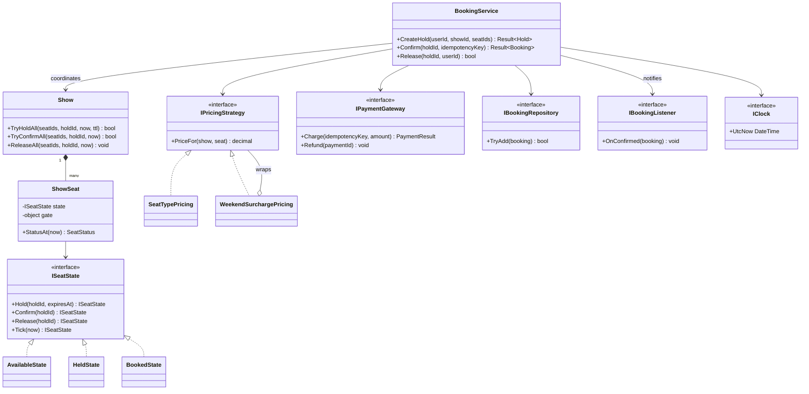
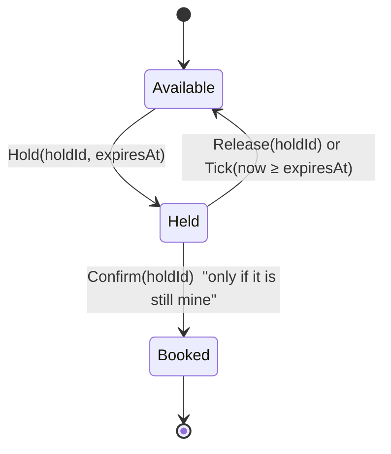

# LLD — Design a Movie Ticket Booking System (C#)

**Low-level design · BookMyShow style · companion to [the HLD note](HLD.md)**

> [!IMPORTANT]
> **HLD vs LLD in one line.** HLD asks *"what are the boxes and how do they scale?"* LLD asks *"what are the classes inside one box, and how do they stay correct and easy to change?"* The same product (BookMyShow) shows up in both rounds, so you must be able to switch between them.

---

## ⚡ The 60-second answer

1. **Clarify scope**, then list the **nouns** (Show, Seat, Hold, Booking, Payment) and the **verbs** (hold, confirm, release).
2. **A seat's life is a State machine:** `Available → Held → Booked`. Each state owns which transitions are legal.
3. **One lock per seat**, taken in **sorted order**, gives all-or-nothing multi-seat holds with **no deadlock**.
4. **Holds expire lazily:** a `Held` state checks the clock when asked. No background timer needed.
5. **Strategy + Decorator** for pricing, **Observer** for notifications, **idempotency key** for confirm.
6. **Confirm = guard 1 (my hold still valid) → charge → guard 2 (seats confirm, then a UNIQUE check) → else refund.**
7. In the room, code only the **spine** (§0, about 100 lines); describe the rest.
8. Code against **interfaces** (`IClock`, `IPaymentGateway`, `IBookingRepository`) so everything is testable.

---

## Contents
- [🧭 Primer: the code ideas in plain English](#-primer-the-code-ideas-in-plain-english)
0. [The interview-sized version (start here)](#0-the-interview-sized-version-what-you-would-actually-write-in-20-minutes)
1. [What interviewers look for](#1-what-interviewers-look-for)
2. [A framework you can reuse for any LLD problem](#2-a-framework-you-can-reuse)
3. [Requirements and scope](#3-requirements-and-scope)
4. [Nouns → classes](#4-nouns--classes)
5. [Class diagram](#5-class-diagram)
6. [Design decisions (and what we deliberately did NOT use)](#6-design-decisions)
7. [The full reference solution](#7-the-full-reference-solution-do-not-write-this-live)
8. [Concurrency: in-process vs distributed](#8-concurrency-in-process-vs-distributed)
9. [Run it](#9-run-it)
10. [Extension questions and how to answer them](#10-extension-questions)
11. [Common mistakes](#11-common-mistakes)
12. [Pacing a 45-minute LLD round](#12-pacing-a-45-minute-lld-round)

---

## 🧭 Primer: the code ideas in plain English

> **If the C# below feels heavy, start here.** Almost every line is one of these ideas. Learn the idea once and the code reads itself.

| Idea | Everyday picture | What it looks like in C# |
|---|---|---|
| **Race condition** | Two cashiers both see "1 ticket left" and both sell it | `if (seat.IsFree) seat.Take();` run by two threads at once |
| **Thread** | Two cashiers working at the same time | `Task.Run(...)`, `Parallel.For(...)` |
| **Lock** | A bathroom with **one key** on a hook: take it, go in, put it back; everyone else waits | `lock (obj) { ...only one thread at a time... }` |
| **Per-seat lock** | One key **per seat**, not one for the whole cinema, so people buying different seats never wait for each other | each `ShowSeat` has its own `_gate` object |
| **Deadlock** | You hold key A and wait for B; I hold B and wait for A; nobody ever moves | locking seats in different orders |
| **Fix: one global order** | Everyone takes keys **alphabetically**, so a circle can't form | `.OrderBy(id => id)` before locking |
| **All-or-nothing** | Grab **all** keys, check all seats, only then change any | "plan" phase, then "apply" phase |
| **Lazy expiry** | No alarm clock: the milk is only checked for being off when you open the fridge | compare `now >= expiresAt` when asked |
| **Idempotency key** | A receipt number: show it twice and the shop says "already done" | `Charge(idempotencyKey, amount)` |
| **Interface** | A plug socket: any plug of the right shape fits | `interface IPaymentGateway { ... }` |
| **Dependency injection** | Hand the chef the oven instead of letting them build one, so a test can hand over a fake oven | constructor takes `IClock`, `IPaymentGateway` |
| **Lambda** | A sticky note of instructions you pass to someone else | `x => x + 1`, `() => { ... }` |
| **`Func<T>`** | "A sticky note that, when run, gives back a T" | `Func<bool> action` |
| **Generic `<T>`** | A template: "a box of **anything**" | `Result<Hold>`, `LockAll<T>` |
| **Nullable `?`** | "Might be empty" written in the type | `Hold?`, `string?` |
| **`record`** | A labelled data card; the compiler adds equality and printing | `record Hold(string HoldId, ...)` |
| **LINQ** | Spreadsheet-style operations on a list | `.Where`, `.Select`, `.Any`, `.All`, `.Sum`, `.OrderBy` |
| **`Lazy<T>`** | A recipe cooked the **first** time someone asks, then reused | `new Lazy<...>(() => ConfirmCore(...))` |

### ✋ Pause and predict (answers folded)

<details><summary><b>1.</b> Two threads call <code>TryHold</code> for seat A1 at the same instant. What stops both from winning?</summary>

Both reach `lock (A1)`. Only one gets the key first. It checks "Available", sets it to Held, and releases the key. The second then gets the key, sees "Held", and returns `null`. The **check and the change happen as one uninterrupted step**.
</details>

<details><summary><b>2.</b> Remove <code>.OrderBy(...)</code> from the seat list. What can go wrong?</summary>

Request 1 locks `B3` then `B4`; request 2 locks `B4` then `B3`. Each holds one key and waits for the other: **deadlock**. Sorting gives everyone the same order, so one simply waits its turn.
</details>

<details><summary><b>3.</b> A fan's payment takes 9 minutes to confirm. What happens in <code>Confirm</code>?</summary>

The charge succeeds, then the "is every seat still held by me and unexpired?" check fails (`now >= HoldExpiresAt`), so the code **refunds** and returns `null`. The customer is never charged for a seat they don't get.
</details>

<details><summary><b>4.</b> Why not simply hold one big lock for the entire show?</summary>

It would be correct but slow: fans buying different seats would queue behind each other. Per-seat locks let unrelated bookings run in parallel.
</details>

<details><summary><b>5.</b> Why does the code never call the payment gateway while holding a seat lock?</summary>

A slow network call under a lock makes every other fan wait on that seat (or worse, causes deadlocks). Keep locked sections **tiny and local**; do slow I/O outside them.
</details>

---

## 0. The interview-sized version (what you would actually write in ~20 minutes)

> [!IMPORTANT]
> **Do not write the full project in §7 in an interview.** It is a reference. In the room, code the spine below, say "pricing is a Strategy, notifications are an Observer" in a sentence each, and move on. About 100 lines, one file.

What this version keeps: **one lock per seat, sorted order, all-or-nothing hold, lazy expiry, idempotent confirm.** What it skips (and you *say* you skip): pricing rules, notifications, State classes, a real repository.

```csharp
public enum SeatStatus { Available, Held, Booked }

public sealed class Seat
{
    public string Id { get; }
    public SeatStatus Status;           // changed only while holding THIS seat's lock (see `lock` below)
    public string? HoldId;              // which hold owns it; `?` = may be null (nobody)
    public DateTime HoldExpiresAt;      // LAZY EXPIRY: we compare this to "now" when asked. No timer thread.
    public Seat(string id) => Id = id;  // `=>` here is just a one-line constructor body
}

// `record` = a class for plain data. Two Holds with the same values count as equal; no boilerplate.
public sealed record Hold(string HoldId, string UserId, List<string> SeatIds, DateTime ExpiresAt);

// An interface is a PLUG SOCKET: BookingService only knows the socket's shape, so in a test you can
// plug in a fake gateway, and in production a real one. (Dependency Inversion.)
public interface IPaymentGateway
{
    bool Charge(string idempotencyKey, decimal amount);   // MUST be idempotent: same key twice = charged once
    void Refund(string idempotencyKey);
}

public sealed class BookingService
{
    private readonly Dictionary<string, Seat> _seats;                 // seatId -> Seat. Never modified after setup,
                                                                      // so reading it from many threads is safe.
    private readonly Dictionary<string, Hold> _holds = new();         // changes at runtime → always `lock (_holds)` first
    private readonly Dictionary<string, string> _confirmed = new();   // idempotencyKey -> bookingId (same rule)
    private readonly IPaymentGateway _pay;
    private readonly Func<DateTime> _now;                             // "a function that returns the time": inject it so
                                                                      // tests can fast-forward instead of sleeping
    private readonly TimeSpan _ttl = TimeSpan.FromMinutes(8);

    public BookingService(IEnumerable<Seat> seats, IPaymentGateway pay, Func<DateTime>? now = null)
    {
        _seats = seats.ToDictionary(s => s.Id);        // LINQ: list of seats -> dictionary keyed by Id
        _pay = pay;
        _now = now ?? (() => DateTime.UtcNow);         // `??` = "use the left side unless it is null, then the right"
    }

    // ───────────────────────────── 1) HOLD ─────────────────────────────────────────────────────────
    // GOAL: reserve ALL the requested seats, or NONE. Never half.
    public Hold? TryHold(string userId, IEnumerable<string> seatIds)
    {
        // Sort the ids. WHY: if two requests lock seats in different orders (A: B3 then B4, B: B4 then B3)
        // each can end up waiting for a key the other holds, forever = DEADLOCK. One agreed order
        // (alphabetical) makes that impossible.
        var ids = seatIds.Distinct().OrderBy(x => x, StringComparer.Ordinal).ToList();
        var seats = ids.Select(id => _seats[id]).ToList();   // `x => ...` is a lambda: "for each id, look up its Seat"
        var now = _now();
        var holdId = Guid.NewGuid().ToString("N");          // unique id for THIS hold

        // LockAll(...) takes every seat's key, then runs the block below, then returns the keys.
        // `() => { ... }` is a lambda with no input: a little bundle of instructions handed to LockAll.
        return LockAll(seats, 0, () =>
        {
            // PHASE 1: check every seat. Change nothing yet.
            foreach (var s in seats)
            {
                if (s.Status == SeatStatus.Held && now >= s.HoldExpiresAt)
                    s.Status = SeatStatus.Available;            // lazy expiry: an old hold counts as free
                if (s.Status != SeatStatus.Available)
                    return null;                                 // ONE unavailable seat cancels the whole request
            }
            // PHASE 2: every seat passed, and we hold all the keys so nobody can sneak in. Apply.
            foreach (var s in seats)
            {
                s.Status = SeatStatus.Held; s.HoldId = holdId; s.HoldExpiresAt = now + _ttl;
            }
            var hold = new Hold(holdId, userId, ids, now + _ttl);
            lock (_holds) _holds[holdId] = hold;                 // the Dictionary is not thread-safe, so lock it too
            return hold;
        });
    }

    // ───────────────────────────── 2) CONFIRM ──────────────────────────────────────────────────────
    // GOAL: charge once, then turn the hold into a booking, but only if the hold is STILL ours.
    public string? Confirm(string holdId, string idempotencyKey, decimal amount)
    {
        // Double tap? Same key = same answer, no second charge.
        lock (_holds) { if (_confirmed.TryGetValue(idempotencyKey, out var done)) return done; }

        // Card declined → free the seats right away (don't make them wait out the 8-minute timer).
        if (!_pay.Charge(idempotencyKey, amount)) { Release(holdId); return null; }

        Hold hold; lock (_holds) hold = _holds[holdId];       // Dictionary isn't thread-safe: read it under its lock
        var seats = hold.SeatIds.Select(id => _seats[id]).ToList();
        var now = _now();

        // THE RACE FROM THE VIDEO: money moved, but did the hold survive while we were paying?
        // Ask again, under the seats' locks: "is every seat still held by ME and not expired?"
        var ok = LockAll(seats, 0, () =>
        {
            if (!seats.All(s => s.Status == SeatStatus.Held && s.HoldId == holdId && now < s.HoldExpiresAt)) return false;
            foreach (var s in seats) s.Status = SeatStatus.Booked;
            return true;
        });
        if (!ok) { _pay.Refund(idempotencyKey); return null; }   // hold expired while paying → automatic refund

        var bookingId = Guid.NewGuid().ToString("N");
        lock (_holds) { _confirmed[idempotencyKey] = bookingId; _holds.Remove(holdId); }
        return bookingId;
    }

    // ───────────────────────────── 3) RELEASE ──────────────────────────────────────────────────────
    public void Release(string holdId)
    {
        Hold? hold;
        lock (_holds) { _holds.TryGetValue(holdId, out hold); _holds.Remove(holdId); }   // `out hold` receives the found value
        if (hold is null) return;
        var seats = hold.SeatIds.Select(id => _seats[id]).ToList();
        LockAll(seats, 0, () =>
        {
            // Only free a seat that is still held by THIS hold (never delete someone else's claim).
            foreach (var s in seats)
                if (s.HoldId == holdId && s.Status == SeatStatus.Held) { s.Status = SeatStatus.Available; s.HoldId = null; }
            return true;
        });
    }

    // ── THE LOCKING HELPER (read this twice; it is the trickiest 4 lines) ───────────────────────────
    // `lock (x) { ... }` = take x's key, run the block, give the key back. We need MANY keys at once,
    // but one `lock` takes one key. So we nest them by recursion:
    //     lock seat[0] { lock seat[1] { lock seat[2] { RUN THE BLOCK } } }
    // `i` = "which seat's key are we about to take?". When i == Count we hold them all, so run `body`.
    // `<T>` makes it work for any return type (Hold?, bool, ...). `Func<T> body` = "a function returning T".
    private static T LockAll<T>(List<Seat> seats, int i, Func<T> body) =>
        i == seats.Count ? body() : LockOne(seats, i, body);
    private static T LockOne<T>(List<Seat> seats, int i, Func<T> body) { lock (seats[i]) return LockAll(seats, i + 1, body); }
}
```

**Then say, out loud (this is the part that scores):**
- *"Check-then-act is the race, so each seat has its own lock and the check and the write happen under it."*
- *"Multi-seat requests lock in sorted order, so overlapping requests can't deadlock, and nothing is applied unless every seat is free: all-or-nothing."*
- *"Expiry is lazy. A held seat whose time has passed counts as free when someone asks."*
- *"Confirm re-checks the hold after the charge. If it expired while paying, I refund."*
- *"This lock only protects one process. Across servers the claim becomes a Redis `SET NX EX`, with a DB unique constraint as the backstop."*

**One test you would write (a race):**
```csharp
var svc = new BookingService(new[] { new Seat("A1") }, gateway);
var results = await Task.WhenAll(
    Task.Run(() => svc.TryHold("u1", new[] { "A1" })),
    Task.Run(() => svc.TryHold("u2", new[] { "A1" })));
Debug.Assert(results.Count(r => r is not null) == 1);   // exactly one winner
```

> [!NOTE]
> This mini version was written but not compiled where these notes were authored. If you use it for practice, type it out and fix any typos; that is also good rehearsal.

**If you have time left, extend in this order:** pricing as a Strategy → State pattern for the seat → notifications as an Observer → a repository interface. Each is a 2-minute verbal sketch, not extra code.

---

## 1. What interviewers look for

Candidate reports for Microsoft-style loops describe LLD as a separate round, often in a shared editor, where you design **classes, interfaces and methods**, then write working code. Typical scoring areas:

| Area | What a strong answer shows |
|---|---|
| **Requirements** | You ask before you draw (one cinema or many? seat types? cancellation?) |
| **Object model** | Small classes with one reason to change; clear ownership |
| **SOLID** | Open/closed pricing, interfaces for dependencies, no god class |
| **Patterns (with restraint)** | State, Strategy, Observer, Decorator, Factory *where they earn their place* |
| **Concurrency** | Two users, one seat, handled on purpose |
| **Extensibility** | A new requirement changes little existing code |
| **Working code** | It compiles, it runs, you can walk a test through it |
| **Edge cases** | Expiry, cancel, payment failure, duplicate requests |

> [!NOTE]
> Reports vary by team, level and interviewer. Use this as a pattern to prepare for, not a guarantee.

---

## 2. A framework you can reuse

Use the same six steps for parking lot, elevator, splitwise, LRU cache, etc.

| Step | Do this | Here |
|---|---|---|
| 1. **Clarify** | Scope, scale, actors, what is out | One show, many seats, hold then pay |
| 2. **Nouns & verbs** | Candidate classes and operations | Show, Seat, Hold, Booking · hold, confirm, release |
| 3. **Relationships** | Has-a, is-a, who owns whom | Show owns ShowSeats; Booking references seat ids |
| 4. **Behaviour that varies** | That is where patterns go | Seat lifecycle (State), price (Strategy), notify (Observer) |
| 5. **Concurrency & failure** | What can race or fail? | Two holds on one seat; payment fails; hold expires |
| 6. **Code the core, then extend** | Write the spine; discuss extensions | `BookingService`, `Show`, `ShowSeat` |

> [!TIP]
> Say the step out loud as you go. Interviewers score *how you think*, not only the final code.

---

## 3. Requirements and scope

**In scope**
- A **show** has a fixed set of **seats**, each with a type (regular / premium / recliner).
- A user **holds** 1–6 seats for a limited time (8 minutes).
- The user **confirms** by paying; a **booking** is created and listeners are notified.
- Holds can be **released** by the user, or **expire** on their own.
- **Pricing** depends on seat type and can have extra rules (weekend surcharge).

**Out of scope (say so):** search, multiple cities/theatres, seat-map rendering, real payment providers, persistence, cancellation/refund policy. *(Extensions in §10.)*

**Invariants to protect** (state them; they guide every decision):
1. A seat is **never** held by two users at once.
2. A seat is **never** booked twice.
3. A payment key is **never** charged twice.
4. A multi-seat hold is **all-or-nothing**.

---

## 4. Nouns → classes

| Noun / verb | Becomes | Responsibility |
|---|---|---|
| Seat | `Seat` (record) | Identity + type. Immutable. |
| A seat *in a show* | `ShowSeat` | Owns its state and its own lock |
| Seat lifecycle | `ISeatState` + `AvailableState` / `HeldState` / `BookedState` | Which transitions are legal |
| Show | `Show` | Owns its seats; does all-or-nothing transitions |
| Hold | `Hold` (record) | Who holds what until when |
| Booking | `Booking` (record) | The durable sale |
| Price rule | `IPricingStrategy` | Price for a seat in a show |
| Payment | `IPaymentGateway` | Charge (idempotent) / refund |
| "Sold" truth | `IBookingRepository` | Mirrors the DB `UNIQUE (show, seat)` |
| Notify | `IBookingListener` | Observer for confirmed bookings |
| Time | `IClock` | Testable expiry |
| Orchestrator | `BookingService` | The facade: hold, confirm, release |

---

## 5. Class diagram



### The seat state machine



---

## 6. Design decisions

| Decision | Why | Alternative you should be able to discuss |
|---|---|---|
| **State pattern** for the seat | Transitions are rules, not `if` chains; adding `Blocked` or `Cancelled` adds a class | An `enum` + `switch` is fine for 3 states in a quick answer; say which you chose and why |
| **Per-seat lock, sorted order** | Seats do not contend; fixed order prevents deadlock between overlapping requests | One global lock = correct but serialises every booking (poor under load) |
| **Two-phase transition** (plan, then apply) | All-or-nothing without rollback logic | Apply one-by-one with undo on failure (more code, more bugs) |
| **Lazy expiry** (`Tick`) | No timer threads, trivially testable with a fake clock | A scheduler/`Timer` that releases holds (more moving parts; races with confirm) |
| **Strategy + Decorator** for price | New pricing rule = new class, old code untouched (open/closed) | `if (weekend) …` inside the service (grows forever) |
| **Observer** for notifications | Booking code does not know about email/SMS | Call the notifier directly (couples sale to a flaky dependency) |
| **Idempotency key + `Lazy`** | Double tap runs confirm once, even across threads | Check-then-act on a dictionary (race: both pass the check) |
| **Repository mirrors UNIQUE** | The last-line guard exists in code too | Trust the hold alone (one bug = a double sale) |
| **Interfaces for clock, payment, repo** | Tests are fast and deterministic | Concrete classes (hard to test expiry or failures) |

**What we deliberately did not use:** Singleton (global state hurts tests), inheritance trees for seat types (a `SeatType` enum is enough until behaviour differs), a Factory (nothing is complex to construct yet). *Naming a pattern you chose not to use is a strong signal.*

---

## 7. The full reference solution (do not write this live)

> [!WARNING]
> This is the **complete** design: State classes, pricing strategies, observer, repository, and demo. It exists so you can see every extension in one place. In an interview you write §0, not this.

> [!NOTE]
> Full project: [`lld-csharp/`](lld-csharp/) (.NET 8). Files below are shown in dependency order. Written for .NET 8 with nullable reference types on. I could not compile it where it was written, so run `dotnet run` once (§9).

### 7.1 Common types: `Result`, `IClock`
```csharp
namespace TicketBooking;

// ┌─ SYNTAX NOTE: `record` ────────────────────────────────────────────────────────────────────────┐
// │ A record is a class whose job is "just carry data". The compiler writes Equals/ToString for you  │
// │ and the properties are read-only by default. Two records with the same values are "equal".       │
// └──────────────────────────────────────────────────────────────────────────────────────────────────┘
//
// ┌─ SYNTAX NOTE: generics `<T>` ──────────────────────────────────────────────────────────────────┐
// │ Result<T> is a template: Result<Hold> carries a Hold, Result<Booking> carries a Booking.         │
// │ `T? Value` means "a T, or nothing (null) if this is a failure".                                  │
// └──────────────────────────────────────────────────────────────────────────────────────────────────┘

/// <summary>
/// Instead of throwing exceptions for expected problems ("seat just taken"), we RETURN a Result.
/// Callers must check <c>Ok</c> before using <c>Value</c>. Exceptions stay for genuine bugs.
/// </summary>
public sealed record Result<T>(bool Ok, T? Value, string? Error)
{
    // `static` factory methods give readable call sites: Result<Hold>.Success(hold) / .Fail("why").
    public static Result<T> Success(T value) => new(true, value, null);
    public static Result<T> Fail(string error) => new(false, default, error);   // default = null for reference types
}

/// <summary>
/// WHY an interface for the clock? Tests can substitute a FakeClock and "jump" 8 minutes in a
/// microsecond instead of calling Thread.Sleep. Anything that touches the outside world
/// (time, network, disk) should sit behind an interface like this.  (SOLID: Dependency Inversion.)
/// </summary>
public interface IClock { DateTime UtcNow { get; } }

/// <summary>The real clock, used in production.</summary>
public sealed class SystemClock : IClock
{
    public DateTime UtcNow => DateTime.UtcNow;      // `=>` after a property = "this is how you compute it"
}

/// <summary>A clock we can move by hand, used in tests.</summary>
// `FakeClock(DateTime start)` is a C# 12 "primary constructor": `start` is available inside the class body.
public sealed class FakeClock(DateTime start) : IClock
{
    private DateTime _now = start;
    public DateTime UtcNow => _now;
    public void Advance(TimeSpan by) => _now += by;   // "move time forward"; nothing else in the app changes
}
```

### 7.2 The seat: State pattern and the per-seat lock
```csharp
namespace TicketBooking;

public enum SeatType { Regular, Premium, Recliner }
public enum SeatStatus { Available, Held, Booked }

// A Seat is just "which seat is this": immutable identity data, so it is a record and needs no lock.
public sealed record Seat(string Id, SeatType Type);

// ════════════════════════════════════════════════════════════════════════════════════════════════
// THE STATE PATTERN, in plain English
//
//   Imagine a seat as a traffic light. Each colour (state) knows which changes are allowed:
//     Green (Available) → can become Held.
//     Amber (Held)      → can become Booked or go back to Available.
//     Red   (Booked)    → stays Red.
//   Instead of one big `if (status == Held && ...)` tangle, each state is a tiny class that answers
//   "what happens if I'm asked to Hold / Confirm / Release?". An illegal request returns `null`.
//
//   WHY BOTHER?  Adding a new state (e.g. "Blocked for maintenance") = adding ONE class,
//   not editing every `if` in the program.
// ════════════════════════════════════════════════════════════════════════════════════════════════
public interface ISeatState
{
    SeatStatus Status { get; }

    // Each method returns the NEXT state, or null (= "that move is not allowed from here").
    // The `?` after ISeatState means "this reference may be null".
    ISeatState? Hold(string holdId, DateTime expiresAt);
    ISeatState? Confirm(string holdId);
    ISeatState? Release(string holdId);

    /// <summary>
    /// LAZY EXPIRY: nobody runs a timer. Whenever we look at a seat we first call Tick(now).
    /// A Held seat whose time has run out turns itself back into Available. No background thread,
    /// nothing to race with, and trivial to test with a fake clock.
    /// </summary>
    // A "default interface method": implementations may override it, otherwise "do nothing" (return this).
    ISeatState Tick(DateTime now) => this;
}

internal sealed class AvailableState : ISeatState
{
    // Static instance: the Available state carries no data, so one shared object is enough.
    public static readonly AvailableState Instance = new();
    public SeatStatus Status => SeatStatus.Available;

    public ISeatState? Hold(string holdId, DateTime expiresAt) => new HeldState(holdId, expiresAt);  // legal
    public ISeatState? Confirm(string holdId) => null;   // nobody holds it, so there is nothing to confirm
    public ISeatState? Release(string holdId) => null;   // nothing to release
}

internal sealed class HeldState : ISeatState
{
    // Held DOES carry data: who holds it (holdId) and until when.
    private readonly string _holdId;
    private readonly DateTime _expiresAt;
    public HeldState(string holdId, DateTime expiresAt) { _holdId = holdId; _expiresAt = expiresAt; }

    public SeatStatus Status => SeatStatus.Held;

    public ISeatState? Hold(string holdId, DateTime expiresAt) => null;   // already held → the loser of the race lands here

    // The key line of the whole design: "confirm ONLY IF the hold is still mine".
    // `cond ? a : b` is the ternary operator: if the ids match give Booked, else null (refuse).
    public ISeatState? Confirm(string holdId) => holdId == _holdId ? BookedState.Instance : null;
    public ISeatState? Release(string holdId) => holdId == _holdId ? AvailableState.Instance : null;

    // Timer ran out? Behave as Available. (>= so "expires exactly now" counts as expired.)
    public ISeatState Tick(DateTime now) => now >= _expiresAt ? AvailableState.Instance : this;
}

internal sealed class BookedState : ISeatState
{
    public static readonly BookedState Instance = new();
    public SeatStatus Status => SeatStatus.Booked;
    public ISeatState? Hold(string holdId, DateTime expiresAt) => null;
    public ISeatState? Confirm(string holdId) => null;
    public ISeatState? Release(string holdId) => null;   // Booked is terminal (cancellation is an extension)
}

/// <summary>
/// One seat in one show. It owns TWO things: its current state and ITS OWN lock.
///
/// WHY one lock per seat? Two fans booking different seats should never wait for each other.
/// A single lock for the whole show would be correct but would make every booking queue up.
/// </summary>
public sealed class ShowSeat
{
    // ┌─ WHAT IS A LOCK? (plain English) ───────────────────────────────────────────────────────────┐
    // │ Think of a bathroom with ONE key hanging on a hook. Whoever takes the key goes in; everyone    │
    // │ else waits outside until the key is back. `lock (obj) { ... }` means "take the key for obj,    │
    // │ run this block, put the key back (even if an error happens)".                                  │
    // │ Any object can serve as the "key"; we use a private object so no outside code can grab it.     │
    // └────────────────────────────────────────────────────────────────────────────────────────────────┘
    private readonly object _gate = new();
    private ISeatState _state = AvailableState.Instance;

    public ShowSeat(Seat seat) => Seat = seat;
    public Seat Seat { get; }

    // `internal` = visible inside this project only. Show needs the key to lock several seats at once.
    internal object Gate => _gate;

    public SeatStatus StatusAt(DateTime now)
    {
        // Reading AND updating (Tick may change the state) must be one uninterrupted step, so we lock.
        lock (_gate) { _state = _state.Tick(now); return _state.Status; }
    }

    // ─ The "Unsafe" suffix is a WARNING label: these methods do NOT lock. The caller (Show) must
    //   already be holding this seat's key. This lets Show lock many seats first, then act.
    //
    // `Func<ISeatState, ISeatState?> transition` is "a function passed in as a parameter":
    // it takes the current state and returns the next one (or null if illegal). It lets Show say
    // WHICH move to try (hold / confirm / release) without duplicating the locking code.
    internal ISeatState? PlanUnsafe(Func<ISeatState, ISeatState?> transition, DateTime now)
    {
        _state = _state.Tick(now);        // expire first
        return transition(_state);        // ask the state "is this legal?"; DON'T apply yet
    }
    internal void SetUnsafe(ISeatState next) => _state = next;   // apply the decision
}
```

### 7.3 The show: all-or-nothing transitions
```csharp
namespace TicketBooking;

public sealed class Show
{
    // After the constructor finishes this dictionary is NEVER modified, so many threads may read it
    // at the same time without a lock. (Immutable data is the easiest kind of thread-safe data.)
    private readonly Dictionary<string, ShowSeat> _seats;

    public Show(string id, string movie, DateTime startsAtUtc, IEnumerable<Seat> seats)
    {
        Id = id; Movie = movie; StartsAtUtc = startsAtUtc;
        // LINQ one-liner: turn the list of seats into a dictionary  seatId → ShowSeat.
        // `s => s.Id` is a lambda: "given a seat s, the key is s.Id".
        _seats = seats.ToDictionary(s => s.Id, s => new ShowSeat(s), StringComparer.Ordinal);
    }

    public string Id { get; }
    public string Movie { get; }
    public DateTime StartsAtUtc { get; }

    public Seat GetSeat(string seatId) => Find(seatId).Seat;
    public SeatStatus StatusOf(string seatId, DateTime now) => Find(seatId).StatusAt(now);

    private ShowSeat Find(string seatId) =>
        _seats.TryGetValue(seatId, out var s) ? s : throw new KeyNotFoundException($"Unknown seat {seatId} for show {Id}");
    // ^ `out var s`: TryGetValue returns true/false AND hands the found value back through `s`.

    // ── The three public operations. They all share ONE routine (Transition) and differ only in the move. ──

    /// <summary>All-or-nothing hold. Either every seat becomes Held, or none does.</summary>
    public bool TryHoldAll(IEnumerable<string> seatIds, string holdId, DateTime now, TimeSpan ttl) =>
        // `s => s.Hold(...)` is a lambda: "for each seat's current state s, try to Hold it".
        Transition(seatIds, now, s => s.Hold(holdId, now + ttl), allOrNothing: true);

    public bool TryConfirmAll(IEnumerable<string> seatIds, string holdId, DateTime now) =>
        Transition(seatIds, now, s => s.Confirm(holdId), allOrNothing: true);

    /// <summary>Best effort and idempotent: seats already expired or not ours are simply skipped.</summary>
    public void ReleaseAll(IEnumerable<string> seatIds, string holdId, DateTime now) =>
        Transition(seatIds, now, s => s.Release(holdId), allOrNothing: false);

    // ════════════════════════════════════════════════════════════════════════════════════════════
    // THE HEART OF THE DESIGN
    //
    //   Step 1  Sort the seat ids alphabetically.
    //   Step 2  Take the lock (key) of each seat, IN THAT ORDER, and keep them all.
    //   Step 3  PLAN: ask every seat "would this move be legal?"  (nothing changes yet)
    //   Step 4  If any seat says no (and we need all-or-nothing) → stop; nothing was changed.
    //   Step 5  Otherwise APPLY the move to every seat.
    //   Step 6  Put all keys back.
    //
    //   WHY SORTED?  (the deadlock story)  Suppose fan A wants seats B3 then B4, and fan B wants
    //   B4 then B3. A grabs B3's key, B grabs B4's key, then each waits forever for the other's key.
    //   That is a DEADLOCK. If everyone takes keys in the same alphabetical order, the cycle
    //   cannot form: both would try B3 first, and one simply waits its turn.
    //
    //   WHY PLAN-THEN-APPLY?  Because we hold all the keys, nobody can change a seat between the
    //   "can we?" check and the "do it" step. And since we only apply if ALL checks passed, there is
    //   never a half-done state to undo.
    // ════════════════════════════════════════════════════════════════════════════════════════════
    private bool Transition(IEnumerable<string> seatIds, DateTime now, Func<ISeatState, ISeatState?> step, bool allOrNothing)
    {
        var ordered = seatIds
            .Distinct()                                   // the same seat listed twice must not be locked twice
            .OrderBy(id => id, StringComparer.Ordinal)    // Step 1: the global lock order
            .Select(Find)                                 // id → ShowSeat (throws if the id doesn't exist)
            .ToList();

        // We pass the body of Steps 3–5 as a lambda `() => { ... }` ("a note of instructions") to
        // WithAllLocked, which holds every key while that note is carried out.
        return WithAllLocked(ordered, 0, () =>
        {
            var plans = ordered.Select(s => s.PlanUnsafe(step, now)).ToList();        // Step 3: decide
            if (allOrNothing && plans.Any(p => p is null)) return false;              // Step 4: one "no" vetoes all
            for (var i = 0; i < ordered.Count; i++)                                   // Step 5: apply
                if (plans[i] is { } next) ordered[i].SetUnsafe(next);                 //   `is { } next` = "if not null, call it next"
            return true;
        });
    }

    // ┌─ RECURSION, slowly ─────────────────────────────────────────────────────────────────────────┐
    // │ We need to hold N locks at once, but `lock` only takes one object. So we nest them by calling   │
    // │ ourselves: lock seat[0] { lock seat[1] { lock seat[2] { ...run the action... } } }             │
    // │ `i` is "which seat's lock are we about to take?". When i == Count, all keys are held → run it.  │
    // │ When the action finishes, each `lock` block ends and releases its key, in reverse order.       │
    // └──────────────────────────────────────────────────────────────────────────────────────────────────┘
    private static bool WithAllLocked(IReadOnlyList<ShowSeat> seats, int i, Func<bool> action)
    {
        if (i == seats.Count) return action();                    // base case: every key is in our hand
        lock (seats[i].Gate) return WithAllLocked(seats, i + 1, action);   // take this key, then deal with the rest
    }
}
```

**Why `Transition` has two phases.** Phase 1 asks every seat "would this transition be legal?" while all locks are held. Only if all say yes does phase 2 apply the change. No partial state is ever visible, and there is nothing to roll back.

### 7.4 Pricing: Strategy and Decorator
```csharp
namespace TicketBooking;

// ═════════════════════════════════════════════════════════════════════════════════════════════
// STRATEGY PATTERN, in plain English
//   "How much does this seat cost?" is a RULE that changes over time (weekend prices, coupons, sales).
//   If that rule lived inside BookingService as a pile of `if`s, every new rule would mean editing
//   (and risking) the booking code. Instead each rule is a small class behind ONE interface, and the
//   service just calls `PriceFor(...)` without knowing which rule it got.
//   → Open/Closed principle: add behaviour by ADDING a class, never by editing old ones.
// ═════════════════════════════════════════════════════════════════════════════════════════════
public interface IPricingStrategy { decimal PriceFor(Show show, Seat seat); }

// `(IReadOnlyDictionary<...> prices)` is a primary constructor; `prices` can be used in the body.
public sealed class SeatTypePricing(IReadOnlyDictionary<SeatType, decimal> prices) : IPricingStrategy
{
    public decimal PriceFor(Show show, Seat seat) => prices[seat.Type];   // lookup by seat type
}

// ═════════════════════════════════════════════════════════════════════════════════════════════
// DECORATOR PATTERN, in plain English
//   A decorator WRAPS another strategy and adds one tweak, like putting a gift wrapper on a gift.
//   WeekendSurchargePricing asks the inner strategy for the base price, then adds 20% on weekends.
//   Wrappers stack: new DiscountPricing(new WeekendSurchargePricing(new SeatTypePricing(...))).
// ═════════════════════════════════════════════════════════════════════════════════════════════
public sealed class WeekendSurchargePricing(IPricingStrategy inner, decimal surchargePercent) : IPricingStrategy
{
    public decimal PriceFor(Show show, Seat seat)
    {
        var basePrice = inner.PriceFor(show, seat);                                           // ask the wrapped rule first
        var weekend = show.StartsAtUtc.DayOfWeek is DayOfWeek.Saturday or DayOfWeek.Sunday;   // `is A or B` = "either one"
        return weekend ? basePrice * (1 + surchargePercent / 100m) : basePrice;
        // `100m` : the `m` suffix means decimal. Always use decimal (never double) for money.
    }
}
```

### 7.5 Payments (idempotent)
```csharp
namespace TicketBooking;

public sealed record PaymentResult(bool Success, string PaymentId, string? Error);

public interface IPaymentGateway
{
    // ┌─ IDEMPOTENCY, in plain English ─────────────────────────────────────────────────────────────┐
    // │ Your phone shows a spinner, the network drops, you tap Pay again. Without protection the bank  │
    // │ might charge twice. With an IDEMPOTENCY KEY (a unique id for this checkout) the provider       │
    // │ remembers "I already handled key X" and simply returns the SAME answer the second time.        │
    // │ "Idempotent" = doing it twice has the same effect as doing it once.                            │
    // └────────────────────────────────────────────────────────────────────────────────────────────────┘
    PaymentResult Charge(string idempotencyKey, decimal amount);
    void Refund(string paymentId);
}

/// <summary>Pretend payment provider for tests. Flip FailNextCharge to simulate a declined card.</summary>
public sealed class FakePaymentGateway : IPaymentGateway
{
    private readonly object _gate = new();                       // the "bathroom key" protecting everything below
    private readonly Dictionary<string, PaymentResult> _byKey = new();   // key → result we already produced
    private readonly HashSet<string> _refunded = new();          // a HashSet silently ignores duplicates → refunds are idempotent too

    public int ChargeCount { get; private set; }                 // tests check "was the card charged exactly once?"
    public int RefundCount => _refunded.Count;
    public bool FailNextCharge { get; set; }

    public PaymentResult Charge(string idempotencyKey, decimal amount)
    {
        // Two threads sending the SAME key at the SAME time must not both charge: one waits for the key,
        // then finds the first one's answer already stored and returns it. That is the whole trick.
        lock (_gate)
        {
            if (_byKey.TryGetValue(idempotencyKey, out var existing)) return existing;   // replay → same answer, no new charge

            PaymentResult result;
            if (FailNextCharge) { FailNextCharge = false; result = new(false, "", "card declined"); }
            else { ChargeCount++; result = new(true, $"pay-{ChargeCount}", null); }

            _byKey[idempotencyKey] = result;                     // remember it so a retry gets the same result
            return result;
        }
    }

    public void Refund(string paymentId) { lock (_gate) _refunded.Add(paymentId); }
}
```

### 7.6 Holds, bookings, repository, observer
```csharp
namespace TicketBooking;

// A Hold is "this user is temporarily reserving these seats until this time". Immutable data → record.
public sealed record Hold(string HoldId, string UserId, string ShowId, IReadOnlyList<string> SeatIds, DateTime ExpiresAt);

// A Booking is the permanent sale.
public sealed record Booking(
    string BookingId, string ShowId, IReadOnlyList<string> SeatIds, string UserId,
    string PaymentId, decimal Amount, DateTime CreatedAt);

public interface IBookingRepository
{
    /// <summary>
    /// The LAST LINE OF DEFENCE. In production this is a database with
    ///   UNIQUE (show_id, seat_id)
    /// which refuses a second sale of the same seat even if every other check had a bug.
    /// Returns false if ANY of the booking's seats is already sold.
    /// </summary>
    bool TryAdd(Booking booking);
}

public sealed class InMemoryBookingRepository : IBookingRepository
{
    private readonly object _gate = new();
    // A HashSet of (show, seat) pairs = "which seats are already sold". Checking membership is instant.
    // `(string Show, string Seat)` is a TUPLE: two values bundled together without writing a class.
    private readonly HashSet<(string Show, string Seat)> _sold = new();
    private readonly List<Booking> _all = new();

    // Return a COPY (ToList) so callers can't modify our internal list while another thread is writing.
    public IReadOnlyList<Booking> All { get { lock (_gate) return _all.ToList(); } }

    public bool TryAdd(Booking booking)
    {
        lock (_gate)   // check + insert must be ONE step, or two threads could both pass the check
        {
            if (booking.SeatIds.Any(s => _sold.Contains((booking.ShowId, s)))) return false;   // ANY seat sold → refuse all
            foreach (var s in booking.SeatIds) _sold.Add((booking.ShowId, s));
            _all.Add(booking);
            return true;
        }
    }
}

// ═════════════════════════════════════════════════════════════════════════════════════════════
// OBSERVER PATTERN, in plain English
//   After a sale, several things may want to react: send an email, send an SMS, update analytics.
//   The booking code must not know about any of them. It just says "a booking was confirmed" to
//   whoever subscribed. Adding a new reaction = adding a new listener, with zero edits to booking code.
// ═════════════════════════════════════════════════════════════════════════════════════════════
public interface IBookingListener { void OnConfirmed(Booking booking); }

/// <summary>A listener that just records what happened, so tests can check notifications were sent once.</summary>
public sealed class RecordingListener : IBookingListener
{
    private readonly List<string> _events = new();
    public IReadOnlyList<string> Events { get { lock (_events) return _events.ToList(); } }
    public void OnConfirmed(Booking b) { lock (_events) _events.Add($"ticket for {b.UserId}: {string.Join(",", b.SeatIds)}"); }
}
```

### 7.7 The orchestrator
```csharp
using System.Collections.Concurrent;

namespace TicketBooking;

/// <summary>
/// The FACADE: the one friendly front door the rest of the app uses (hold / confirm / release).
/// It COORDINATES the other classes but owns no seat rules itself: those live in Show and ShowSeat.
/// </summary>
public sealed class BookingService
{
    public const int MaxSeatsPerHold = 6;   // cap so nobody can hoard a whole section

    private readonly IClock _clock;
    private readonly IPaymentGateway _payments;
    private readonly IBookingRepository _bookings;
    private readonly IPricingStrategy _pricing;
    private readonly IReadOnlyList<IBookingListener> _listeners;
    private readonly TimeSpan _holdTtl;

    // ConcurrentDictionary = a dictionary that is safe to use from many threads at once without our own lock.
    private readonly ConcurrentDictionary<string, Show> _shows = new();
    private readonly ConcurrentDictionary<string, Hold> _holds = new();

    // ┌─ Lazy<T> + GetOrAdd: "run this exactly once per key" ────────────────────────────────────────┐
    // │ Problem: two threads send the same idempotency key at the same moment. ConcurrentDictionary's    │
    // │ GetOrAdd is thread-safe, but it may run its "create the value" function TWICE under a race.      │
    // │ Fix: don't store the answer, store a Lazy (a recipe that is only cooked the first time anyone    │
    // │ calls .Value; later callers get the same cooked result). So the confirm logic runs ONCE per key. │
    // └──────────────────────────────────────────────────────────────────────────────────────────────────┘
    private readonly ConcurrentDictionary<string, Lazy<Result<Booking>>> _confirmations = new();

    public BookingService(IClock clock, IPaymentGateway payments, IBookingRepository bookings,
        IPricingStrategy pricing, IEnumerable<IBookingListener> listeners, TimeSpan holdTtl)
    {
        _clock = clock; _payments = payments; _bookings = bookings; _pricing = pricing;
        _listeners = listeners.ToList(); _holdTtl = holdTtl;
    }

    public void AddShow(Show show) => _shows[show.Id] = show;

    // ── 1. HOLD ───────────────────────────────────────────────────────────────────────────────────
    // "Reserve these seats for 8 minutes." In the distributed design this is Redis SET NX EX;
    // here Show.TryHoldAll does the same job with in-process locks.
    public Result<Hold> CreateHold(string userId, string showId, IReadOnlyCollection<string> seatIds)
    {
        if (!_shows.TryGetValue(showId, out var show)) return Result<Hold>.Fail("unknown show");
        if (seatIds.Count == 0 || seatIds.Count > MaxSeatsPerHold) return Result<Hold>.Fail($"choose 1 to {MaxSeatsPerHold} seats");

        var now = _clock.UtcNow;
        var holdId = Guid.NewGuid().ToString("N");   // a unique id; the hold on each seat remembers it ("only if it's still mine")
        try
        {
            if (!show.TryHoldAll(seatIds, holdId, now, _holdTtl)) return Result<Hold>.Fail("one or more seats were just taken");
        }
        catch (KeyNotFoundException e) { return Result<Hold>.Fail(e.Message); }   // someone sent a seat id that doesn't exist

        var hold = new Hold(holdId, userId, showId, seatIds.Distinct().OrderBy(s => s, StringComparer.Ordinal).ToList(), now + _holdTtl);
        _holds[holdId] = hold;
        return Result<Hold>.Success(hold);
    }

    // ── 2. CONFIRM ────────────────────────────────────────────────────────────────────────────────
    // Wraps the real work (ConfirmCore) so the same idempotency key can never run it twice.
    public Result<Booking> Confirm(string holdId, string idempotencyKey) =>
        _confirmations.GetOrAdd(idempotencyKey, _ => new Lazy<Result<Booking>>(() => ConfirmCore(holdId, idempotencyKey))).Value;
    //                                              ^ `_ =>` = a lambda that ignores its argument

    // The same TWO GUARDS as the HLD note:
    //   guard 1: is the hold still mine and unexpired?   guard 2: do the seats confirm, and does UNIQUE agree?
    // Any failure AFTER money moved must refund, otherwise the customer pays for nothing.
    private Result<Booking> ConfirmCore(string holdId, string idempotencyKey)
    {
        if (!_holds.TryGetValue(holdId, out var hold)) return Result<Booking>.Fail("hold not found");
        var show = _shows[hold.ShowId];
        var now = _clock.UtcNow;

        // Cheap early exit BEFORE touching money: if the timer already ran out, don't even charge.
        if (now >= hold.ExpiresAt) return Result<Booking>.Fail("hold expired");

        var amount = hold.SeatIds.Sum(id => _pricing.PriceFor(show, show.GetSeat(id)));   // LINQ Sum over the seats' prices

        var pay = _payments.Charge(idempotencyKey, amount);
        if (!pay.Success)
        {
            // Card declined: free the seats immediately so other fans can have them (don't wait 8 minutes).
            show.ReleaseAll(hold.SeatIds, holdId, _clock.UtcNow);
            _holds.TryRemove(holdId, out _);                    // `out _` = "I don't care about the removed value"
            return Result<Booking>.Fail(pay.Error ?? "payment failed");   // `??` = "if left side is null, use the right"
        }

        // THE RACE FROM THE VIDEO: the money moved, but did the hold survive the time spent paying?
        // Re-ask the seats: "confirm ONLY IF the hold is still mine". If not, we refund automatically.
        if (!show.TryConfirmAll(hold.SeatIds, holdId, _clock.UtcNow))
        {
            _payments.Refund(pay.PaymentId);
            return Result<Booking>.Fail("hold expired while paying; payment refunded");
        }

        var booking = new Booking(Guid.NewGuid().ToString("N"), hold.ShowId, hold.SeatIds, hold.UserId, pay.PaymentId, amount, _clock.UtcNow);

        // The UNIQUE safety net. If everything above is correct this can never fail; it exists so that
        // ONE bug anywhere above still can't produce a double sale.
        if (!_bookings.TryAdd(booking))
        {
            _payments.Refund(pay.PaymentId);
            return Result<Booking>.Fail("seat already sold; payment refunded");
        }

        _holds.TryRemove(holdId, out _);
        foreach (var l in _listeners)
        {
            try { l.OnConfirmed(booking); }
            catch { /* a broken email service must NEVER undo a sale. (Production: outbox + retry.) */ }
        }
        return Result<Booking>.Success(booking);
    }

    // ── 3. RELEASE ────────────────────────────────────────────────────────────────────────────────
    public bool Release(string holdId, string userId)
    {
        if (!_holds.TryGetValue(holdId, out var hold) || hold.UserId != userId) return false;   // only the owner may release
        _shows[hold.ShowId].ReleaseAll(hold.SeatIds, holdId, _clock.UtcNow);
        return _holds.TryRemove(holdId, out _);
    }
}
```

**Read `ConfirmCore` as the same two guards from the HLD note:**
1. *Guard 1:* is the hold still mine and unexpired? (checked again after the charge by `TryConfirmAll`)
2. *Charge:* idempotent by key.
3. *Guard 2:* `TryConfirmAll` then `TryAdd` (the UNIQUE mirror).
4. Any failure after the money moved **refunds automatically**.

### 7.8 A self-checking demo
```csharp
using TicketBooking;

// A self-checking demo: each scenario prints PASS/FAIL. Run with:  dotnet run
//
// HOW TO READ THIS FILE: it uses "top-level statements" (no Main method, no class). The code simply runs
// from top to bottom. Each `{ ... }` block below is an independent scenario with its own fresh service,
// so one scenario can never affect another.
var failures = 0;
void Check(bool ok, string what) { Console.WriteLine($"{(ok ? "PASS" : "FAIL")}  {what}"); if (!ok) failures++; }

static Show MakeShow(string id, DateTime startsAt) => new(id, "Coldplay Live", startsAt,
    new[] { "A", "B" }.SelectMany(row => Enumerable.Range(1, 6).Select(n =>
        new Seat($"{row}{n}", row == "A" ? SeatType.Premium : SeatType.Regular))));

static (BookingService Svc, FakeClock Clock, FakePaymentGateway Pay, InMemoryBookingRepository Repo, RecordingListener Mail) Build(DateTime startsAt)
{
    var clock = new FakeClock(new DateTime(2026, 10, 1, 11, 59, 0, DateTimeKind.Utc));
    var pay = new FakePaymentGateway();
    var repo = new InMemoryBookingRepository();
    var mail = new RecordingListener();
    var pricing = new WeekendSurchargePricing(
        new SeatTypePricing(new Dictionary<SeatType, decimal> { [SeatType.Regular] = 2500m, [SeatType.Premium] = 6000m, [SeatType.Recliner] = 9000m }), 20m);
    var svc = new BookingService(clock, pay, repo, pricing, new IBookingListener[] { mail }, TimeSpan.FromMinutes(8));
    svc.AddShow(MakeShow("show-1", startsAt));
    return (svc, clock, pay, repo, mail);
}

var weekday = new DateTime(2026, 10, 7, 14, 0, 0, DateTimeKind.Utc);   // Wednesday
var weekend = new DateTime(2026, 10, 10, 14, 0, 0, DateTimeKind.Utc);  // Saturday

// 1. Two fans race for the same seat → exactly one winner.
//    A Barrier makes both tasks WAIT until both are ready, then releases them at the same instant, so the
//    race is real instead of "task 1 happened to finish before task 2 started".
{
    var (svc, _, _, _, _) = Build(weekday);
    using var barrier = new Barrier(2);
    var results = new[] { "fan-1", "fan-2" }
        .Select(u => Task.Run(() => { barrier.SignalAndWait(); return svc.CreateHold(u, "show-1", new[] { "A1" }); }))
        .Select(t => t.Result).ToList();
    Check(results.Count(r => r.Ok) == 1, "race for A1: exactly one hold wins");
}

// 2. Hundreds of racers, many seats: no seat is ever held twice.
//    Parallel.For runs the loop body on many threads at once. ConcurrentBag is a thread-safe collection.
//    400 people fight over 6 seats; exactly 6 must win and each seat must be won by exactly one person.
{
    var (svc, _, _, _, _) = Build(weekday);
    var wins = new System.Collections.Concurrent.ConcurrentBag<string>();
    Parallel.For(0, 400, i =>
    {
        var seat = $"B{1 + i % 6}";
        var r = svc.CreateHold($"fan-{i}", "show-1", new[] { seat });
        if (r.Ok) wins.Add(seat);
    });
    Check(wins.Count == 6 && wins.Distinct().Count() == 6, "400 racers over 6 seats: exactly 6 winners, one per seat");
}

// 3. Multi-seat is all-or-nothing: an overlapping request leaves NO half-held seats behind.
{
    var (svc, _, _, _, _) = Build(weekday);
    var a = svc.CreateHold("fan-a", "show-1", new[] { "B1", "B2", "B3" });
    var b = svc.CreateHold("fan-b", "show-1", new[] { "B3", "B4" });
    var c = svc.CreateHold("fan-c", "show-1", new[] { "B4" });
    Check(a.Ok && !b.Ok && c.Ok, "overlap on B3: second request fails as a set, B4 stays free");
}

// 4. Idempotent confirm: a double tap charges once and returns the same booking.
{
    var (svc, _, pay, repo, mail) = Build(weekday);
    var hold = svc.CreateHold("fan-a", "show-1", new[] { "A1", "A2" }).Value!;
    var first = svc.Confirm(hold.HoldId, "checkout-123");
    var second = svc.Confirm(hold.HoldId, "checkout-123");
    Check(first.Ok && second.Ok && first.Value!.BookingId == second.Value!.BookingId, "double tap returns the same booking");
    Check(pay.ChargeCount == 1 && repo.All.Count == 1 && mail.Events.Count == 1, "…with one charge, one booking, one notification");
    Check(first.Value!.Amount == 12000m, "2 premium seats on a weekday = 12,000");
}

// 5. Expiry is lazy: after 8 minutes the seat is free again, and a late confirm is refused.
{
    var (svc, clock, pay, _, _) = Build(weekday);
    var hold = svc.CreateHold("fan-a", "show-1", new[] { "B5" }).Value!;
    clock.Advance(TimeSpan.FromMinutes(8) + TimeSpan.FromSeconds(1));
    var other = svc.CreateHold("fan-b", "show-1", new[] { "B5" });
    var late = svc.Confirm(hold.HoldId, "checkout-late");
    Check(other.Ok, "after the timer, someone else can take the seat");
    Check(!late.Ok && pay.ChargeCount == 0, "late confirm is refused before any money moves");
}

// 6. Payment declined → the hold is released at once.
{
    var (svc, _, pay, _, _) = Build(weekday);
    var hold = svc.CreateHold("fan-a", "show-1", new[] { "B6" }).Value!;
    pay.FailNextCharge = true;
    var res = svc.Confirm(hold.HoldId, "checkout-bad");
    var retry = svc.CreateHold("fan-b", "show-1", new[] { "B6" });
    Check(!res.Ok && retry.Ok, "declined card frees the seat immediately");
}

// 7. Pricing decorator: weekend surcharge stacks on the base strategy without editing it.
{
    var (svc, _, _, _, _) = Build(weekend);
    var hold = svc.CreateHold("fan-a", "show-1", new[] { "B1" }).Value!;
    var res = svc.Confirm(hold.HoldId, "checkout-wknd");
    Check(res.Ok && res.Value!.Amount == 3000m, "regular seat on a Saturday = 2,500 + 20% = 3,000");
}

Console.WriteLine(failures == 0 ? "\nAll scenarios passed." : $"\n{failures} scenario(s) FAILED.");
return failures;
```

---

## 8. Concurrency: in-process vs distributed

This is the bridge between your two rounds.

| Concern | **LLD (one process)** | **HLD (many servers)** |
|---|---|---|
| Atomic claim of a seat | Per-seat `lock` (or `ConcurrentDictionary`/`Interlocked`) | Redis `SET NX EX` |
| Multi-seat all-or-nothing | Sorted lock order, two-phase transition | Lua script / ordered acquisition |
| Hold expiry | `Tick(now)` against a clock | Redis TTL |
| Final truth | `IBookingRepository` uniqueness check | DB `UNIQUE (show_id, seat_id)` |
| Idempotent confirm | `ConcurrentDictionary<key, Lazy<…>>` | Idempotency key table / unique constraint |
| Notify after sale | Observer | Outbox → queue → idempotent consumer |

> [!WARNING]
> **The in-memory locks only protect one process.** If the interviewer says "now run two instances", the honest answer is: *the claim must move to a shared store (Redis/DB), exactly as in the HLD.* That sentence is often the follow-up they want.

**Why not lock the whole `Show`?** Correct but slow: every booking waits behind every other. Per-seat locks mean two fans booking different seats never wait for each other.

**Why sort the seat ids?** If request 1 locks `B3` then `B4` while request 2 locks `B4` then `B3`, they deadlock. A global order removes the cycle.

**Why not `async`/`await`?** Nothing here awaits I/O; the gateway is in-memory. In production the gateway call is async I/O, and you must **not** hold a `lock` across an `await`. You would call the gateway *outside* the seat locks (as `ConfirmCore` already does) and use `SemaphoreSlim` only if you truly need an async critical section.

---

## 9. Run it

```bash
cd sd-07-ticket-booking/lld-csharp
dotnet run
```

Expected output (each line is a self-check):

```text
PASS  race for A1: exactly one hold wins
PASS  400 racers over 6 seats: exactly 6 winners, one per seat
PASS  overlap on B3: second request fails as a set, B4 stays free
PASS  double tap returns the same booking
PASS  …with one charge, one booking, one notification
PASS  2 premium seats on a weekday = 12,000
PASS  after the timer, someone else can take the seat
PASS  late confirm is refused before any money moves
PASS  declined card frees the seat immediately
PASS  regular seat on a Saturday = 2,500 + 20% = 3,000

All scenarios passed.
```

> [!NOTE]
> I could not run a .NET compiler in the environment where these notes were written, so please run `dotnet run` once and tell me if anything needs fixing. That is exactly the kind of check you should also do before presenting code in an interview.

---

## 10. Extension questions

Practise answering each in under a minute, naming *which class changes*.

<details><summary><b>Cancel a booking and refund</b></summary>

Add `Cancel(bookingId)` to `BookingService`. Add a `CancelledState`? No: a booked seat becomes `Available` again, so add a `Booked → Available` transition guarded by policy (e.g. before show start). Refund via `IPaymentGateway.Refund`. The repository needs `Remove`, and in a database the unique index should be **partial** (`WHERE status = 'CONFIRMED'`) so a cancelled seat can be sold again.
</details>

<details><summary><b>Add coupons / discounts</b></summary>

Another `IPricingStrategy` decorator (`CouponPricing(inner, coupon)`). Booking code is untouched. Mention ordering: surcharge before discount or after?
</details>

<details><summary><b>Waitlist when a show is sold out</b></summary>

Observer again: `ReleaseAll` and expiry publish a "seat freed" event; a `WaitlistService` listens and offers the seat to the first waiter by creating a short hold for them.
</details>

<details><summary><b>Best-available "any 2 seats together"</b></summary>

A `ISeatSelectionStrategy` that proposes candidate seat sets from the seat map (adjacent in a row). `CreateHold` tries candidates in order; the all-or-nothing hold makes each attempt safe.
</details>

<details><summary><b>Multiple theatres, screens and cities</b></summary>

Add `City → Theatre → Screen → Show`. `Screen` owns the seat layout; `Show` instantiates `ShowSeat`s from it. `BookingService` is unchanged because it only needs a `Show`.
</details>

<details><summary><b>Notifications must retry</b></summary>

Move from a synchronous observer to the outbox pattern: persist an event with the booking, a relay publishes with retries, the consumer dedupes by booking id (see the HLD note §10).
</details>

<details><summary><b>Persist to a database</b></summary>

Implement `IBookingRepository` with SQL. `TryAdd` becomes an `INSERT` that relies on the `UNIQUE` constraint; catch the violation and return `false`. Holds move to Redis (TTL) in a distributed setup.
</details>

<details><summary><b>Run on multiple servers</b></summary>

See §8: the per-seat lock becomes a Redis `SET NX EX`, the repository check becomes the DB unique constraint, idempotency keys go in a shared store.
</details>

<details><summary><b>Different seat types with different behaviour (e.g. recliner needs 2 adjacent)</b></summary>

If only data differs (price), keep the enum. If behaviour differs, introduce a rule object (`ISeatRule`) rather than subclassing `Seat`; prefer composition.
</details>

<details><summary><b>How would you unit test this?</b></summary>

`FakeClock` for expiry, `FakePaymentGateway.FailNextCharge` for declines, `RecordingListener` for notifications, and a `Barrier`-based race test (see scenario 1). Assert the invariants: no seat has two holds, no seat has two bookings, no key is charged twice.
</details>

---

## 11. Common mistakes

- ❌ **One giant `BookingSystem` class** that knows about seats, prices, payments and email.
- ❌ **Check-then-act** on seat status without a lock (the classic race).
- ❌ **One global lock** (correct, but you lose the scalability point).
- ❌ **Locking in inconsistent order** across multiple seats → deadlock.
- ❌ **Partial multi-seat holds** left behind after a failure.
- ❌ **Forgetting hold expiry** or implementing it with `Thread.Sleep`.
- ❌ **Charging before checking the hold is still valid.**
- ❌ **No idempotency** on confirm.
- ❌ **Pattern stuffing:** a Factory, Singleton and Visitor for three classes.
- ❌ **Holding a `lock` across an `await`** or an external call.
- ❌ **Never saying how it changes when it runs on more than one server.**

---

## 12. Pacing a 45-minute LLD round

| Minutes | Do this |
|---|---|
| 0–5 | Clarify requirements, list invariants, name what is out of scope |
| 5–10 | Nouns/verbs, a rough class diagram, name the patterns and why |
| 10–30 | Code the spine: `Seat` states, `Show`, `BookingService` (interfaces first) |
| 30–38 | Walk a test: the race, the overlap, the expiry |
| 38–45 | Extensions (§10) and "what changes when this is distributed" (§8) |

> [!TIP]
> If time is short, **code the hard part first** (the concurrency-safe hold) and describe the easy parts (pricing, notifications) in words.

---

<p align="center"><a href="HLD.md">⬅ HLD note</a> · <a href="../README.md">All problems</a></p>
