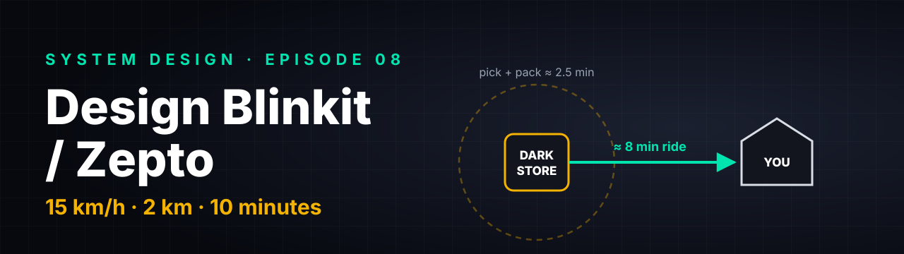
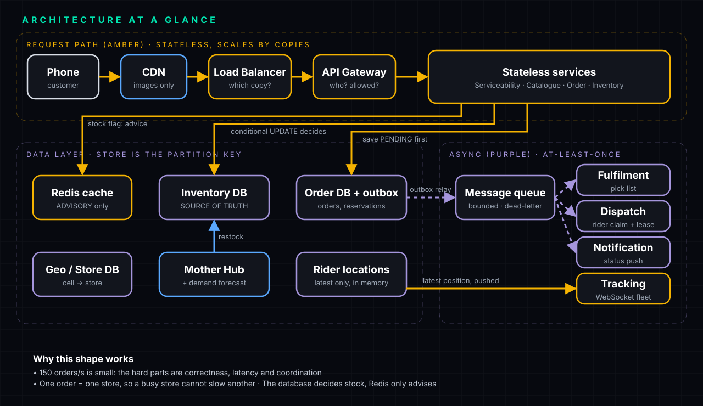
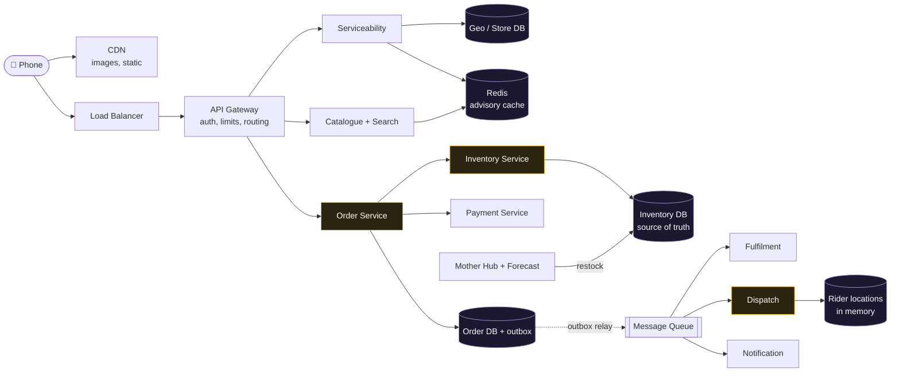
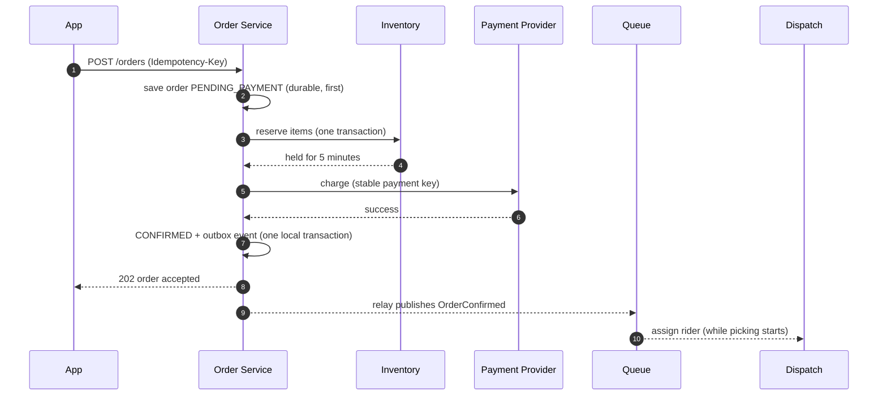
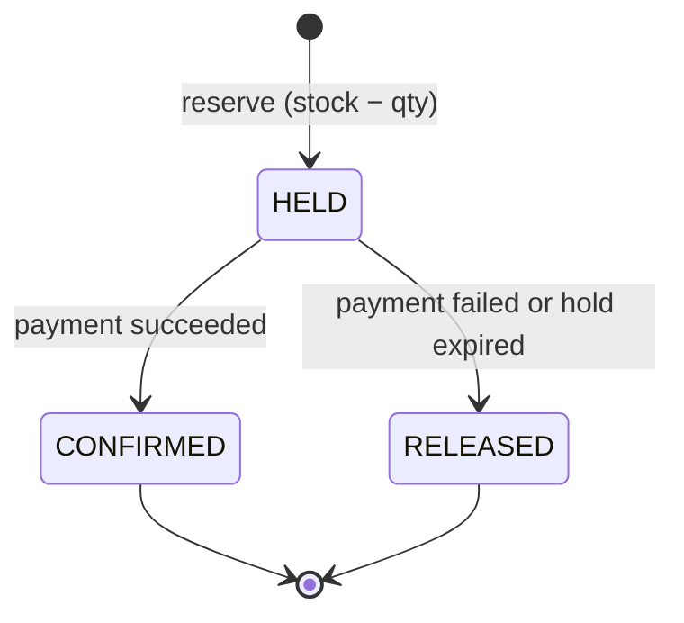
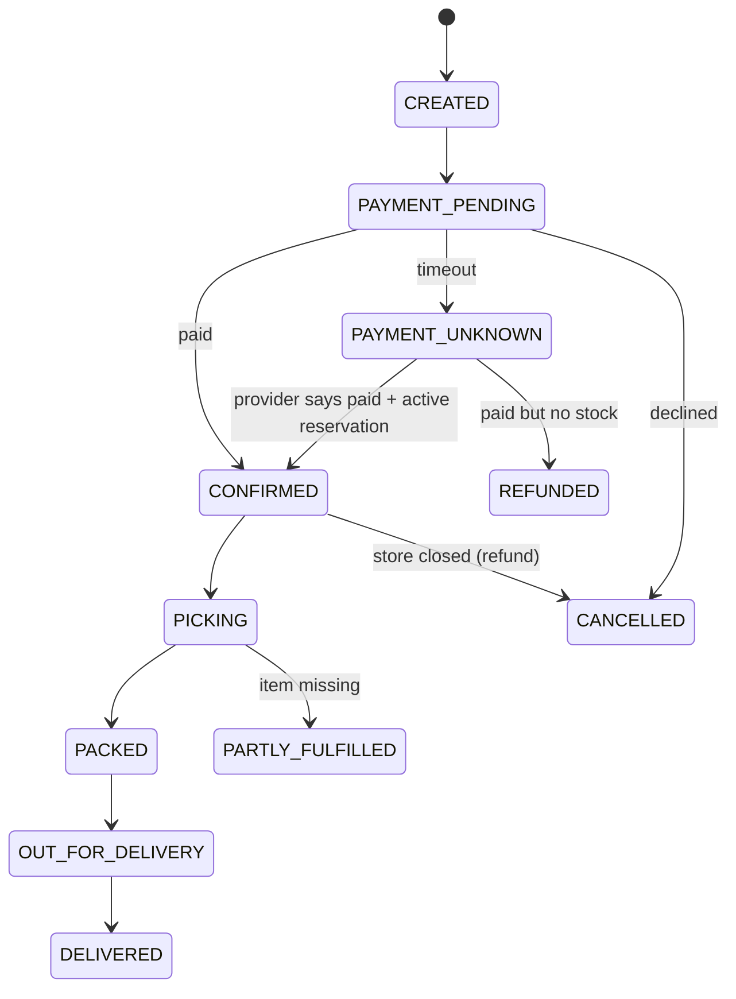

<p align="center"></p>

# Design Blinkit / Zepto (10-Minute Delivery)

**Quick-commerce · HLD walkthrough · Episode 08** · 🎬 [Video](#) · 🧑‍💻 [LLD companion (C#)](LLD.md)

> 🧭 **Where this fits.** Episode 07 (tickets) was *one seat, millions of people*. This one is *thousands of stores, each with a few thousand items, and a human on a scooter at the end*. It reuses the same safety idea (an **atomic conditional write**) but adds three new things interviewers love: **inventory as counts, a multi-step checkout (saga)**, and **a real-world dispatch problem**.

> [!IMPORTANT]
> Blinkit and Zepto have **not published** their full architecture. This note is "how *you* would design it" in an interview, using the few numbers they have shared (the CEO's pick-and-pack and ride times). Everything else is **our design** or **a stated assumption**. Interviewers want exactly that: clear assumptions, not pretend inside knowledge.

---

## 🧠 How to read this note

| Icon | Meaning |
|---|---|
| ⚡ | The short answer: say this first |
| 🧠 | **Mentor's note**: *why* something works |
| ✋ | **Pause and predict**: answer before opening the fold |
| 🎤 | An **interview line** you can say almost word for word |
| ⚠️ | A trap that costs offers |

---

## ⚡ The 60-second answer

1. **The speed is geography, not engineering.** A rider does about 15 km/h, so 10 minutes only works if the **store is within ~2 km**. Design for **one order = one nearby store**.
2. **The store is the main partition key** for inventory and fulfilment. A busy store cannot slow another.
3. **Front door:** CDN (static) → load balancer (which copy?) → API gateway (who are you, allowed?) → **stateless** services.
4. **Serviceability** = geo lookup (polygon / geohash / H3) → store, plus a *live* check (open? capacity?).
5. **Inventory lives in the database.** Reserve with one **conditional `UPDATE … WHERE available >= qty`** plus a reservation row, in **one transaction**. **Redis is advice, never the authority.**
6. **Checkout is a saga:** save `PENDING` first → reserve → charge with a **stable payment key** → confirm. Handle the *unknown* payment outcome. **Outbox** for events, **idempotent consumers**.
7. **Dispatch:** score nearby riders, **claim rider + order atomically** with a lease. **Assign while picking** (pipelining).
8. **Tracking:** latest position only, pushed over a WebSocket. **ETA = pick time left + ride.**
9. **When overloaded, refuse honestly** (pause a store) instead of promising 10 minutes you cannot keep.

---

## 📑 Contents

1. [Requirements](#1-requirements)
2. [Back-of-envelope numbers](#2-back-of-envelope-numbers)
3. [API](#3-api)
4. [Data model](#4-data-model)
5. [High-level design](#5-high-level-design)
6. [Deep dive A: the front door](#6-deep-dive-a-the-front-door)
7. [Deep dive B: serviceability and catalogue](#7-deep-dive-b-serviceability-and-catalogue)
8. [Deep dive C: inventory, never oversell](#8-deep-dive-c-inventory-never-oversell)
9. [Deep dive D: checkout, payment and the saga](#9-deep-dive-d-checkout-payment-and-the-saga)
10. [Deep dive E: queue, outbox, order state machine](#10-deep-dive-e-queue-outbox-and-the-order-state-machine)
11. [Deep dive F: picking and rider dispatch](#11-deep-dive-f-picking-and-rider-dispatch)
12. [Deep dive G: tracking and ETA](#12-deep-dive-g-live-tracking-and-eta)
13. [Deep dive H: what breaks (scaling and failure)](#13-deep-dive-h-what-breaks)
14. [Alternatives you should be able to discuss](#14-alternatives-you-should-be-able-to-discuss)
15. [Consistency map and failure cheat-sheet](#15-consistency-map-and-failure-cheat-sheet)
16. [Observability](#16-observability)
17. [Follow-up questions interviewers ask](#17-follow-up-questions-interviewers-ask)
18. [Common mistakes](#18-common-mistakes)
19. [How to present this in 45 minutes](#19-how-to-present-this-in-45-minutes)
20. [Test yourself](#20-test-yourself)

---

## 1. Requirements

**Always spend the first 3-5 minutes here.** Ask, then write down:

**Functional**
- See what is available **near my address** (catalogue per store), search, add to cart.
- Place an order, pay.
- A picker **picks and packs** in the store; a rider **delivers**.
- Customer **tracks** the order live.

**Non-functional (these shape the design)**

| Requirement | Why it matters |
|---|---|
| Delivery target ~10 min | Forces *one nearby store per order* |
| **Never oversell** | Money and trust: no "sorry, item unavailable" after paying |
| Always up (dinner, rain) | Stateless services, replicas, zones |
| Survives spikes (cricket final) | Queues, scaling, load shedding |
| Low latency browsing | Caches, per-store catalogue |

**Out of scope (say it out loud):** payment-provider internals, search ranking, dynamic pricing, rider pay, fraud, unit economics.

> 🎤 **Say it:** "I will assume one order is fulfilled from exactly one store, and that a store is the main unit I partition inventory and fulfilment by. Tell me if you want multi-store orders."

> 🧠 **Mentor's note: why "one store per order" is the key sentence.** It turns a national problem into thousands of tiny independent ones. Almost every later decision (sharding, hot spots, failure blast radius) follows from it.

---

## 2. Back-of-envelope numbers

State assumptions first. Only the first two lines are public; the rest are **ours**.

| Quantity | Value | How |
|---|---|---|
| Orders per year (Blinkit, reported FY26) | ~917 M | public figure |
| Orders per day | ~2.5 M (about 25 lakh) | 917 M ÷ 365 |
| **Average orders per second** | **~30/s** | 2.5 M ÷ 86,400 |
| **Peak orders per second** (assume 5× at evening) | **~150/s** | assumption |
| Product views per order | ~50 | assumption → reads:writes ≈ **50:1** |
| Riders online nationally | ~100,000 | assumption |
| Location pings | 100,000 ÷ 4 s = **25,000/s** | assumption |
| Order record size | ~2 KB | assumption |
| Order storage | 2.5 M × 2 KB ≈ **5 GB/day ≈ 1.8 TB/year** | |

### Throughput vs concurrency (a senior-level distinction)

- **Throughput** = orders per second (150/s at peak).
- **Concurrency** = orders *alive at once* (being picked, waiting for a rider, on the road).

By **Little's law**: alive orders = arrival rate × time in system = 150/s × ~600 s ≈ **90,000** orders alive nationally (illustration).

That number sizes the **state we hold** (tracking, assignments). It is **not** queue depth and **not** simultaneous checkout requests.

> 🧠 **Mentor's note: what these numbers tell you.**
> 150 orders/s is *small*. A single well-tuned database can take that. So the difficulty is **not raw throughput**. It is **correctness** (never oversell), **latency** (everything must be fast because the promise is 10 minutes) and **real-world coordination** (pickers and riders). Saying this aloud is what separates a senior answer from "add Kafka and shard everything".

> ✋ **Pause and predict.** Location pings are 25,000/s, far more than orders. Do you need a database that stores all of them forever?
> <details><summary>Answer</summary>No. You only need the <b>latest</b> position per rider to show the map and compute the ETA. Keep it in memory (Redis-like, overwritten each ping). If you want history for analytics, send a sampled stream to cheap storage asynchronously.</details>

---

## 3. API

Three calls cover the customer journey.

```http
GET  /serviceability?lat=28.61&lng=77.20          → { "store_id": 17, "open": true }
GET  /stores/17/catalogue?cursor=…                → items, prices, "in stock" flags
POST /orders
     Idempotency-Key: 7f3a9c…                     ← generated by the app, reused on retry
     { "store_id": 17, "items": [{"product_id": 9, "qty": 2}, …], "address_id": 55 }
→ 202 { "order_id": 4417, "status": "PENDING_PAYMENT" }
→ 409 { "unavailable": ["eggs"] }                 ← reserved nothing, nothing charged
```

Also: `GET /orders/{id}` (poll fallback), and a **WebSocket** `/orders/{id}/stream` for live status and rider position.

> 🧠 **Mentor's note: why `202`, not `201`.** Placing an order kicks off a *process* (payment, picking). The request returns once the order is **durably accepted**, not finished. Status then flows over the stream.

> 🎤 **Say it:** "The `POST` carries an idempotency key. If the network drops and the app retries, it gets the same order back, never a second one."

---

## 4. Data model

The access patterns decide the storage. **Inventory, reservations and orders need transactions and constraints → relational.** Rider location is overwritten constantly → key-value in memory. Search → a search index.

```sql
-- Who and where
CREATE TABLE stores (
  store_id     INT PRIMARY KEY,
  city_id      INT NOT NULL,
  status       VARCHAR(10) NOT NULL,       -- OPEN | CLOSED | PAUSED
  service_area GEOGRAPHY                   -- polygon (or a set of H3 cells)
);

CREATE TABLE products (
  product_id BIGINT PRIMARY KEY,
  name       VARCHAR(200) NOT NULL,
  price_paise INT NOT NULL                 -- store money as integers, never floats
);

-- THE heart of the system: one row per store+product
CREATE TABLE store_inventory (
  store_id    INT    NOT NULL,
  product_id  BIGINT NOT NULL,
  available   INT    NOT NULL CHECK (available >= 0),   -- DB refuses negative stock
  version     BIGINT NOT NULL DEFAULT 0,
  PRIMARY KEY (store_id, product_id)
);

-- A hold on stock for one order (see section 8)
CREATE TABLE reservations (
  reservation_id BIGINT PRIMARY KEY,
  order_id    BIGINT NOT NULL,
  store_id    INT    NOT NULL,
  product_id  BIGINT NOT NULL,
  qty         INT    NOT NULL,
  status      VARCHAR(10) NOT NULL,        -- HELD | CONFIRMED | RELEASED
  expires_at  TIMESTAMP NOT NULL,
  UNIQUE (order_id, product_id)            -- one reservation per item per order
);

CREATE TABLE orders (
  order_id     BIGINT PRIMARY KEY,
  customer_id  BIGINT NOT NULL,
  store_id     INT    NOT NULL,
  status       VARCHAR(20) NOT NULL,       -- state machine (section 10)
  version      INT    NOT NULL DEFAULT 0,  -- optimistic guard: no moving backwards
  payment_key  VARCHAR(64) NOT NULL,       -- stable, derived from order_id
  idem_key     VARCHAR(64) NOT NULL,
  created_at   TIMESTAMP NOT NULL,
  UNIQUE (customer_id, idem_key)           -- the idempotency guarantee, enforced by the DB
);

CREATE TABLE order_items (
  order_id BIGINT NOT NULL, product_id BIGINT NOT NULL, qty INT NOT NULL, price_paise INT NOT NULL,
  PRIMARY KEY (order_id, product_id)
);

-- Outbox: events written in the SAME transaction as the order change (section 10)
CREATE TABLE outbox (
  event_id BIGINT PRIMARY KEY, order_id BIGINT NOT NULL, type VARCHAR(30) NOT NULL,
  payload JSON NOT NULL, published BOOLEAN NOT NULL DEFAULT FALSE
);

-- Consumers remember what they already handled
CREATE TABLE processed_events (
  consumer VARCHAR(30) NOT NULL, event_id BIGINT NOT NULL,
  PRIMARY KEY (consumer, event_id)
);

-- Rider assignment (section 11)
CREATE TABLE riders (
  rider_id BIGINT PRIMARY KEY, status VARCHAR(10) NOT NULL,   -- FREE | CLAIMED | BUSY
  active_orders INT NOT NULL DEFAULT 0
);
CREATE TABLE assignments (
  order_id BIGINT NOT NULL, rider_id BIGINT NOT NULL,
  status VARCHAR(10) NOT NULL,             -- OFFERED | ACCEPTED | RELEASED | DONE
  lease_expires_at TIMESTAMP NOT NULL
);
CREATE UNIQUE INDEX ux_one_active_assignment ON assignments (order_id) WHERE status IN ('OFFERED','ACCEPTED');
```

**Not in SQL:** rider's *latest* location (in-memory key-value, keyed by `rider_id` + area cell), cart (key-value with a TTL), catalogue search (search index filtered by `store_id`).

### Partition keys (a favourite probe)

| Data | Key | Why |
|---|---|---|
| Inventory, reservations, fulfilment | **`store_id`** | The store is the unit of contention |
| Order history | `customer_id` | "my orders" query |
| Rider location | `rider_id` / area cell | Read by area and by rider |
| Order events | `order_id` | Keep one order's events ordered |

> ⚠️ **Trap.** Saying "shard everything by store" is wrong. Order history by `store_id` makes "show me my orders" a scatter-gather. **Different data, different keys.**

---

## 5. High-level design

<p align="center"></p>



### One order's journey



---

## 6. Deep dive A: the front door

Build it in the order a request travels.

1. **CDN.** Product photos, icons, app static files. They don't change by the minute, so serve copies from servers near the customer. **Never cache live stock** here: it changes every second.
2. **Load balancer.** Job: **capacity**. Spread requests across identical copies of the next layer and quietly stop sending to unhealthy ones.
3. **API gateway.** Job: **policy**. Authenticate, **rate limit** (one buggy app or bot cannot flood us), route to the right service. Services don't repeat this work.
4. **Stateless services.** Hold nothing about the customer in memory. All state is in the data layer. So you can **add or remove copies freely** as traffic changes.

> 🎤 **Say it:** "The load balancer answers *which copy?* The gateway answers *which service, and are you allowed?*"

> ✋ **Pause and predict.** Why must the services be stateless for autoscaling to work?
> <details><summary>Answer</summary>If a copy held a customer's cart or session in its own memory, removing that copy would lose it, and the load balancer would have to always send that customer to the same copy ("sticky"). With state in a shared store, any copy can serve any request, so copies are interchangeable and disposable.</details>

---

## 7. Deep dive B: serviceability and catalogue

### Which store serves this address?

Each store has a **service area**: a polygon, or a set of small grid cells. A lookup finds which area contains the customer.

| Index | One-line idea | Good for |
|---|---|---|
| **Polygon** (point-in-polygon) | Exact shape of the delivery area | Precise, but slower per lookup |
| **Geohash** | Interleave lat/lng bits into a string; shared prefix = nearby | Simple, prefix lookups; cells are rectangles |
| **H3** (hexagons) | Hexagon cells, uniform neighbour distances | Distance logic, "nearby cells" queries |

In our design: **address → cell → store**. If no area contains it, the app says "not delivering here yet".

**Stable vs dynamic.** The *mapping* (cell → store) almost never changes, so cache it hard. Whether the store can serve you *right now* (open? paused? has pickers free?) is **dynamic**, so check it live or cache for seconds at most.

> 🧠 **Mentor's note.** Real platforms may weigh several nearby stores by stock, distance and load. Say it's a simplification, and move on. Don't spend ten minutes on geometry.

### Where does a cache go?

**Cache-aside**: look in the cache; on a miss read the DB and save the answer for next time. A cache belongs **in front of data that is read far more often than it changes**: store mapping, product details, search results.

### Catalogue and search

- Catalogue is **per store**: that's why it changes when you change your address.
- Static details (name, description, image) are the same for everyone → **cache hard**.
- **Stock flag changes fast** → short TTL, shown as **advice, not a promise**.
- Search: one index, **filtered by `store_id`**. Ranking is out of scope.

### The cart

A fast key-value store with a TTL. **Adding to cart reserves nothing.** People add and abandon all day; reserving at add-to-cart would lock the shelves. Reserve at **checkout**.

---

## 8. Deep dive C: inventory, never oversell

> This is the part to nail. It's the same family as SD-07 (ticket booking), but with **counts** instead of unique seats.

### The problem

Two people order the last packet of milk, same store, same second. Both saw "in stock". Both pay. One gets a "sorry" call. **Check-then-act is a race.**

### The fix: one conditional update, in the database

```sql
-- Reserve 1 unit. Succeeds only if enough stock exists RIGHT NOW.
UPDATE store_inventory
   SET available = available - 1, version = version + 1
 WHERE store_id = 17 AND product_id = 9 AND available >= 1;
-- rows affected = 1 → you got it.   rows affected = 0 → sold out, refuse.

INSERT INTO reservations (…, status, expires_at)
VALUES (…, 'HELD', now() + interval '5 minutes');
```

Both statements run in **one transaction**: both happen or neither. The database serialises updates to the *same row*, so two buyers cannot both win. The `CHECK (available >= 0)` is a second safety net.

> 🧠 **Mentor's note: why this is better than "read, then write".**
> The test (`available >= 1`) and the change (`- 1`) happen **inside one atomic statement**. There is no gap between checking and acting for another request to slip into. This single idea answers a huge share of "prevent overselling" questions.

### Several items in one order

Reserve every item in **one transaction**, all or nothing. Lock rows in a **consistent order (sorted by `product_id`)**. Otherwise two orders that want {milk, bread} and {bread, milk} can deadlock, each holding the row the other needs. (Same lesson as sorted seat locks in the ticket note.)

### The reservation is a hold with an expiry



**Release exactly once.** The cleanup job runs:

```sql
UPDATE reservations SET status = 'RELEASED' WHERE reservation_id = ? AND status = 'HELD';
-- only if rows affected = 1, add the quantity back to store_inventory (same transaction)
```

Because it only works on a hold that is *still* `HELD`, running it twice, or racing with a confirm, can never return the unit twice.

### Where does Redis fit?

Browse screens read stock from a cache. That cache is **advisory**: it can be seconds stale, and if it says "in stock" when it isn't, the real reservation just says no. **Redis never decides who gets the milk.**

Keeping reservations *only* in Redis is possible, but then they must be durable, replicated and reconciled with the DB. That's a harder design; mention it as an alternative, don't default to it.

### Reality checks

- **Shelf vs system drift.** Items get damaged or misplaced. Stores do **cycle counts** (count a few shelves daily); a mismatch corrects the count **with an audit row**.
- **Restocking.** Forecast demand per store (household essentials are predictable), and a central **Mother Hub** warehouse moves stock to stores before the crowd arrives. Forecasting is a batch/ML job that *writes inventory targets*; it is not on the order path.
- **Hot item.** One viral item in one store serialises on one row. The update stays *correct*, only slower. **Measure first.** Only if it's the proven bottleneck, split that stock into separate **buckets** (e.g. 3 + 3 + 2 units), each its own row, so no unit lives in two buckets. A buyer tries one bucket, then another.

> ✋ **Pause and predict.** The cache says "milk: 5". The DB says 0. A customer taps "Place order". What happens, and is any money lost?
> <details><summary>Answer</summary>The conditional update finds <code>available = 0</code>, affects zero rows, and the order is refused <b>before payment</b>. No money moved. The stale cache only cost the customer a disappointing screen, never a wrong sale. That's the entire point of treating the cache as advice.</details>

---

## 9. Deep dive D: checkout, payment and the saga

Three services must agree: **inventory, payment, order**. They cannot share one database transaction (payment is an external provider).

### Saga: a chain of local steps, each with an undo

| Step | Action | Compensation (undo) |
|---|---|---|
| 1 | Save order `PENDING_PAYMENT` (**first**, before anything external) | Mark `CANCELLED` |
| 2 | Reserve stock | Release the hold |
| 3 | Charge, with a **stable payment key** from the order id | Refund |
| 4 | Confirm: `CONFIRMED` + outbox event | n/a |

> 🧠 **Mentor's note: why save `PENDING` first.** If we charge and *then* crash before recording anything, we have taken money for an order that doesn't exist. Writing the intent first means recovery always has a record to work from.

### Payment has three outcomes

1. **Success** → confirm the hold, continue.
2. **Definite failure** (declined card) → release the hold, cancel.
3. **Unknown** (timeout: we don't know) → the dangerous one.

For **unknown**, set the order `PAYMENT_UNKNOWN`. Keep the hold and **retry or query the provider with the same payment key** (the key makes a retry safe: the provider will not charge twice).

### The subtle trap: an expired hold

The hold has an expiry. Suppose payment is still *unknown*, the hold expires and is released, and **then** the payment turns out to have succeeded. That expired reservation **cannot be confirmed** (it's `RELEASED`; the unit may be gone).

Reconciliation then does one of two things:
1. **Take a fresh reservation** if stock is still available, and confirm; or
2. **Refund the payment** if it isn't.

Never "confirm the expired hold".

> 🎤 **Say it:** "I save the order first, charge with a stable key, and treat a timeout as *unknown*, not *failed*. A reconciliation job resolves unknowns by asking the provider. An expired hold can't be confirmed; we either re-reserve or refund."

---

## 10. Deep dive E: queue, outbox and the order state machine

### The outbox: atomic *for our own writes*

Problem: update the order **and** announce it on a queue. If we write the DB then crash before publishing, the event is lost. If we publish first then the DB write fails, we announced something false.

Solution: in **one local transaction**, write the order change **and** an `outbox` row. A separate **relay** reads unpublished rows and publishes them.

> ⚠️ **Trap.** The outbox makes *our database and our event* atomic. It does **not** make an *external payment* and our database atomic. That is what the saga and reconciliation are for.

### The relay can publish twice

So every consumer is **idempotent**: it records handled event ids in durable storage (`processed_events`, with `PRIMARY KEY (consumer, event_id)`) and ignores repeats. This is "at-least-once delivery + idempotent consumers", the practical stand-in for exactly-once.

### Order state machine



**Every move is a conditional update** (`WHERE status = 'PICKING' AND version = 7`). An old or duplicate event can therefore never move an order backwards.

### The queue

After confirm, an event goes to a **message queue**; fulfilment, dispatch and notifications consume it.

- A queue **smooths a burst**. It does **not create capacity**: if orders arrive faster than stores pick, it just grows.
- So: **bound it**, **push back** when it's too long, watch the **age of the oldest message**, and send repeat failures to a **dead-letter queue** for repair.

---

## 11. Deep dive F: picking and rider dispatch

### Pick list

Sort items by **where they sit in the store** so the picker walks one path, no backtracking. If something is missing: mark it, **substitute or refund that line**, and correct the stock count.

### Assigning a rider

1. Riders are indexed by location (same map-cell idea as stores).
2. For an accepted order, find free riders at or near the store.
3. **Score**: available? current load? how soon can they reach the store?
4. Rule of thumb: don't stack a third order on a rider unless no one else is free.

### The claim must guard BOTH sides

The rider must still be **free** and the order must still be **unassigned**. So the claim is **one transaction** (or one coordinated conditional write) that sets both, with a uniqueness rule: **one active assignment per order** (see the partial unique index in §4).

If two dispatch workers race, one commits, the other fails the guard and moves on to another rider. A **lease** covers the rider's acceptance window: if it runs out, the claim is released and the next rider is tried. The lease handles *recovery*; the uniqueness rule is the *final judge*.

### Pipelining: assign while picking

Start the rider travelling to the store while the picker is still picking. When the bag is sealed, the rider is already there. The ride still starts only when the bag is sealed; **what disappears is the waiting in between**.

> 🧠 **Mentor's note.** This is the real "10 minutes" trick on the software side. You can't make the scooter faster. You can only **remove waiting**.

> ✋ **Pause and predict.** Two dispatch workers pick the *same* free rider for two *different* orders at the same instant. What stops a double booking?
> <details><summary>Answer</summary>The claim guards the <b>rider</b> too: <code>UPDATE riders SET status='CLAIMED' WHERE rider_id=? AND status='FREE'</code>. Only one affects a row. The loser sees zero rows, fails, and tries the next-best rider.</details>

---

## 12. Deep dive G: live tracking and ETA

- Riders send location every ~4 s. Keep **only the latest** per rider in memory, keyed by rider and area (not by store).
- The customer's app holds a **WebSocket**; the server pushes each new position.
- **ETA = pick time remaining + ride time to your door.** The picker queue matters as much as the road.
- Statuses can arrive out of order, so **each carries a version number**; the app ignores anything older.

> 🧠 **Mentor's note: WebSocket vs polling.** Polling every 4 s from millions of phones is wasteful (most polls return "no change"). A WebSocket (one held connection) lets the server push only when something changes. The trade-off: the server must keep many open connections, so those gateways are a separate fleet you scale on connection count.

**Do the sum, honestly:** about 2.5 min picking + about 8 min riding ≈ 10.5 minutes, **and those are averages**. 10 minutes is a **target**, not a guarantee.

---

## 13. Deep dive H: what breaks

| Event | What happens | Answer |
|---|---|---|
| **Traffic triples** (cricket final) | Stateless services scale by adding copies. A *store* can't scale by copies. | Scale by having more stores; store is the partition boundary, so a busy store can't drag down another. A very hot store needs its own extra capacity. |
| **Redis dies** | Browse is slower; stock read from the DB. | **No sale is ever wrong**, because the cache was only advice. |
| **Cache empty after restart** | Every request hits the DB at once: a **cache stampede**. | Warm it first; let **only one request refill** each key. |
| **DB primary fails** | Failover to a replica. | **Async replication** may lose the last acknowledged writes; **sync** avoids loss but every write waits. Decide your **RPO** (acceptable loss) and **RTO** (recovery time). Ensure only **one primary** after failover. |
| **A store is overwhelmed** | Pickers can't keep up. | **Pause new orders** from that store or hide slow-to-pick items. Honest beats broken. |
| **Whole city cluster fails** | Blast radius. | Run each city as an **independent cluster**. |

### Strict where it costs money, relaxed everywhere else

| Strong consistency | Eventual is fine |
|---|---|
| Stock, reservations, orders, payments | Catalogue, images, search, tracking |

> 🎤 **Say it:** "Stock and orders must be strongly consistent. A catalogue a few seconds old is fine. I'm deliberately spending consistency only where it protects money."

---

## 14. Alternatives you should be able to discuss

| Question | Our choice | Alternative | When the alternative wins |
|---|---|---|---|
| Source of truth for stock | Relational DB, conditional update | Reservations in Redis/memory | Extreme write rates *and* you accept building durability + reconciliation |
| Cross-service checkout | Saga (compensations) | Two-phase commit | Almost never across an external payment provider |
| Event delivery | Outbox + queue | Direct publish from the service | Only if losing an event is acceptable |
| Dispatch | Score + atomic claim | Global optimiser (batch matching) | Very high order density; batch every few seconds for better global assignment |
| Tracking | WebSocket push | Polling | Tiny scale, simplicity |
| Rider location store | In-memory latest value | Time-series DB | When you need history/analytics |
| Partition | Store | Geographic cell | When stores overlap heavily |

---

## 15. Consistency map and failure cheat-sheet

| Failure | Result | Protected by |
|---|---|---|
| Two buyers, last unit | One wins, one refused before payment | Conditional `UPDATE … available >= qty` |
| App retries `POST /orders` | Same order returned | `UNIQUE (customer_id, idem_key)` |
| Payment times out | `PAYMENT_UNKNOWN`, no double charge | Stable payment key + reconciliation |
| Hold expires during unknown payment | Re-reserve or refund | Expired hold can't be confirmed |
| Relay publishes event twice | Handled once | `processed_events` |
| Old status arrives late | Ignored | Version check |
| Two dispatchers pick one rider | One wins | Guard on rider **and** order, unique active assignment |
| Redis down | Slower browse, no wrong sale | Cache is advisory |
| Pickers overloaded | Honest pause / longer ETA | Load shedding |

---

## 16. Observability

Track **percentiles (p95 / p99), not averages.** Key signals:

- **Checkout success rate** and reservation-failure rate
- **Oversell count (must be 0)**
- **Queue depth and oldest-message age**
- **Pick time** and **rider assignment time**
- **ETA error** (predicted vs actual)
- **Share of orders delivered inside the promise**
- Cache hit rate; DB replication lag

> 🎤 **Say it:** "If I can't measure it I can't defend it. The headline SLO is the share of orders inside the promise, and I'd alert on queue age before customers feel it."

---

## 17. Follow-up questions interviewers ask

<details><summary><b>1. Payment succeeded but our write failed. What now?</b></summary>
The pending order was saved first, so recovery looks it up and asks the provider using the same payment key. If paid: fulfil it (re-reserving if the hold lapsed) or refund. Nothing is lost because intent was durable before the charge.
</details>

<details><summary><b>2. The picker can't find an item, or the system says 3 and the shelf says 0?</b></summary>
Mark it missing, offer a substitute or refund that line, and correct the stock count with an audit entry. Repeated mismatches trigger a cycle count.
</details>

<details><summary><b>3. SQL or NoSQL?</b></summary>
By access pattern. Inventory, reservations, orders need transactions and constraints: relational. Location pings: fast key-value. Search: a search index. The cache is only a cache.
</details>

<details><summary><b>4. The rider cancels or never shows up?</b></summary>
The claim's lease expires, the assignment is released, dispatch tries the next rider. For a delivered-late order, notify with an honest new ETA.
</details>

<details><summary><b>5. Two stores could serve the same customer?</b></summary>
Score them on stock for the whole cart, distance and current load; pick one per order. Reserve only at the chosen store.
</details>

<details><summary><b>6. A rush on one item in one store?</b></summary>
The conditional update stays correct but one hot row serialises. Measure first. If proven, split stock into disjoint buckets in separate rows; a buyer tries one bucket, then another.
</details>

<details><summary><b>7. Peak hour and pickers can't keep up?</b></summary>
Prioritise earliest promise first. If still behind, show a longer estimate honestly or pause the store, rather than fail quietly.
</details>

<details><summary><b>8. How do you know it works?</b></summary>
Rehearse. Replay a busy evening against a copy of the system. Watch p95/p99 latency, checkout success, queue age, ETA error, oversell = 0.
</details>

<details><summary><b>9. How would you add a "scheduled delivery" or "reorder" feature?</b></summary>
Scheduled orders skip the live 10-minute path: store the intent, and at (slot minus buffer) run the normal reserve-and-dispatch flow. The scheduler is a durable job, not an in-memory timer. Reserve stock late (near the slot) to avoid locking shelves for hours.
</details>

<details><summary><b>10. Coupons and surge pricing: where do they plug in?</b></summary>
Pricing is computed in the order service *before* the charge and **stored on the order** (`order_items.price_paise`), so the price the customer saw is the price charged. Coupon use is itself a race ("one per user"): enforce it with the same pattern, a unique constraint or conditional update.
</details>

<details><summary><b>11. How would you design the "out of stock → show restock ETA" feature?</b></summary>
Hide vs show is a product trade-off (honest vs keeps the sale). Technically: the catalogue reads a per-store restock ETA written by the replenishment pipeline; it's advisory data, cached briefly.
</details>

<details><summary><b>12. Multiple cities, one global user. Where does their data live?</b></summary>
Customer profile and order history are keyed by customer and replicated; each city cluster owns its inventory, fulfilment and dispatch. A request is routed to the cluster of the store chosen at serviceability.
</details>

---

## 18. Common mistakes

1. Drawing 15 boxes before asking a single requirement question.
2. Putting Redis as the **authority** for stock.
3. Check-then-write for stock (a race), instead of a **conditional update**.
4. Charging **before** saving the order.
5. Treating a payment **timeout** as a failure (leads to double charges or lost orders).
6. Forgetting **idempotency** on `POST /orders` and on consumers.
7. Claiming a queue "adds capacity".
8. Sharding *everything* by one key.
9. Promising 10 minutes under overload instead of **degrading honestly**.
10. Talking about technology names but never the **reason**.

---

## 19. How to present this in 45 minutes

| Minutes | Do | Say |
|---|---|---|
| 0-5 | Requirements, out of scope, assumptions | "One order, one nearby store." |
| 5-10 | Numbers, API, schema (store key) | "Throughput is small. Correctness is the hard part." |
| 10-18 | Draw the diagram, front door to services | LB vs gateway one-liner |
| 18-30 | Deep dives: **inventory** → **checkout saga** → dispatch | Conditional update; stable key; atomic claim |
| 30-38 | What breaks: spikes, cache down, replication | Strong vs eventual; refuse honestly |
| 38-45 | Follow-ups, metrics, recap | "Nothing here is fast. It's close, or early." |

> 🎤 **Close with:** "Ten minutes isn't a speed. It's a map."

---

## 20. Test yourself

<details><summary><b>Q1. Why is "one order, one store" the key assumption?</b></summary>
It splits a national problem into thousands of small independent ones, makes the store the partition boundary, and keeps the ride within ~2 km, which makes ten minutes feasible at all.
</details>

<details><summary><b>Q2. Write the SQL that reserves stock safely.</b></summary>
<code>UPDATE store_inventory SET available = available - :q WHERE store_id = :s AND product_id = :p AND available >= :q;</code> then check rows affected = 1. Plus a reservation insert, in one transaction.
</details>

<details><summary><b>Q3. Why is the saga's first step "save PENDING"?</b></summary>
So there is always a durable record before any external side effect. Without it, a crash after charging leaves money taken and nothing to reconcile against.
</details>

<details><summary><b>Q4. What does the outbox solve, and what does it NOT solve?</b></summary>
Solves: our DB change and our event are atomic. Does not solve: atomicity with an external payment provider (that's the saga + reconciliation). It also doesn't prevent duplicate publishes (that's consumer idempotency).
</details>

<details><summary><b>Q5. Payment times out. What is the order's state and what runs next?</b></summary>
<code>PAYMENT_UNKNOWN</code>. Hold stays. Retry or query the provider with the same payment key. If it turns out paid after the hold expired: re-reserve if stock exists, else refund.
</details>

<details><summary><b>Q6. Redis is down. Can you oversell?</b></summary>
No. Redis is only an advisory read cache; the DB conditional update decides. Browsing gets slower.
</details>

<details><summary><b>Q7. Why guard both rider and order in assignment?</b></summary>
Guarding only the order allows one rider to be double-booked by two orders; guarding only the rider allows one order to get two riders. One transaction with both guards, plus a unique active assignment per order, closes both.
</details>

<details><summary><b>Q8. Why can't a queue save you from overload?</b></summary>
It only smooths bursts. If arrival rate exceeds processing rate, it grows forever. Bound it, push back, watch oldest-message age, dead-letter failures, and shed load.
</details>

<details><summary><b>Q9. Why track latest rider position only?</b></summary>
Only the current position drives the map and ETA; storing all 25,000 pings/s forever is expensive and unnecessary. Overwrite in memory; sample to cold storage if analytics need history.
</details>

<details><summary><b>Q10. Which data is strongly consistent, which eventual?</b></summary>
Strong: stock, reservations, orders, payments. Eventual: catalogue, images, search, tracking.
</details>

---

**Next:** try the [LLD companion](LLD.md) (C#): the same inventory reservation, order state machine and rider claim, as classes. Then compare with [Ticket booking](../sd-07-ticket-booking/HLD.md): same atomic-write idea, different shape.
