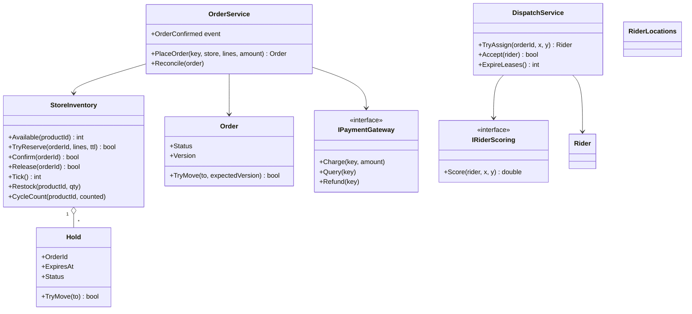
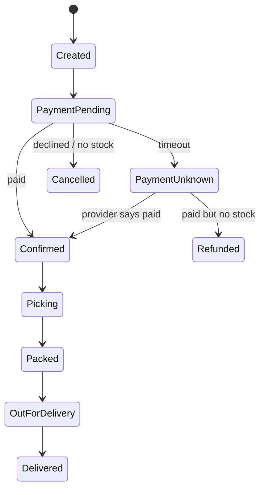

# LLD — Design a Quick-Commerce Order Flow (C#)

**Low-level design · Blinkit / Zepto style · companion to [the HLD note](HLD.md)**

> [!IMPORTANT]
> **HLD asked:** "what are the boxes?" **LLD asks:** "what are the *classes inside three of those boxes*, and how do they stay correct when threads race?" In an interview you will rarely be asked to code the whole app. You will be asked to model **inventory, the order lifecycle, and rider assignment**: exactly the three pieces here.

---

## ⚡ The 60-second answer

1. **Clarify scope:** one store, order with several items, pay, pick, assign rider. No UI, no real payment.
2. **Nouns → classes:** `StoreInventory`, `Hold`, `Order`, `OrderService`, `Rider`, `DispatchService`.
3. **Stock reservation is plan-then-apply under locks**: check every line first, then subtract, so it's **all-or-nothing**. Lock products in **sorted order** to avoid deadlock.
4. **A hold has an expiry and moves out of `Held` exactly once**, so stock is released once, never twice.
5. **`Order` is a state machine with a version.** A legal-moves table plus a version check rejects duplicate or old events.
6. **Checkout is a saga**: record `PaymentPending` first → reserve → charge with a **stable key** → confirm. `Unknown` payment is its own state.
7. **Idempotency** with `ConcurrentDictionary<string, Lazy<Order>>`: the same key always gives the same order.
8. **Rider claim guards both sides** (rider is free **and** order unassigned) under one lock. A **lease** recovers abandoned claims.
9. **Strategy** for rider scoring, **Observer** for "order confirmed", **interfaces** (`IClock`, `IPaymentGateway`) for testability.

---

## 📑 Contents
- [🧭 Primer: the new ideas in plain English](#-primer-the-new-ideas-in-plain-english)
0. [The interview-sized version (write this live)](#0-the-interview-sized-version-write-this-live)
1. [What interviewers look for](#1-what-interviewers-look-for)
2. [Requirements and scope](#2-requirements-and-scope)
3. [Nouns → classes (diagram)](#3-nouns--classes)
4. [Design decisions](#4-design-decisions)
5. [Guided tour of the full code](#5-guided-tour-of-the-full-code)
6. [Concurrency: in-process vs real database](#6-concurrency-in-process-vs-real-database)
7. [Run it](#7-run-it)
8. [Extension questions](#8-extension-questions)
9. [Common mistakes](#9-common-mistakes)
10. [Pacing a 45-minute LLD round](#10-pacing-a-45-minute-lld-round)
11. [Test yourself](#11-test-yourself)

> 📌 **Already did [SD-07 LLD](../sd-07-ticket-booking/LLD.md)?** Good: the lock-in-sorted-order, State and `Lazy` ideas are explained there in detail. This note only explains what is **new**: counted stock, versioned state, leases, and the two-sided claim.

---

## 🧭 Primer: the new ideas in plain English

| Idea | Everyday picture | In the code |
|---|---|---|
| **Plan, then apply** | Check the whole shopping list is on the shelf *before* you put anything in the basket | Loop 1 checks, loop 2 subtracts |
| **Conditional update** | "Take one *only if* there is one" as a single indivisible action | `if (available >= qty) available -= qty` inside a `lock` |
| **Version guard** | A form stamped "edition 3". If you hold edition 2, it's out of date: don't act on it | `Order.TryMove(to, expectedVersion)` |
| **Hold with expiry** | A shop assistant keeps your item behind the counter for 5 minutes | `Hold` + `ExpiresAt` + `Tick()` |
| **Move exactly once** | A ticket that can be torn up only one time | `Hold.TryMove` returns `true` for one caller only |
| **Stable payment key** | A receipt number: asking again about "receipt 4417" never charges again | `$"pay-{order.Id}"` |
| **Lease** | Borrowing a library book for 15 seconds. Don't return it? It goes back on the shelf | `Rider.LeaseExpiresAt` + `ExpireLeases()` |
| **Two-sided claim** | A wedding match needs both people to say yes *at the same moment* | `Claim()`: rider free **and** order free, one lock |

> ✋ **Pause and predict.** Why does `TryReserve` do *two loops* (check all, then subtract all) instead of "check and subtract each line as you go"?
> <details><summary>Answer</summary>If line 1 (milk) is subtracted and then line 2 (eggs) fails, you have already taken the milk and must undo it. Undo code is easy to get wrong and another thread could see the half-done state. Checking everything first, while holding all the locks, means the subtraction loop <b>cannot fail</b>. That's "all or nothing" without any undo logic.</details>

---

## 0. The interview-sized version (write this live)

~80 lines. It keeps the *three ideas that earn marks* and drops everything else. Start with **one lock** and say you'd refine it later.

```csharp
public sealed record OrderLine(string ProductId, int Qty);

// ---------- 1. Inventory: all-or-nothing reserve ----------
public sealed class Inventory
{
    private readonly Dictionary<string, int> _stock;     // productId -> available
    private readonly object _gate = new();               // ONE lock for the whole store (simple; refine later)
    public Inventory(Dictionary<string, int> stock) => _stock = stock;

    public bool TryReserve(IReadOnlyList<OrderLine> lines)
    {
        lock (_gate)                                      // only one thread inside at a time
        {
            foreach (var l in lines)                      // PLAN: just look
                if (!_stock.TryGetValue(l.ProductId, out var have) || have < l.Qty) return false;

            foreach (var l in lines)                      // APPLY: cannot fail now
                _stock[l.ProductId] -= l.Qty;
            return true;
        }
    }

    public void Release(IReadOnlyList<OrderLine> lines)  // call ONLY for a reservation that is still active
    {
        lock (_gate) foreach (var l in lines) _stock[l.ProductId] += l.Qty;
    }
}

// ---------- 2. Order: state machine + version ----------
public enum Status { Pending, Confirmed, Cancelled, Delivered }

public sealed class Order
{
    private readonly object _gate = new();
    public Status Status { get; private set; } = Status.Pending;
    public int Version { get; private set; }

    private static readonly Dictionary<Status, Status[]> Allowed = new()
    {
        [Status.Pending]   = [Status.Confirmed, Status.Cancelled],
        [Status.Confirmed] = [Status.Delivered, Status.Cancelled],
        [Status.Delivered] = [], [Status.Cancelled] = [],
    };

    public bool TryMove(Status to, int expectedVersion)
    {
        lock (_gate)
        {
            if (Version != expectedVersion || !Allowed[Status].Contains(to)) return false; // stale or illegal
            Status = to; Version++; return true;
        }
    }
}

// ---------- 3. Rider claim: guard BOTH sides ----------
public sealed class Rider { public readonly object Gate = new(); public bool Free = true; public string? OrderId; }

public sealed class Dispatch(IReadOnlyList<Rider> riders)
{
    private readonly HashSet<string> _assignedOrders = new();   // "one rider per order"
    private readonly object _ordersGate = new();

    public Rider? Assign(string orderId)
    {
        foreach (var r in riders)
        {
            lock (r.Gate)                                         // guard 1: rider still free?
            {
                if (!r.Free) continue;
                lock (_ordersGate)                                // guard 2: order still unassigned?
                {
                    if (!_assignedOrders.Add(orderId)) return null;   // someone beat us to this order
                }
                r.Free = false; r.OrderId = orderId; return r;
            }
        }
        return null;
    }
}
```

**Then say out loud:**
- "One global lock is fine for a first version. In production the lock becomes **a database row**, one row per (store, product), so stores don't block each other."
- "Hold expiry, payment, saga and idempotency: I'd add those next." (Offer them; don't write them unless asked.)
- "I haven't made `Release` safe against double-calls; the full version moves a `Hold` out of `Held` exactly once."

> 🧠 **Mentor's note.** Interviewers aren't grading volume. They watch for: did you **clarify**, did you pick **sensible classes**, did you spot the **race** and explain the fix, and can you **extend** it. This ~80 lines is enough to show all four.

---

## 1. What interviewers look for

| Signal | How to show it |
|---|---|
| Requirement clarity | Ask: one store or many? Partial fulfilment? Is payment real? |
| Modelling | Small classes with one job each: inventory, order, rider, dispatch |
| **Concurrency awareness** | Name the race (two buyers, last unit) *before* being asked |
| Correct invariants | Stock never negative; an order never moves backwards; one rider per order |
| Patterns, used honestly | State (order), Strategy (rider scoring), Observer (events). Not name-dropping |
| Testability | Interfaces for clock and payment; deterministic tests |
| Extensibility | "What if coupons / two stores / priority orders?" answered by *where* you'd change code |

---

## 2. Requirements and scope

**In scope**
- Reserve stock for an order with several items, all-or-nothing.
- Holds that **expire**; confirm after payment; release on failure.
- Place an order **idempotently**; handle payment `Success / Declined / Unknown`.
- Order lifecycle with legal transitions.
- Assign a rider; recover if they don't accept; track latest position.

**Out of scope (say it):** cart UI, real payment provider, search, pricing, persistence, geospatial index (a `Score` function stands in).

---

## 3. Nouns → classes



The **order lifecycle** (same machine as the [HLD](HLD.md#10-deep-dive-e-queue-outbox-and-the-order-state-machine)):



---

## 4. Design decisions

| Decision | Why | Alternative and when it wins |
|---|---|---|
| **Per-product locks, sorted** | Two orders for different products never wait on each other; sorting prevents deadlock | One lock per store: simpler, fine at low volume (use it in the interview) |
| **Plan-then-apply** | All-or-nothing without undo code | Apply-and-rollback: more code, more bugs |
| **`Hold` moves out of `Held` once** | Release can't double-add stock; confirm can't race release | Boolean flag with no guard: classic double-release bug |
| **State machine + version** | Duplicate / late events can't move an order backwards | Free `status` string: any code can set any value |
| **Saga with `PaymentUnknown`** | A timeout is not a failure | Treat as failure: double charges or lost orders |
| **`Lazy<Order>` per idempotency key** | Concurrent retries run the work once | Lock the whole service: kills throughput |
| **Two-sided claim + lease** | No double-booked rider, no order with two riders, abandoned claims recover | Optimistic retry loop: fine, but the guards are the same |
| **Strategy for rider scoring** | Swap "nearest" for "least loaded" without touching dispatch | A giant `if` in `TryAssign` |
| **Observer for `OrderConfirmed`** | Fulfilment, dispatch, notification subscribe independently | Direct calls: the order service must know all of them |

**Deliberately not used:** Singleton (hides dependencies), Factory (nothing to choose between), Repository (persistence is out of scope, but it would go *behind* an interface if asked).

---

## 5. Guided tour of the full code

Full project: [`lld-csharp/`](lld-csharp/) (5 files, about 650 lines **with comments**; the code itself is far less). Read in this order. Don't try to hold it all in your head.

| File | Read it for |
|---|---|
| [`Domain.cs`](lld-csharp/Domain.cs) | `Order` state machine + version |
| [`Inventory.cs`](lld-csharp/Inventory.cs) | `TryReserve`, `Hold`, expiry, lock order |
| [`OrderService.cs`](lld-csharp/OrderService.cs) | The saga, idempotency, `Unknown` payment, reconcile |
| [`Dispatch.cs`](lld-csharp/Dispatch.cs) | Two-sided claim, lease, Strategy, latest-position store |
| [`Program.cs`](lld-csharp/Program.cs) | 9 self-checking scenarios: read these *first* to see what each guarantee means |

### Excerpt 1: reserve all-or-nothing (`Inventory.cs`)

```csharp
var sorted = lines.OrderBy(l => l.ProductId, StringComparer.Ordinal).ToList();   // fixed order → no deadlock

return WithLocks(sorted, 0, () =>                  // runs only once EVERY product lock is held
{
    foreach (var l in sorted)                      // PLAN
        if (_stock[l.ProductId].Available < l.Qty) return false;

    foreach (var l in sorted)                      // APPLY: cannot fail
        _stock[l.ProductId].Available -= l.Qty;

    lock (_holds) _holds[orderId] = new Hold(orderId, sorted, _clock.UtcNow + ttl);
    return true;
});
```

> 🧠 **Mentor's note: `WithLocks` is just nested `lock`s.** `lock` is a block, so you can't write `lock` in a loop. The helper calls itself once per product: `lock(milk){ lock(bread){ ...body... } }`. `Func<bool> body` is "a piece of code I'm handing you to run at the right moment".

### Excerpt 2: release exactly once (`Inventory.cs`)

```csharp
return WithLocks(h.Lines, 0, () =>
{
    if (!h.TryMove(HoldStatus.Released)) return false;   // already confirmed/released → add NOTHING back
    foreach (var l in h.Lines) _stock[l.ProductId].Available += l.Qty;
    return true;
});
```

`TryMove` is the whole trick. It's the C# twin of `UPDATE reservations SET status='RELEASED' WHERE id=? AND status='HELD'`: **only the caller who actually changed the row** gets to put the stock back.

### Excerpt 3: the two-sided claim (`Dispatch.cs`)

```csharp
lock (rider.Gate)                                                      // check + change, no gap
{
    if (rider.Status != RiderStatus.Free) return ClaimResult.RiderTaken;         // guard 1
    if (!_assigned.TryAdd(orderId, rider.Id)) return ClaimResult.OrderTaken;    // guard 2 (unique per order)
    rider.Status = RiderStatus.Claimed;
    rider.LeaseExpiresAt = clock.UtcNow + Lease;
    return ClaimResult.Ok;
}
```

Three results, not two, because the caller reacts differently: `RiderTaken` → try the next rider; `OrderTaken` → stop, the job is done.

### Excerpt 4: the saga's shape (`OrderService.cs`)

```csharp
Advance(order, OrderStatus.PaymentPending);                 // 1. record intent FIRST
if (!inventory.TryReserve(order.Id, lines, HoldTtl)) {      // 2. reserve (refuse BEFORE taking money)
    Advance(order, OrderStatus.Cancelled); return order;
}
var outcome = payments.Charge($"pay-{order.Id}", amount);   // 3. stable key → retries are safe
Settle(order, outcome);                                     // 4. Success / Declined / Unknown, three reactions
```

---

## 6. Concurrency: in-process vs real database

This code runs in **one process**. Real Blinkit-style systems run **many copies of the service** against **one database**. `lock` only protects threads *inside one process*, so in production the same ideas move into the database:

| In this code | In a real system |
|---|---|
| `lock (stock)` + `if (Available >= qty)` | `UPDATE … SET available = available - ? WHERE … AND available >= ?` (check rows affected) |
| `Hold.TryMove` | `UPDATE reservations SET status=… WHERE id=? AND status='HELD'` |
| `Order.TryMove(to, version)` | `UPDATE orders SET status=?, version=version+1 WHERE id=? AND version=?` |
| `_assigned.TryAdd(orderId, …)` | Unique partial index on active assignments |
| `Lazy` in `ConcurrentDictionary` | `UNIQUE (customer_id, idem_key)` |
| `Tick()` | A scheduled cleanup job |
| `Rider.LeaseExpiresAt` | A `lease_expires_at` column + a sweeper |

> 🎤 **Say it:** "My locks only work inside one process. The *ideas* transfer: every guard becomes a conditional `UPDATE` or a unique constraint, because the database is the single judge across all copies."

---

## 7. Run it

Requires the [.NET 8 SDK](https://dotnet.microsoft.com/download).

```bash
cd sd-08-quick-commerce/lld-csharp
dotnet run
```

Expected output:

```
1. Last packet of milk, 20 buyers at the same instant
  ✔ exactly one buyer wins the last unit
  ✔ stock is 0, never negative
2. All or nothing across items
  ✔ order is refused because eggs are gone
  ✔ milk was NOT taken (no half-reservation)
3. Opposite item order does not deadlock
  ✔ both finished (sorted lock order)
  ✔ all stock returned exactly once
4. Hold expiry releases exactly once
  ✔ an expired hold cannot be confirmed
  ✔ cleanup returns the unit
  ✔ running cleanup again adds nothing (no double release)
5. Same Idempotency-Key from 8 retrying threads
  ✔ every retry got the SAME order
  ✔ the customer was charged once
  ✔ stock reserved once, order confirmed
6. Payment times out, hold expires, THEN payment succeeds
  ✔ timeout is 'unknown', not 'failed'
  ✔ stock still there: took a fresh reservation and confirmed
  ✔ no stock left: the customer is refunded
7. Order state machine rejects stale and illegal moves
  ✔ Created -> PaymentPending
  ✔ cannot jump to Delivered
  ✔ a stale event (old version) is ignored
  ✔ the correct move works and bumps the version
8. Rider claim guards BOTH the rider and the order
  ✔ one rider can't be double-booked
  ✔ one order can't get two riders
  ✔ accepting after the lease expired fails
  ✔ expired claim is released
  ✔ the order can be assigned again
9. Tracking keeps only the latest position
  ✔ the late ping did not overwrite the newer one

All good: 25 checks passed.
```

> [!NOTE]
> I wrote and reasoned through this code carefully, but **it has not been compiled or run in the environment where these notes were written** (no .NET SDK there). If `dotnet run` shows anything different, trust the compiler and treat it as a learning opportunity. 🙂

**Experiments that teach (break it on purpose):**
1. In `TryReserve`, delete the `OrderBy` line and run scenario 3. What happens? (Hint: it may hang, and the 10 s timeout catches it.)
2. In `Release`, remove the `TryMove` guard. Which scenario fails?
3. Make `Check` in scenario 1 use 2 units of stock. Does the number of winners change as you'd expect?

---

## 8. Extension questions

| Question | Answer: *where* the code changes |
|---|---|
| **Add a cart** | A `Cart` class (items + TTL). It reserves **nothing**; `OrderService.PlaceOrder` takes the cart's lines at checkout. |
| **Coupons** | A `IPricingRule` list (Strategy/Decorator, as in the ticket LLD) applied *before* `Charge`; store the final price on the order. "One per user" is the same unique-constraint race. |
| **Two stores can serve one customer** | `OrderService` takes a `IStoreChooser` (Strategy): rank stores by *stock for the whole cart*, distance, load. Reserve only at the winner. |
| **Priority / earliest-promise-first at peak** | Replace the FIFO feed to `DispatchService` with a priority queue ordered by promised-by time. |
| **Batching two orders on one rider** | `Rider.ActiveOrders` already exists; relax the "free" guard to `ActiveOrders < 2` and add a "same direction" rule inside `IRiderScoring`. |
| **Partial fulfilment (item missing)** | A new `OrderStatus.PartlyFulfilled`; `Order` keeps per-line status; refund the missing line. |
| **Hot item** | Split one `Stock` into several buckets inside `StoreInventory` (disjoint units). `TryReserve` tries buckets in order. |
| **Add observability** | A `IMetrics` interface injected into `OrderService`/`DispatchService`; count reserve failures, claim races lost, `Unknown` payments. |
| **Make it distributed** | Keep the classes as *domain logic*; implement `StoreInventory` and `Order` on a database with conditional updates (§6). |

---

## 9. Common mistakes

1. Checking stock, *then* writing it (a race). Do both under one guard.
2. Releasing a hold without checking it is **still held** (double-add of stock).
3. Locking multiple products in **whatever order they arrive** (deadlock).
4. Treating a payment **timeout as a failure**.
5. An `OrderStatus` that any code can set to anything.
6. Forgetting that **retries happen**: no idempotency on `PlaceOrder`.
7. Claiming a rider by checking only "is the rider free?" and not "is the order already assigned?".
8. Real `DateTime.UtcNow` everywhere, so expiry can't be tested without `Thread.Sleep`.
9. Writing 600 lines. In the room, write ~80 and *describe* the rest.
10. Using a pattern's name without saying the problem it solves.

---

## 10. Pacing a 45-minute LLD round

| Minutes | Do |
|---|---|
| 0-5 | Clarify, list in/out of scope, name the nouns |
| 5-12 | Class sketch (boxes + key methods), name the invariants |
| 12-30 | **Code**: `Inventory.TryReserve`, `Order.TryMove`, the claim. Narrate the race and the fix |
| 30-38 | Walk through two scenarios by hand (last unit; payment timeout) |
| 38-45 | Extensions, testing with a fake clock, how it becomes distributed |

---

## 11. Test yourself

<details><summary><b>Q1. Why plan-then-apply?</b></summary>
It gives all-or-nothing without undo code. While you hold every lock, a check that passed cannot become false before the subtract, so the apply loop can't fail.
</details>

<details><summary><b>Q2. What bug does <code>Hold.TryMove</code> prevent?</b></summary>
Double release (stock added back twice) and confirm-vs-release races. Only the caller that actually moves the hold out of <code>Held</code> performs the side effect.
</details>

<details><summary><b>Q3. Why a version on <code>Order</code> as well as a legal-moves table?</b></summary>
The table stops illegal jumps (Delivered → Picking). The version stops <i>stale or duplicate</i> events that are individually legal (e.g. a late "Confirmed" arriving after the order is already Picking is rejected because its version is old).
</details>

<details><summary><b>Q4. Why is <code>PaymentUnknown</code> a separate state?</b></summary>
Because "we don't know" needs different handling from "failed": keep the hold, retry/query with the same key, and reconcile. Merging it with Declined causes lost orders or double charges.
</details>

<details><summary><b>Q5. What happens if <code>_assigned.TryAdd</code> is removed from <code>Claim</code>?</b></summary>
Two dispatch workers can give the <i>same order</i> two different riders (each rider's own lock passes). Guard 2 (unique active assignment per order) is what prevents it.
</details>

<details><summary><b>Q6. Your locks only work in one process. What replaces them in production?</b></summary>
The database: conditional <code>UPDATE … WHERE</code> guards, unique constraints, and version columns. Same ideas, enforced by the one component every service copy shares.
</details>

---

**Next:** go back to the [HLD](HLD.md) and re-read §8-§11 with the code in mind. Then try the **experiments in §7**: breaking things on purpose is the fastest way to learn why each guard exists.
