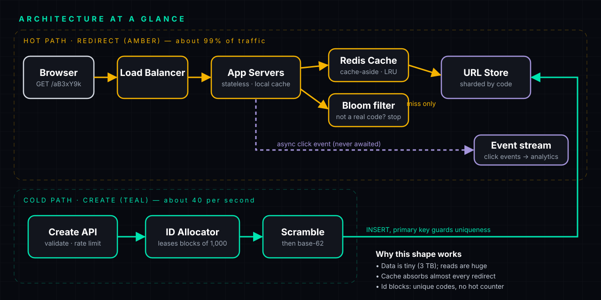
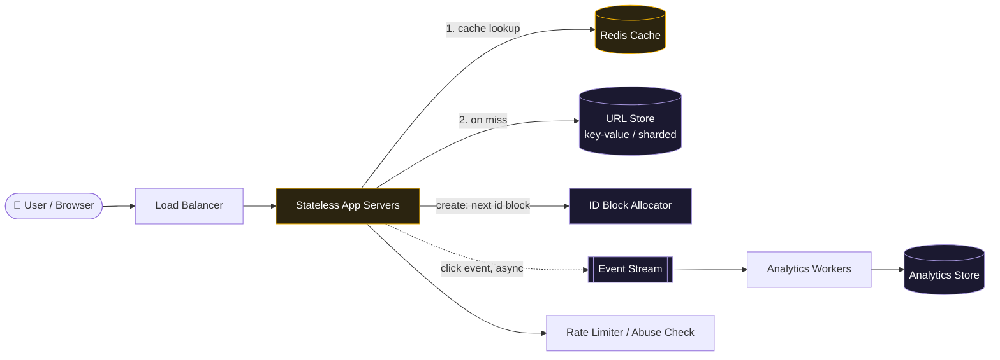
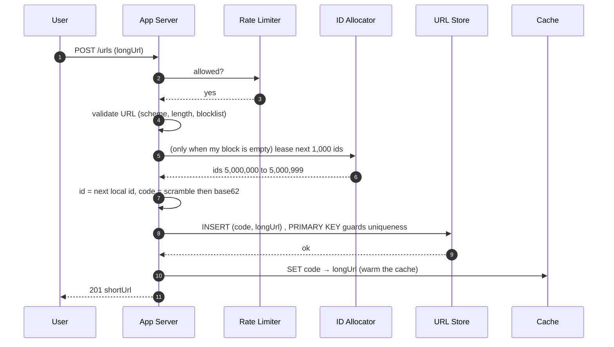
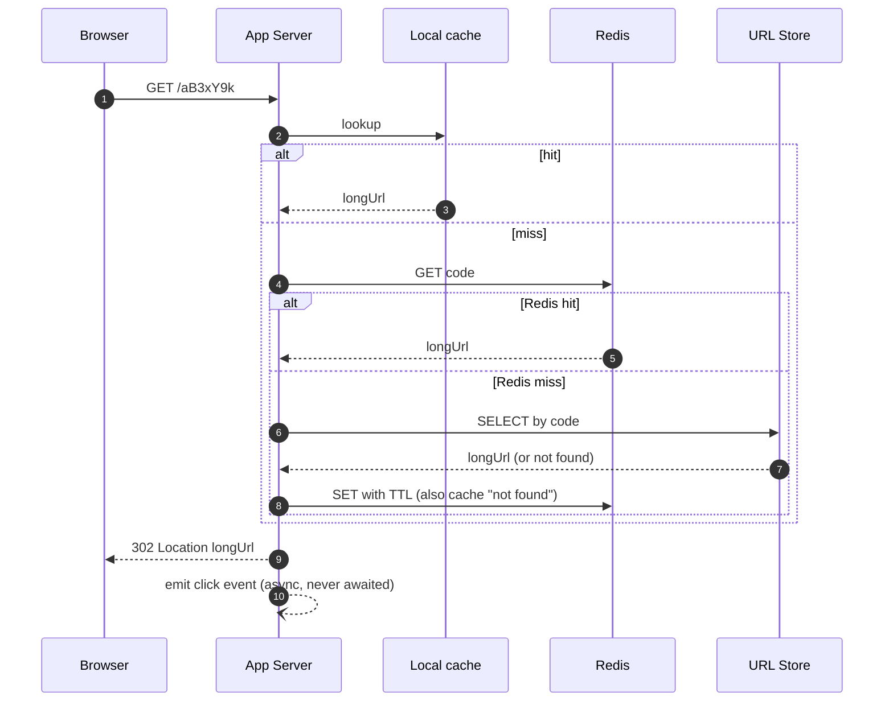
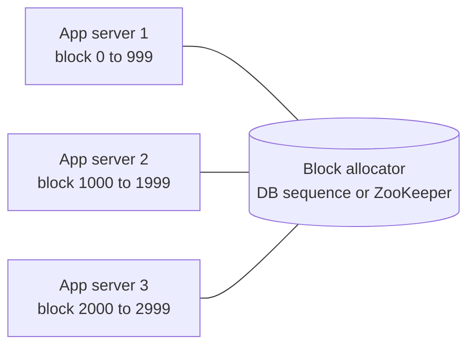
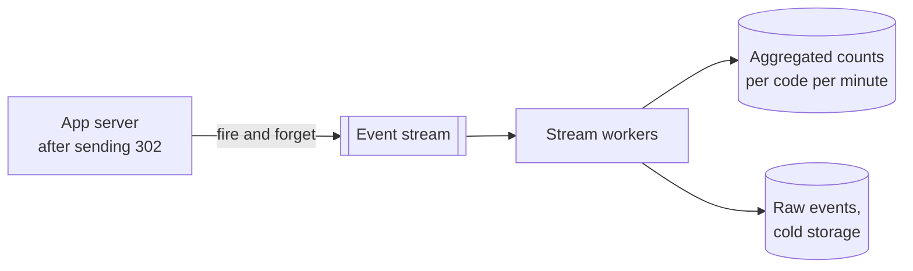

<p align="center"></p>

# Design a URL Shortener

**TinyURL / bit.ly style · HLD walkthrough · Episode 08**

> 🧭 **Where this fits.** Episode 07 (ticket booking) was a *contention* problem: a few rows, millions of people. This one is the opposite shape: a **read-heavy** problem where the data is simple and the traffic is huge. If you can do both, you have covered two of the most common shapes in interviews.

> [!IMPORTANT]
> Numbers on this page are **assumptions you state out loud**, not facts about any real company.

---

## 🧠 How to read this note

| Icon | Meaning |
|---|---|
| ⚡ | The short answer: say this first |
| 🧠 | **Mentor's note**: *why* something works, the part people memorise without understanding |
| ✋ | **Pause and predict**: try to answer before opening the fold |
| 🎤 | An **interview line**: a sentence you can say almost word for word |
| ⚠️ | A trap that costs offers |

---

## ⚡ The 60-second answer

1. **Two operations:** *create* a short link (rare) and *redirect* (constantly). Reads outnumber writes about **100 to 1**, so design for the redirect.
2. **A short code is a number in base 62** (`0-9a-zA-Z`). **7 characters give 62⁷ ≈ 3.5 trillion codes**, far more than we need.
3. **Generating unique codes is the interesting problem.** Best answer: a **counter handed out in blocks** (each server leases, say, 1,000 ids), encoded in base 62, then **scrambled** so codes aren't guessable. No collisions, no per-write uniqueness check.
4. **Store `code → long URL`** in a key-value store (or a relational table with the code as primary key). It is looked up by one key only, so it **shards perfectly by code**.
5. **Redirect path = cache first.** Redis cache-aside, a tiny in-process cache for hot links, negative caching for junk codes. The database sees only misses.
6. **Return `302`** (not `301`) if you want analytics, expiry, or the ability to change the target.
7. **Never do slow work on the redirect.** Click analytics are emitted as an event to a queue and processed asynchronously.
8. **Protect it:** validate URLs (only `http`/`https`), rate-limit creation, scan for malware/phishing, make codes unguessable.

---

## 📑 Contents

1. [Requirements](#1-requirements)
2. [Back-of-envelope numbers](#2-back-of-envelope-numbers)
3. [API (and the 301 vs 302 question)](#3-api)
4. [Data model](#4-data-model)
5. [High-level design](#5-high-level-design)
6. [Deep dive A: generating the short code](#6-deep-dive-a--generating-the-short-code)
7. [Deep dive B: a fast, cheap redirect](#7-deep-dive-b--a-fast-cheap-redirect)
8. [Deep dive C: storage and scale](#8-deep-dive-c--storage-and-scale)
9. [Deep dive D: custom aliases and uniqueness](#9-deep-dive-d--custom-aliases-and-uniqueness)
10. [Deep dive E: expiry and cleanup](#10-deep-dive-e--expiry-and-cleanup)
11. [Deep dive F: analytics without slowing redirects](#11-deep-dive-f--analytics-without-slowing-redirects)
12. [Deep dive G: abuse and security](#12-deep-dive-g--abuse-and-security)
13. [Deep dive H: availability and multi-region](#13-deep-dive-h--availability-and-multi-region)
14. [Alternatives you should be able to discuss](#14-alternatives-you-should-be-able-to-discuss)
15. [Consistency map](#15-consistency-map)
16. [Failure modes cheat-sheet](#16-failure-modes-cheat-sheet)
17. [Observability](#17-observability)
18. [Follow-up questions](#18-follow-up-questions-interviewers-ask)
19. [Common mistakes](#19-common-mistakes)
20. [How to present this in 45 minutes](#20-how-to-present-this-in-45-minutes)
21. [Test yourself](#21-test-yourself)

---

## 1. Requirements

**Functional**

| # | Requirement |
|---|---|
| F1 | Given a long URL, create a **short URL** |
| F2 | Visiting the short URL **redirects** to the long URL |
| F3 | *(Optional)* Users may pick a **custom alias** |
| F4 | *(Optional)* Links can **expire** |
| F5 | *(Optional)* Owners can see **click analytics** and **delete** a link |

**Non-functional**

| Property | Target | Why it matters |
|---|---|---|
| **Redirect latency** | p99 well under ~100 ms | Users feel it directly; it is the whole product |
| **Availability** | Very high (say 99.99%) | A dead redirect breaks every page that links to it |
| **Durability** | Never lose a mapping | A lost mapping is a permanently broken link |
| **Unguessable codes** | Hard to enumerate | Private links must stay private |
| **Scale** | Billions of links, thousands of redirects/s | Drives the design |

**Out of scope (say so):** user accounts/billing detail, a full analytics product, QR codes, link previews.

> 🎤 *"I'll treat redirect as the hot path and creation as the cold path, because the read:write ratio is roughly 100:1."*

---

## 2. Back-of-envelope numbers

State assumptions, then derive.

| Quantity | Value | Working |
|---|---|---|
| New links | **100 M / month** | *Assumption* |
| Seconds in a month | ~2.6 M | 30 × 86,400 |
| **Write rate** | **~40 / s** | 100 M ÷ 2.6 M ≈ 38.6 |
| Read : write | **100 : 1** | *Assumption* |
| **Read rate (average)** | **~4,000 / s** | 40 × 100 |
| **Read rate (peak)** | **~40,000 / s** | ×10 for spikes |
| Links in 5 years | **6 B** | 100 M × 12 × 5 |
| Bytes per record | ~500 B | code + long URL + metadata |
| **Storage (5 yrs)** | **~3 TB** | 6 B × 500 B |
| Code space, 6 chars | 62⁶ ≈ **56.8 B** | enough for 6 B links |
| Code space, 7 chars | 62⁷ ≈ **3.5 T** | huge headroom |
| Cache size | ~20% of one day's traffic | rule of thumb |

> 🧠 **Mentor's note: what the numbers tell you.**
> 40 writes a second is *nothing*. 3 TB is *small*. A single well-run database could hold it. So the problem is **not** capacity. It is (a) producing **unique** codes without a bottleneck, and (b) answering **tens of thousands of redirects a second quickly**. A good estimate points at the real problem, exactly as in the ticket-booking episode (there it pointed at *contention*; here it points at *read speed and code generation*).

✋ **Pause and predict: how many characters do we need for 6 billion links?**
<details><summary>Answer</summary>

62⁶ ≈ 56.8 billion, which is more than 6 billion, so **6 characters suffice**. We pick **7** for headroom: 62⁷ ≈ 3.5 trillion, so even 6 B links fill under 0.2% of the space. That sparseness also makes random guessing hopeless.
</details>

---

## 3. API

```http
POST   /api/v1/urls
       { "longUrl": "https://…", "customAlias": "summer-sale"?, "expiresAt": "2027-01-01T00:00:00Z"? }
       Idempotency-Key: <uuid>                      # a retried create must not make a second link
       → 201 { "shortUrl": "https://sho.rt/aB3xY9k", "code": "aB3xY9k" }
       → 409 if the custom alias is taken · 400 if the URL is invalid

GET    /{code}                                      # THE hot path
       → 302 Found  Location: https://…             # or 404 / 410 Gone (expired)

DELETE /api/v1/urls/{code}                          # owner only
GET    /api/v1/urls/{code}/stats                    # analytics
```

### 301 vs 302: the classic question

| | **301 Moved Permanently** | **302 Found (temporary)** |
|---|---|---|
| Browser caches it? | **Yes**, so later clicks may never reach you | No (unless you add cache headers) |
| Server load | Lower | Higher |
| Analytics | **Lost** for repeat visitors | Every click is seen |
| Change/expire the target later | **Hard** (cached copies linger) | Easy |
| Typical choice | Pure SEO / no analytics needed | **Shorteners that offer analytics, expiry, editing** |

> 🎤 *"I'd use 302 so every click reaches us: that keeps analytics accurate and lets owners change or expire links. The cost is more traffic, which our cache absorbs."*

---

## 4. Data model

The access pattern is **one lookup: code → long URL**. No joins, no range scans. That points to a **key-value store**, though a relational table with `code` as the primary key also works at this scale.

```sql
CREATE TABLE urls (
  code        VARCHAR(10)   PRIMARY KEY,         -- the short code; the ONLY lookup key
  long_url    VARCHAR(2048) NOT NULL,
  owner_id    BIGINT        NULL,                -- null = anonymous
  created_at  TIMESTAMP     NOT NULL DEFAULT now(),
  expires_at  TIMESTAMP     NULL,                -- null = never
  is_custom   BOOLEAN       NOT NULL DEFAULT FALSE,
  status      VARCHAR(10)   NOT NULL DEFAULT 'ACTIVE'   -- ACTIVE | DISABLED (e.g. flagged as malicious)
);
-- PRIMARY KEY already enforces "one row per code": that uniqueness is the safety net for code generation.

-- Optional: lets us return the existing code if the same user shortens the same URL again.
CREATE INDEX ix_urls_owner_url ON urls (owner_id, long_url_hash);
```

**Click events** are *not* stored in this table. They are an append-only stream, written asynchronously (see §11).

> 🧠 **Mentor's note: why a key-value store fits.**
> If every query is "get the value for this one key", you do not need the power of SQL. A key-value store (DynamoDB, Cosmos DB, Cassandra, Redis-backed) partitions by key automatically, so capacity grows by **adding machines**. You give up joins, which this problem never needed. But the relational option is perfectly defensible at 3 TB. Say the access pattern, then choose.

---

## 5. High-level design

<p align="center"></p>

The same system as a zoomable diagram:



### The two flows

**Create (cold path, ~40/s)**



**Redirect (hot path, ~4,000 to 40,000/s)**



---

## 6. Deep dive A: generating the short code

This is the part interviewers care most about. The goal: **a short, unique, ideally unguessable code, generated fast, with no central bottleneck.**

### First, what *is* a short code?

A short code is just **a number written in base 62**, the same way `255` in decimal is `FF` in hexadecimal.

```text
Alphabet (62 symbols):  0-9  a-z  A-Z
Index:                  0..9 10..35 36..61

Number 125 → 125 = 2×62 + 1  →  digits [2, 1]  →  code "21"
Number 3844 (=62²)           →  digits [1, 0, 0] → code "100"
```

> 🧠 **Mentor's note.** Base 62 (not 64) because `+` and `/` are awkward in URLs, and all 62 letters/digits are safe. Some systems drop look-alikes (`0/O`, `1/l/I`) to avoid confusing humans; that is why you sometimes see base 58.

```csharp
// Encoding a number as a base-62 code. (C#: this is a tiny, self-contained helper.)
const string Alphabet = "0123456789abcdefghijklmnopqrstuvwxyzABCDEFGHIJKLMNOPQRSTUVWXYZ";

static string Encode(long id)
{
    if (id == 0) return "0";
    var digits = new Stack<char>();              // a stack reverses order for us
    while (id > 0)
    {
        digits.Push(Alphabet[(int)(id % 62)]);   // the LAST digit comes first (remainder)...
        id /= 62;                                // ...then drop it and repeat
    }
    return new string(digits.ToArray());         // ...so popping order puts the biggest digit first
}

static long Decode(string code)
{
    long n = 0;
    foreach (var c in code) n = n * 62 + Alphabet.IndexOf(c);   // shift left one base-62 place, add the digit
    return n;
}
// Encode(125) == "21"   Encode(3844) == "100"   Decode("21") == 125
```

### The four ways to get the number

| # | Approach | How | ✅ Good | ❌ Bad |
|---|---|---|---|---|
| 1 | **Hash the URL** | `base62(hash(longUrl))`, first 7 chars | Same URL → same code (free dedupe). Stateless. | **Collisions** (different URLs, same 7 chars). Must detect and retry with a salt. Same URL can't have two codes. |
| 2 | **Random code** | Pick 7 random base-62 chars | Unguessable. Simple. | **Collisions** (a birthday problem). Needs a uniqueness check on every write. |
| 3 | **Counter + base62** | A global counter, `base62(counter)` | **No collisions ever.** Short. | **Predictable** (`aaa`, `aab`...). Single counter = **bottleneck / SPOF**. |
| 4 | **Counter in blocks** ⭐ | Each server leases a **block** of ids (say 1,000), then hands them out locally | **No collisions.** No per-write coordination. Fast. | Gaps if a server dies (harmless). Still predictable unless scrambled. |

### ⭐ Recommended: counter in blocks, plus scramble



1. The allocator holds one counter. A server asks for a block and the allocator bumps the counter by 1,000 (one atomic operation). 
2. The server then creates **1,000 codes with no network call**. It only talks to the allocator once per 1,000 links.
3. If a server crashes, its unused ids are simply **skipped**. Gaps are fine: we have 3.5 trillion codes.
4. The allocator is **off the hot path** and can be replicated (use a consensus store or a database sequence with failover).

> 🧠 **Mentor's note: why blocks beat a plain counter.**
> A plain counter makes every create call wait on one shared thing. Blocks turn "ask the shared thing 40 times a second" into "ask it once every 25 seconds per server". **Batching coordination** is one of the most reusable ideas in distributed design.

### But sequential codes are guessable. Fix: scramble

If link #1 is `1` and link #2 is `2`, anyone can walk through every link ever created, including private ones. So after getting the number, pass it through a **reversible scramble** before encoding:

```text
scrambled = (id × K) mod 62⁷        where K is coprime with 62  (odd, and not a multiple of 31)
code      = base62(scrambled)  (left-pad to 7 characters)
```

Because `K` shares no factor with the modulus, this mapping is a **bijection**: every id maps to a *unique* code and nothing collides. It looks random but needs **no uniqueness check**.

> ⚠️ A scramble is **obfuscation, not security.** If a link must be truly private, the code alone must not be the only protection (use auth or signed links). Say that.

### Collisions with random codes, quantified

With 6 B links already stored in a 3.5 T space, a *new random* code collides with probability ≈ 6 × 10⁹ ÷ 3.5 × 10¹² ≈ **0.17%**. Rare, but it is not zero, so approach 2 needs "insert; if the key exists, pick another". Blocks + scramble **avoids the check entirely**. That is the elegance.

✋ **Pause and predict: you hash the long URL and take 7 characters. Two different URLs get the same code. What do you do?**
<details><summary>Answer</summary>

Detect it (the insert fails because the primary key exists and the stored `long_url` differs), then **re-hash with a salt** (e.g. append a counter or random value) and retry. This works, but every write now needs a read-check. It is why hashing is a decent *first* answer and counter-blocks a better *final* one.
</details>

> 🎤 *"I'd hand out ids in blocks from a small allocator, scramble them with a multiplication that's coprime to 62⁷ so codes aren't guessable, and base-62 encode. That gives unique codes with no per-write coordination."*

---

## 7. Deep dive B: a fast, cheap redirect

The redirect is **~99% of traffic**, so it must be nearly free.

### The latency ladder (fastest first)

| Layer | Hit cost | Notes |
|---|---|---|
| **In-process cache** (a small LRU in each app server) | ~microseconds | Great for viral links; tiny; per-server |
| **Redis** (shared) | ~0.5 to 1 ms | The main cache; shared by all app servers |
| **Database** | ~5 to 20 ms | Only on a miss |

**Cache-aside (lazy loading):** on a miss, read the database, then put the answer in the cache with a TTL. Most redirect traffic is a handful of popular links, so the hit rate is very high (often 95%+ with an LRU).

> 🧠 **Mentor's note: why LRU works here.** Link popularity follows a **power law**: a small set of links gets most clicks. An LRU cache keeps recently used entries, which naturally means the popular ones. So a cache of about 20% of the daily working set absorbs most traffic.

### Three cache problems, with fixes

| Problem | What happens | Fix |
|---|---|---|
| **Hot key** | One viral link hammers one Redis shard | In-process cache on every app server; replicate the hot key |
| **Cache stampede** | A hot entry expires and thousands of requests hit the DB at once | **Request coalescing** (one request refills, the rest wait), jittered TTLs |
| **Cache penetration** | Bots request codes that **don't exist**, bypass the cache every time, hammer the DB | **Negative caching** (cache "not found" for a short TTL) and a **Bloom filter** of all valid codes ("definitely not present" answers need no DB hit) |

### Can a CDN help?

A CDN or edge cache can serve redirects for very hot links if responses are cacheable (`Cache-Control` with a short max-age). That trades some analytics accuracy and edit-ability for speed, so it is a per-product decision. Mention it as an optional layer, with the trade-off.

> 🎤 *"The redirect checks a local cache, then Redis, and only then the store. I'd add negative caching and a Bloom filter so scanners probing random codes never reach the database."*

---

## 8. Deep dive C: storage and scale

**Shard by `code`.** Because every query is by a single code, partitioning is trivial: `shard = hash(code) mod N`, or better, **consistent hashing** so adding a node moves only ~1/N of the keys.

| Concern | Answer |
|---|---|
| **Shard key** | `code` (a good hash spreads load evenly, and the scramble already makes codes look random) |
| **Hot shard?** | Unlikely for writes (codes are random). Hot *reads* are handled by cache, not the shard |
| **Replication** | Leader–follower (or quorum) per shard, 3 copies; followers serve cache-miss reads |
| **Read-your-writes** | A user creates a link and immediately clicks it. Populate the cache **on create**, so the first read works even before replicas catch up |
| **Resharding** | Consistent hashing + virtual nodes; move data in the background |
| **Backups** | Snapshots + point-in-time recovery; a lost mapping is a permanently broken link |

> 🧠 **Mentor's note: replication lag in one sentence.** A follower copies the leader *a moment later*. If a brand-new link is read from a follower before the copy arrives, it returns "not found". Writing to the cache during create hides that gap.

---

## 9. Deep dive D: custom aliases and uniqueness

A user wants `sho.rt/summer-sale`. Two people might ask for it at the same moment.

> 🧠 **Mentor's note: you have seen this problem before.** It is the **same race as two fans tapping one seat** in Episode 07: "check if free, then write" lets both through. The fix is the same: make **check-and-claim one atomic step**.

```sql
-- Atomic claim: succeeds for exactly one caller; the other gets a unique-key error → return 409.
INSERT INTO urls (code, long_url, is_custom) VALUES ('summer-sale', 'https://…', TRUE);
```

In a key-value store: a **conditional put** (`IF NOT EXISTS` / `attribute_not_exists(code)`).

Also: **reserve** words (`api`, `admin`, `login`), enforce length and character limits, and keep the custom namespace **separate** from generated codes (e.g. generated codes are always exactly 7 chars; aliases are never 7 random-looking chars) so an alias can never collide with a future generated code.

---

## 10. Deep dive E: expiry and cleanup

| Mechanism | How | Notes |
|---|---|---|
| **Lazy check on read** | On redirect, if `expires_at < now` return **410 Gone** | Always correct; no background work |
| **Store-level TTL** | DynamoDB/Cassandra TTL deletes expired rows | Free cleanup |
| **Background janitor** | Periodic job removes expired rows | For stores without TTL |
| **Cache TTL ≤ link expiry** | Never cache past the link's expiry | Otherwise an expired link keeps redirecting |

**Should expired codes be reused?** Prefer **not** soon: browsers, caches and old pages still hold the short URL, and reusing it would send people to the **wrong destination**. At 3.5 T codes you can afford never to reuse.

---

## 11. Deep dive F: analytics without slowing redirects

**Rule: never put slow work on the redirect path.** Writing a click row to a database inside the redirect would add milliseconds to *every* request and couple redirects to the analytics store's health.



- Emit one small event (`code`, timestamp, coarse geo, user-agent, referrer) **after** responding. If the stream is down, **drop or buffer locally**; losing a few click counts is better than failing a redirect.
- Workers aggregate (per code per time bucket) and store the totals, so the stats page reads a few rows, not millions.
- **Unique visitors** need not be exact: **HyperLogLog** gives a tiny, approximate distinct count.
- Analytics is **eventually consistent**: the dashboard may lag by seconds or minutes. That is acceptable.

> 🎤 *"The redirect only emits an event. Counting happens off the hot path, so analytics can be slow or even down without affecting redirects."*

---

## 12. Deep dive G: abuse and security

A URL shortener is a favourite tool for **phishing and malware**, because the short link hides the destination.

| Threat | Mitigation |
|---|---|
| **Malicious destinations** | Check against **block lists / safe-browsing style services** at create time *and* re-scan periodically; mark links `DISABLED`; show an interstitial warning for suspicious ones |
| **Dangerous schemes** | Allow only `http` and `https`. **Reject `javascript:`, `data:`, `file:`** |
| **Spam creation** | Rate-limit per user / IP / API key; CAPTCHA for anonymous bulk creation |
| **Enumeration / scraping** | Unguessable codes (scramble), rate limits on the redirect per IP, 404 timing that doesn't leak |
| **Open-redirect abuse** | Don't redirect through arbitrary parameters; fixed lookup only |
| **SSRF** (if you fetch the page title or preview) | Fetch from an isolated service, block private IP ranges, limit size and time |
| **Takedown** | An owner/admin `DELETE`/disable that also **purges caches** |
| **Privacy** | Don't log full URLs with tokens in query strings; honour data-retention rules |

> 🧠 **Mentor's note.** Saying *"I'd also think about abuse, since shorteners hide destinations"* unprompted is a strong signal: it shows you consider the product's real-world risks, not only throughput.

---

## 13. Deep dive H: availability and multi-region

- **Stateless app servers** behind a load balancer: any instance serves any request, so scale out and replace freely.
- **Geo-DNS / anycast** routes users to the nearest region; each region has a **cache and a read replica**.
- **Writes (40/s)** can go to a single home region (simple) or any region if each region owns a **disjoint block range** of ids, so two regions can never generate the same code.
- **Failure of the cache** is survivable (slower, DB takes the load, but protect it with rate limiting and coalescing).
- **Failure of the ID allocator** is survivable for a while (servers use their remaining block); alert before they run dry. Keep a **spare block** in reserve per server.
- **Degradation order:** disable analytics first, then creation of *new* links, but **keep redirects alive**: they are the product.

> 🎤 *"I'd degrade analytics first, then creation, and protect redirects at all costs."* (This mirrors the "decide what fails first" idea from Episode 07.)

---

## 14. Alternatives you should be able to discuss

| Decision | Option A | Option B | My pick and why |
|---|---|---|---|
| **Code generation** | Hash of URL | **Counter in blocks + scramble** | B: no collisions, no check, fast |
| **Code generation** | Random + check | Counter blocks | B: avoids the retry loop |
| **Store** | **Key-value (Dynamo/Cosmos/Cassandra)** | Relational with PK on code | Either; KV scales by adding nodes, SQL is simpler at 3 TB |
| **Redirect status** | 301 | **302** | 302 for analytics and edit-ability |
| **Same URL twice** | Return the same code (dedupe) | Always make a new code | New code per request is simpler and lets each owner track their own clicks |
| **Analytics** | Synchronous DB write | **Async event stream** | Async: protects redirect latency |
| **ID allocator** | Single DB sequence | **Block leasing from a replicated store** | Blocks: off the hot path |

---

## 15. Consistency map

> *Strong where codes are claimed. Eventual everywhere else.*

| Data | Consistency | Why |
|---|---|---|
| Code → URL mapping (primary key) | **Strong** (unique PK / conditional put) | Two links must never share a code |
| Custom alias claim | **Strong** | Same race as the seat |
| Cache | **Eventual** (TTL) | A brief stale redirect is acceptable; invalidate on delete |
| Read replicas | **Eventual** | New-link read handled by cache-on-create |
| Click analytics | **Eventual** | Dashboard can lag |
| Block allocator | **Strong** (atomic increment) | Blocks must never overlap |

---

## 16. Failure modes cheat-sheet

| What breaks | What happens | Why it's safe |
|---|---|---|
| Cache (Redis) down | Redirects slow down, DB takes load | Rate limit + coalescing protect DB; app still works |
| DB shard down | That shard's links fail; replica takes over | Replication; per-shard blast radius |
| ID allocator down | Servers use leftover block, then creation pauses | Redirects unaffected; alert early |
| App server crashes with an unused block | Those ids are skipped | Gaps are harmless |
| Duplicate create (client retry) | Idempotency key returns the same code | No second link |
| Two people claim one alias | One wins, other gets 409 | PK uniqueness / conditional put |
| Event stream down | Clicks dropped or buffered | Redirects never wait on it |
| Bot probing random codes | Negative cache + Bloom filter | DB never sees them |
| Malicious link reported | Disable + purge cache | Redirect now returns 410/warning |
| Viral link | In-process cache + replicated hot key | No single shard melts |

---

## 17. Observability

- **Redirect:** p50/p95/p99 latency, **cache hit ratio** (the single most important number), error rate, 404 rate (spike = scanning).
- **Create:** rate, validation rejections, rate-limit rejections, conflicts on custom aliases.
- **ID allocator:** blocks remaining per server (alert at 20%), allocation latency.
- **Store:** per-shard load, replication lag, storage growth.
- **Analytics:** stream lag, dropped events.
- **Abuse:** malicious-link detections, takedown latency.
- Alert on **symptoms** (redirect p99, error rate, hit ratio dropping) and keep a **runbook** for each.

---

## 18. Follow-up questions interviewers ask

<details><summary><b>How do you generate the short code? Why not just hash?</b></summary>

Hashing causes collisions you must detect and re-hash around, and costs a read-check per write. Counter-blocks plus a coprime scramble give unique, unguessable codes with no per-write check.
</details>

<details><summary><b>What if two servers generate the same code?</b></summary>

With blocks they cannot: the allocator hands out disjoint ranges atomically. As a backstop, the primary key on `code` rejects a duplicate insert.
</details>

<details><summary><b>How would you handle a viral link getting 1M requests/s?</b></summary>

An in-process cache on every app server and replicated hot keys, plus optional short-lived edge caching. The shard behind it sees almost none of the traffic.
</details>

<details><summary><b>301 or 302, and why?</b></summary>

302 if you need analytics, expiry or edits; 301 only if you want browsers to cache it and don't care. See §3.
</details>

<details><summary><b>How do you scale the database?</b></summary>

Shard by `code` with consistent hashing, replicate each shard, rely on the cache for reads. Writes are only ~40/s so the write path is easy.
</details>

<details><summary><b>How do you support custom aliases without races?</b></summary>

An atomic conditional insert; the loser gets a 409. Same idea as the seat claim.
</details>

<details><summary><b>How do you keep analytics from slowing redirects?</b></summary>

Emit an async event after responding; aggregate downstream; accept eventual consistency and possible small loss.
</details>

<details><summary><b>How do you prevent abuse?</b></summary>

Scheme allow-list, safe-browsing checks, rate limits, CAPTCHA for anonymous bulk creation, takedown that purges caches, and unguessable codes.
</details>

<details><summary><b>How would you delete or expire a link?</b></summary>

Lazy `expires_at` check on read (410 Gone), store TTL or a janitor for cleanup, cache TTL no longer than expiry, and purge the cache on explicit delete.
</details>

<details><summary><b>Can the same long URL map to many codes?</b></summary>

Yes, by default; it lets each owner track their own clicks. If you want one code per URL, hash the URL and dedupe on a unique index, accepting its collision handling.
</details>

<details><summary><b>How would you make it multi-region?</b></summary>

Geo-routing, a cache and replica per region, and either a single write home or disjoint id-block ranges per region so codes never collide.
</details>

<details><summary><b>How would you test it?</b></summary>

Load-test the redirect path at 10× peak with a skewed (power-law) key distribution, test cache failover, test concurrent alias claims, fuzz URL validation, and assert: *no code maps to two URLs; no private link is enumerable.*
</details>

---

## 19. Common mistakes

- ❌ Designing for storage. **3 TB is small;** the problem is redirect speed and code generation.
- ❌ **Hashing the URL and ignoring collisions.**
- ❌ **A single global counter** as a bottleneck/SPOF (and predictable codes).
- ❌ **Sequential codes** with no scramble, so private links are enumerable.
- ❌ **Writing analytics synchronously** on the redirect.
- ❌ **301 by default** and then wondering why analytics are wrong.
- ❌ Forgetting **negative caching** for non-existent codes.
- ❌ **Not validating URLs** (`javascript:` redirects, malware).
- ❌ Not thinking about **abuse** at all.
- ❌ **Reusing expired codes** and sending people to the wrong site.
- ❌ Calling a scramble "encryption".

---

## 20. How to present this in 45 minutes

| Minutes | Do this |
|---|---|
| 0 to 5 | Clarify: scale, analytics?, custom aliases?, expiry? State out-of-scope |
| 5 to 8 | Numbers: 40 writes/s, 4K to 40K reads/s, 3 TB, 7 chars. **Conclude: read-heavy, small data** |
| 8 to 15 | API (with 301 vs 302) and data model; draw the HLD with both flows |
| 15 to 28 | **Deep dive 1:** code generation (the four options, then blocks + scramble) |
| 28 to 36 | **Deep dive 2:** redirect speed (cache ladder, hot keys, negative caching) |
| 36 to 42 | Quick hits: analytics async, abuse, expiry, multi-region |
| 42 to 45 | Recap with the consistency map; invite follow-ups |

> 🎤 Practise the **60-second answer** out loud until it is smooth. If that works, the depth follows.

---

## 21. Test yourself

Cover the page and answer. Then open the fold.

<details><summary><b>Q1.</b> Why is "6 billion links" not a storage problem?</summary>

6 B × ~500 B ≈ 3 TB, which fits comfortably in a sharded store. The real problems are unique code generation and fast redirects.
</details>

<details><summary><b>Q2.</b> What does <code>Encode(125)</code> return, and why?</summary>

`"21"`. 125 = 2×62 + 1, so the digits are 2 and 1, which are the characters `2` and `1`.
</details>

<details><summary><b>Q3.</b> Why do blocks beat a single counter?</summary>

The shared counter is touched once per 1,000 links instead of every link, so it is no longer a bottleneck; a crashed server just wastes some ids.
</details>

<details><summary><b>Q4.</b> Why scramble the number, and why must the multiplier be coprime to 62?</summary>

To make codes unguessable. Coprime means the map `id → (id × K) mod 62⁷` is a one-to-one mapping, so no two ids produce the same code.
</details>

<details><summary><b>Q5.</b> A bot requests a million non-existent codes. How do you keep the database safe?</summary>

Negative caching plus a Bloom filter of valid codes, and rate limits per IP.
</details>

<details><summary><b>Q6.</b> Why return 302 rather than 301?</summary>

So every click reaches you (analytics) and links stay editable and expirable; 301 gets cached by browsers.
</details>

<details><summary><b>Q7.</b> How is a custom-alias race like the seat race in Episode 07?</summary>

Both are "check then write" races on a unique resource, fixed by an atomic claim (unique key / conditional put) where exactly one request wins.
</details>

<details><summary><b>Q8.</b> What do you turn off first under extreme load?</summary>

Analytics, then new-link creation. Redirects stay up.
</details>

---

<p align="center">
  <a href="../README.md">⬅ All problems</a> · Previous: <a href="../sd-07-ticket-booking/HLD.md">SD-07 Ticket Booking</a> · Built alongside the <b>Tech Intuition</b> video series
</p>
